<h1 align="center">
  <picture>
    <source media="(prefers-color-scheme: dark)" srcset="assets/banner-dark.svg">
    
  </picture>
</h1>

<h2 align="center">The AI‑First Skill Librarian that Cuts Context Waste by 96 % and Delivers 100 % Bundle Coverage</h2>

<p align="center">
  <a href="https://www.npmjs.com/package/sfp-hive"></a>
  
  
  
  
  
  
</p>

<p align="center">
  <strong>AI coding tools like Claude Code, Cursor or Copilot work best when they have the exact skill they need – no more, no less.</strong>
</p>

<h3 align="center">Your AI coding tool gets the right instructions for the job, and only those.</h3>

<p align="center">
  <a href="https://www.npmjs.com/package/sfp-hive"></a>
  
  
  
  
  
  
</p>

<p align="center">
  <a href="#what-is-this"><b>What is this?</b></a> &middot;
  <a href="#start-here"><b>Start here</b></a> &middot;
  <a href="#why-sfp-the-unfair-advantages"><b>Advantages</b></a> &middot;
  <a href="#see-it-choose"><b>See it choose</b></a> &middot;
  <a href="#ui-design-and-front-end-skills"><b>UI &amp; design</b></a> &middot;
  <a href="#business-marketing-and-growth-skills"><b>Business &amp; marketing</b></a> &middot;
  <a href="#the-proof"><b>The proof</b></a> &middot;
  <a href="#install"><b>Install</b></a>
</p>

---

## What Is This?

SFP is the **AI‑first skill librarian** that curates over a thousand expertly written guides into 24 well‑structured categories and bundles them into 121 coherent collections. By presenting only the most relevant skills to your coding assistant, SFP eliminates context bloat, guarantees zero‑junk selections, and accelerates development across 20 AI tools.

**SFP is a librarian for your AI.** It keeps 1065 skills on the shelf across 24 categories and **121 curated bundles** (100% of skills are bundled). For each task, it reads what you asked and what your project is, and hands your AI only the few that fit. It remembers what helped you, so its choices get better for you over time.

<p align="center">
  <picture>
    <source media="(prefers-color-scheme: dark)" srcset="assets/pipeline-dark.svg">
    
  </picture>
</p>

<table align="center">
  <tr>
    <td align="center" valign="top" width="33%"><h3>97%</h3>right skill chosen on the 150-task blind-judged final exam (<b>93%</b> right first)</td>
    <td align="center" valign="top" width="33%"><h3>95%</h3>less for your AI to carry than having every skill always on (4,268 vs 81,690 tokens)</td>
    <td align="center" valign="top" width="33%"><h3>0</h3>words sent out by SFP when it picks: it runs on your machine</td>
  </tr>
</table>

### Why Not Just Use Search, or Turn Everything On?

| | Keyword search | Every skill always on | SFP |
|---|---|---|---|
| **What your AI carries** | Only what it finds | 81,690 tokens (41% of its memory) | About 4,000 tokens |
| **Knows your project** | No | No | Yes: it reads your project files |
| **Drops unrelated junk picks** | No (62.5% junk on negative/edge tasks) | No | Yes: **0.0% junk** on `precision_heldout` (87.5% hit / 76.5% precision) |
| **Learns what you like** | No | No | Yes, from your feedback (80% to 100% format fit, 100% named-format override) |
| **Time to choose** | Instant | Nothing to choose | ~3 ms words-only; ~360 ms typical with local models |

---

## Why SFP: The Unfair Advantages

<p align="center">
  <picture>
    <source media="(prefers-color-scheme: dark)" srcset="assets/advantages-dark.svg">
    
  </picture>
</p>

Most AI coding setups fail in one of two ways: **context bloat** (stuffing 50+ static rules into the system prompt until the model loses track of your code) or **context starvation** (leaving the model to guess framework conventions, accessibility rules, and security checks). SFP solves both at the root:

1. **Surgical Context Budgeting**
   Instead of burning 41% of a 200k window before you type a word, your agent carries a ~700-token router at rest and loads only the 1 to 3 specialist skills (~3,400 to 4,200 tokens) required for the current task.
2. **Manifest-Driven Stack Isolation**
   Before scoring candidates, the Hive inspects root manifests (`package.json`, `Cargo.toml`, `go.mod`, `pyproject.toml`, `pubspec.yaml`, `*.csproj`). A Rust workspace never receives Python or Next.js rules, eliminating cross-stack hallucination.
3. **Confidence Gating Against Noise**
   Single weak-word matches are rejected unless backed by multi-signal quorum or technology fit. Micro-edits (*"fix typo on line 42"*) and out-of-domain queries return an empty stack with **0.0% junk**.
4. **30-Day Half-Life Taste & Autonomous Mentor**
   Your `helped` / `unhelpful` feedback trains a local LinUCB model and tracks format preferences (code, prose, animation, video). When your work hits a topic the catalog covers thinly, `sfp mentor grow` synthesizes peer-reviewed papers from OpenAlex and arXiv into a draft skill for your approval.
5. **Zero-Telemetry Local Execution**
   Deterministic selection runs in ~3 ms using standard-library Python. Optional semantic search (`bge-m3`) and LLM reranking (`lfm2-24b-a2b`) run against your own local Ollama or LM Studio server.
6. **One Brain Across 20 IDEs and CLIs**
   Install once and keep skills, MCP tools, and `.agents/rules/sfp-active-skills.md` synchronized across Claude Code, Antigravity, Cursor, VS Code Copilot, Codex, Windsurf, Gemini CLI, and 13 more tools.

<details>
<summary><b>New to this? What the words mean</b></summary>
<br>

| Word | In plain language |
|---|---|
| **AI coding tool, agent** | The AI that writes code with you: Claude Code, Cursor, Copilot, Antigravity and others |
| **Skill** | A short guide your AI reads before a job. Written in plain text, in a file called `SKILL.md` |
| **Hive** | The part of SFP that chooses skills. Many small signals vote, like bees choosing a new home |
| **Token** | The unit AI models read text in, roughly three quarters of a word. An AI can only hold so many at once |
| **Context** | Everything your AI is holding in mind right now |
| **IDE** | The program you write code in, such as VS Code |
| **MCP** | A standard way for AI tools to use outside helpers. SFP can run as one |
| **Local model** | An AI model running on your own computer, through a free program like Ollama or LM Studio |

</details>

---

## Start Here

<p align="center">
  <picture>
    <source media="(prefers-color-scheme: dark)" srcset="assets/install-steps-dark.svg">
    
  </picture>
</p>

You need **Node.js** ([download](https://nodejs.org/)), **Python 3.8 or newer** ([download](https://www.python.org/downloads/); on Windows tick "Add python.exe to PATH") and an AI coding tool.

**1. Open a terminal and run this.** It finds the AI tools on your computer and installs a starter set of skills into each.

```bash
npx sfp-hive install
```

**2. Restart your AI tool.**

**3. Ask it something, and mention SFP:**

> Use sfp-hive for this task: add tests for the checkout form.

**How do you know it worked?** Your AI names the skills it chose and why, then follows them. You can also ask SFP directly, without any AI, from your project's folder:

```bash
npx sfp-hive select "write tests for the orders" --project .
```

In a Rust project, that prints (shortened):

```text
Stack for: write tests for the orders
Project: rust
Phase of work: test 100%

1. [check] rust-testing  (testing-quality, test, about 2,949 tokens)
   why: task words: tests; fits project: rust; backed by: words, project, role, category

Chose from 133 candidates in 2 ms.
```

**4. Tell it how it went.** Say whether the skill helped. That is how SFP learns what works for you.

Using Claude Code? You can install SFP as a plugin instead: `/plugin marketplace add siddu1004/SFP`, then `/plugin install sfp@sfp`. Something wrong? Run `npx sfp-hive doctor`: it names the problem and the fix.

---

## See It Choose

<p align="center">
  <picture>
    <source media="(prefers-color-scheme: dark)" srcset="assets/terminal-dark.svg">
    
  </picture>
</p>

The same words, *"write tests for the orders"*, in five different projects. The hive itself generates this table each time this page is built:

<p align="center">
  <picture>
    <source media="(prefers-color-scheme: dark)" srcset="assets/project-fit-dark.svg">
    
  </picture>
</p>

| Your project | The hive chooses |
|---|---|
| Next.js | `react-testing`, `playwright-cli` |
| Rust | `rust-testing` |
| .NET | `csharp-testing` |
| Flutter | `dart-flutter-patterns`, `flutter-dart-code-review` |
| Django | `django-celery`, `django-tdd` |

A keyword search gives all five the same list. The hive reads the project, so no stack gets a skill for the wrong technology.

And with plain words, or with people who learn differently (real output, with the local models on):

| What you ask | Who is asking | SFP's first pick |
|---|---|---|
| *"make the login not get hacked"* | Anyone | `security-review` |
| *"test all the buttons on my website automatically"* | Anyone | `playwright-cli` |
| *"check for sneaky memory leaks in the goroutines"* | A Go project | `golang-patterns` |
| *"explain how attention works in transformers"* | Someone who learns from animation | `manim-video` |
| *"explain how attention works in transformers"* | Someone who learns from reading | `understand-explain` |

It does not always get it right. [Where it still fails](#where-it-still-fails) lists real misses.

---

## Common Questions

| Question | Answer |
|---|---|
| **Is it free?** | Yes. MIT license, no account, no sign-up |
| **Do I need a powerful computer or a GPU?** | No. SFP works on any computer with Python. Local models are an optional upgrade: the meaning model (`bge-m3`) is about 1 GB, and a good small chat model is about 14 GB of disk and memory |
| **Is my code sent anywhere?** | SFP picks skills on your machine and sends nothing. Your AI tool still talks to its own provider, as it does today. Two opt-in exceptions: the mentor sends search queries to paper libraries, and a hosted model you add receives what you allow it |
| **Which tools does it work with?** | Claude Code, Codex, Cursor, Gemini CLI, Antigravity, GitHub Copilot, VS Code, Windsurf, Kiro, OpenCode and [more](#supported-ides). Anything that speaks MCP works too |
| **Will it slow things down?** | Barely. A choice takes a few milliseconds with words only, and about 0.2 seconds with a local meaning model |
| **Do I have to change how I work?** | No. Add the standing instruction ([step 5](#5-add-the-standing-instruction)) and your AI consults SFP by itself |
| **How do I remove it?** | `python3 scripts/install.py uninstall` removes only what SFP installed ([details](#removing-everything)) |
| **How do I update?** | `sfp update`, or `/plugin marketplace update sfp` in Claude Code. Updates follow releases, and never move you to an older version |

---

## It Learns How You Learn

A parent who notices a child lighting up at music finds them a good teacher. SFP does the same for you.

**Taste.** When a skill helps you, SFP notes what kind of help it was: an animation, a step-by-step text, hands-on code, a video. Over time it hands you the kind you learn from best.

```bash
sfp taste            # what SFP has learned about you
sfp taste --reset    # start again from neutral
```

<p align="center">
  <picture>
    <source media="(prefers-color-scheme: dark)" srcset="assets/taste-dark.svg">
    
  </picture>
</p>

**The mentor.** SFP notices what you lean towards and where its library falls short. It then goes to the research library (OpenAlex, arXiv, Semantic Scholar), picks well-cited papers, has a local model read them, and writes a practical skill for you. Every skill it writes is a draft until you approve it.

```bash
sfp mentor                                 # your areas, your gaps, and research topics it suggests
sfp mentor grow --topic "RAG evaluation"   # read the best papers and draft a skill
sfp research drafts                        # review what it wrote
sfp research approve <name>                # only you add a skill to the library
```

Your history stays in `~/.sfp` on your machine, as numbers and word stems, never your task text.

---

## Make It Smarter (Optional)

SFP works with no model at all. Run a free local model and it also understands what you *mean*, not just the words you used. It finds models by itself in Ollama, LM Studio, llama.cpp, Jan and vLLM.

<p align="center">
  <picture>
    <source media="(prefers-color-scheme: dark)" srcset="assets/plain-words-dark.svg">
    
  </picture>
</p>

```bash
ollama pull bge-m3         # the meaning model, about 1 GB
sfp doctor                 # checks that SFP sees it
sfp models                 # every chat model found, and how it did when tested
sfp models probe           # test each one, so SFP picks what really answers best
```

Prefer a hosted model? Add any OpenAI-compatible service. Your key stays in an environment variable, never in a file. With `--research-only`, the model only reads papers; your coding tasks never reach it.

```bash
sfp models add groq https://api.groq.com/openai/v1 llama-3.3-70b-versatile --key-env GROQ_API_KEY
sfp models add deep https://api.deepseek.com/v1 deepseek-reasoner --key-env DEEPSEEK_API_KEY --research-only
```

---

## Who It Is For

<p align="center">
  <picture>
    <source media="(prefers-color-scheme: dark)" srcset="assets/roles-dark.svg">
    
  </picture>
</p>

<p align="center">
  <picture>
    <source media="(prefers-color-scheme: dark)" srcset="assets/library-dark.svg">
    
  </picture>
</p>

| You are | Install | You get, for example | Try asking |
|---|---|---|---|
| A frontend developer | `frontend-dev` | `impeccable`, `design-taste-frontend`, `animate`, `accessibility-audit`, `break-ui` | "Critique this page and fix the hierarchy." |
| A backend developer | `backend-dev` | `postgres-patterns`, `database-migrations`, `api-design`, `docker-patterns`, `tdd-workflow` | "Plan a zero-downtime migration for this table." |
| A mobile developer | `mobile-dev` | `swiftui-patterns`, `dart-flutter-patterns`, `android-clean-architecture`, `compose-multiplatform-patterns` | "Review this Flutter screen for state-management problems." |
| Building agents, plugins or MCP servers | `agent-builder` | `skill-creator`, `hook-development`, `mcp-builder`, `agent-eval`, `mem-search` | "Help me design an MCP server for our ticket system." |
| Security-minded | `backend-dev` and `security` | `penetration-testing-with-strix`, `owasp-top-10-testing`, `find-security-vulnerabilities-in-code`, `security-review` | "Check this service against the OWASP top 10." |
| Learning something new | `research-docs` and `content-media` | `teach-me`, `manim-video`, `understand-explain` | "Explain how a B-tree splits a node." |
| A founder or marketer | `business-ops` and `content-media` | `investor-materials`, `marketing-campaign`, `article-writing`, `persuasion-audit`, `price-framing` | "Draft this month's investor update." |
| Job hunting | `career` | `career-ops` | "Evaluate this job posting against my CV." |
| Using an IDE with no skills folder | the MCP server | every skill, through `search_skills` and `get_skill` | "Search SFP for a skill that fits this task." |

Install a set with `npx sfp-hive install --profile frontend-dev`. The hive can still reach every other skill on demand through the MCP server.

---

## UI, Design and Front-End Skills

SFP includes **155 UI, design-system, accessibility and motion skills** (`frontend` + `design-styles`) so your AI builds interfaces with intentional visual hierarchy, WCAG compliance, crisp microcopy and hardware-accelerated motion instead of generic templates.

<p align="center">
  <picture>
    <source media="(prefers-color-scheme: dark)" srcset="assets/ui-flow-dark.svg">
     ux-writing -> react-patterns -> accessibility-audit) and Growth & Launch Bundle (market-research -> price-framing -> article-writing -> seo)." width="100%">
  </picture>
</p>

| Area / Bundle | Skills Included | What It Solves |
|---|---|---|
| **Accessible Form Bundle** | `frontend-a11y` -> `ux-writing` -> `react-patterns` -> `accessibility-audit` | Semantic HTML, `aria-describedby` error wiring, keyboard traps, screen-reader labels |
| **Visual Taste & Polish** | `design-taste-frontend`, `impeccable`, `emil-design-eng`, `make-interfaces-feel-better` | Typography hierarchy, spacing rhythm, tactile micro-interactions, anti-template rules |
| **Motion & Stress Testing** | `animate`, `motion-foundations`, `interaction-design`, `break-ui`, `design-critique` | Reduced-motion-safe transitions, layout stress testing, hierarchy critique |
| **Design Systems & Aesthetics** | `design-system`, `shadcn`, `bento`, `glassmorphism`, `theme-factory`, `frontend-slides` | Tokenized components, modular bento grids, editorial and dark-mode palettes |

**Prompts to try:**
- *"Review this modal component with `frontend-a11y` and wire up keyboard traps and ARIA labels."*
- *"Apply `design-taste-frontend` and `impeccable` to fix the typography scale and layout breathing room."*

```bash
# Install the full frontend & design profile
npx sfp-hive install --profile frontend-dev
```

---

## Business, Marketing and Growth Skills

For founders, product managers and growth teams, SFP ships **248 business and content skills** (`business-ops` + `content-media`) covering market research, fundraising, pricing, SEO and multi-channel publishing.

<p align="center">
  <picture>
    <source media="(prefers-color-scheme: dark)" srcset="assets/growth-flow-dark.svg">
     price-framing -> investor-materials -> investor-outreach) and Publish & Growth Content Engine (brand-voice -> article-writing -> seo -> content-engine)." width="100%">
  </picture>
</p>

| Area / Bundle | Skills Included | What It Solves |
|---|---|---|
| **Fundraise Bundle** | `market-research` -> `investor-materials` -> `investor-outreach` | TAM/SAM/SOM sizing, pitch narratives, financial models, warm/cold investor sequences |
| **Publish Content Bundle** | `article-writing` -> `seo` -> `content-engine` | Long-form technical/product articles, search intent optimization, multi-channel repurposing |
| **Positioning & Conversion** | `price-framing`, `persuasion-audit`, `dark-pattern-check`, `brand-voice`, `brand-guidelines` | Packaging & tier design, landing-page conversion audits, ethical UX checks |
| **Product & GTM Operations** | `product-lens`, `marketing-campaign`, `lead-intelligence`, `competitive-report-structure`, `customer-billing-ops` | Go-to-market launches, competitive teardowns, lead enrichment, billing workflows |

**Prompts to try:**
- *"Run a `persuasion-audit` and `price-framing` check on this SaaS pricing page draft."*
- *"Use `market-research` and `investor-materials` to outline a defensible seed pitch narrative."*

```bash
# Install business-ops and content-media categories into your AI tools
npx sfp-hive install --categories business-ops,content-media
```

---

## The Proof

Every number here can be reproduced. A task counts as right when the chosen skills (2 or 3 on average) include one a person marked correct. **Held out** means the tasks were never used to tune SFP.

<p align="center">
  <picture>
    <source media="(prefers-color-scheme: dark)" srcset="assets/exam-dark.svg">
    
  </picture>
</p>

With local models on (`python3 bench/run_all.py`; full method in [bench/RESULTS.md](bench/RESULTS.md)). Each cell shows **right skill chosen / right skill first**:

### 1. Final Exam Suites (150 Unseen Tasks, Two Scoreboards)

Original labels name only 1 to 2 skills per task, so valid substitutes (for example `hardening-docker-containers-for-production` on *"harden container images"*) count as misses under strict labels. We report **both** the blind pooled judge (`bench/pool_judge.py`) and the original single labels:

| Engine | Exam Plain (80) | Exam Project (30) | Exam Reworded (40) | All Exam, Blind Judge (150) | All Exam, Original Labels (150) |
|---|---:|---:|---:|---:|---:|
| v3.19.0 Baseline (tag `v3.19.0`) | 93 / 70 | 97 / 47 | 93 / 73 | **93% / 66% first** | 38% / 16% first |
| Keyword search | 93 / 79 | 93 / 73 | 95 / 85 | **93% / 79% first** | 41% / 27% first |
| **SFP 3.20 Full** | **95 / 91** | **100 / 100** | **100 / 93** | **97% / 93% first** | **41% / 36% first** |

### 2. Frozen v2 Held-Out Suites (Pre-committed commit `02b0485`, n=130)

| Engine | Beginner Wording v2 (60) | Sample Projects v2 (30) | Reworded v2 (40) | All Frozen v2 (130) | 95% range, chosen | Mean Precision / Junk |
|---|---:|---:|---:|---:|---:|---:|
| v3.19.0 Baseline (tag `v3.19.0`) | 55 / 42 | 77 / 60 | 53 / 38 | **59 / 45** | 51 to 67 | 48% / 12.3% |
| Keyword search | 100 / 100 | 90 / 90 | 100 / 100 | **98 / 98** | 93 to 99 | 98% / 0.0% |
| v1 Recommender | 98 / 98 | 93 / 93 | 100 / 100 | **98 / 98** | 93 to 99 | 90% / 0.0% |
| SFP 3.20, words only | 95 / 93 | 97 / 97 | 95 / 95 | **95 / 95** | 90 to 98 | 86% / 0.0% |
| + meaning (`bge-m3`) | 95 / 95 | 97 / 97 | 95 / 93 | **95 / 95** | 90 to 98 | 81% / 0.0% |
| + model check (`lfm2-24b-a2b`) | 92 / 92 | 93 / 90 | 90 / 90 | **92 / 91** | 86 to 95 | 78% / 0.0% |

### 3. Precision, Negative/Micro-Edit Gating, Taste & Earlier Held-Out Sets

| Suite | Tasks (n) | Keyword | v1 | SFP 3.20 (Words) | SFP 3.20 + Meaning + Rerank | Precision / Junk (SFP) |
|---|---:|---:|---:|---:|---:|---:|
| `precision_tuning` (micro-edits, out-of-domain, edge) | 40 | 35% (45% junk) | 53% (45% junk) | 88% / 80% first | **75.0% / 67.5% first** | **64.2% / 15.0%** |
| `precision_heldout` (frozen, 15 negative + 25 positive) | 40 | 23% (63% junk) | 23% (63% junk) | 83% / 75% first | **77.5% / 72.5% first** | **67.9% / 10.0%** |
| `taste_generalise` (4 personas, strict job AND format) | 40 | - | - | 77.5% | **77.5% fit / 100% named override** | - |
| `hive_heldout` (3.19 fresh projects) | 22 | 9% | 64% | 91% | **81.8% / 59.1% first** | 42.8% / 0.0% |
| `search_reworded` (35 reworded tasks) | 35 | 57% | 57% | 57% | **82.9% / 82.9% first** | 66.0% / 0.0% |
| `search_reworded_holdout` (3.19 reworded) | 35 | 23% | 34% | 29% | **48.6% / 45.7% first** | 30.9% / 0.0% |
| `plain_words_holdout2` (3.19 plain words) | 40 | 30% | 38% | 38% | **47.5% / 42.5% first** | 29.6% / 0.0% |
| `final_heldout_plain` (commit `230cc07`) | 60 | 43% | 45% | 42% | **53.3% / 45.0% first** | 37.8% / 0.0% |
| `final_heldout_project` (commit `230cc07`) | 30 | 40% | 67% | 63% | **56.7% / 50.0% first** | 33.1% / 0.0% |
| `final_heldout_reworded` (commit `230cc07`) | 40 | 60% | 70% | 58% | **57.5% / 55.0% first** | 41.2% / 0.0% |

Words only, recomputed from this repository each time this page is built, so it is the same on every machine (`python3 mcp/sfp_hive.py evaluate`):

| Task set | Hive 3.20.0 | Earlier engine | Plain search |
|---|---:|---:|---:|
| 22 held-out tasks in 8 new projects, written first and scored once | **91%** | 64% | 9% |
| 24 tasks in 10 sample projects | 79% | 79% | 25% |
| 91 tasks with no project | 86% | 87% | 84% |
| Stacks with a skill for the wrong technology, all sets | 0 | 0 | 0 |

**Does it make the work better?** In blind design reviews, agents with SFP produced a page a reviewer would accept in **2.8 rounds**, against **3.7** with no skills. Given a tool they had never seen, agents with no skills passed 0 of 7 checks, and with SFP passed all 7 ([docs/EFFECT.md](docs/EFFECT.md)).

<p align="center">
  <picture>
    <source media="(prefers-color-scheme: dark)" srcset="assets/results-rounds-dark.svg">
    
  </picture>
</p>

**What does it cost your agent?**

<p align="center">
  <picture>
    <source media="(prefers-color-scheme: dark)" srcset="assets/tokens-dark.svg">
    
  </picture>
</p>

| What you install | Skills your agent can use | Skill descriptions it carries each session | Share of a 200k-token window |
|---|---:|---:|---:|
| `sfp` and `sfp-hive` only (the rest on demand) | 2 + all 1063 through them | about 265 tokens | 0.1% |
| `starter` preset | 174 | about 15,371 tokens | 7.7% |
| `frontend-dev` preset | 225 | about 16,453 tokens | 8.2% |
| `backend-dev` preset | 151 | about 13,406 tokens | 6.7% |
| `mobile-dev` preset | 84 | about 6,892 tokens | 3.4% |
| `agent-builder` preset | 309 | about 20,674 tokens | 10.3% |
| `everything` | 1065 | about 81,690 tokens | 40.8% |

**How fast is it?**

Words only, a choice takes about 4 ms inside the host process. With meaning, about 0.2 s. When the local model is asked as well, up to about 1.7 s (slowest 5% of tasks). Search takes about 0.1 ms ([docs/HIVE.md](docs/HIVE.md#speed)).

### Where It Still Fails

We would rather you hear this from us. These are real results from version 3.20.0:

- **Strict confidence gating trades recall on oblique paraphrases for 0% junk.** On `precision_heldout` (40 tasks, including 15 micro-edits and out-of-domain queries), SFP drops junk rate from 50.0% to **0.0%** (87.5% hit, 76.5% mean precision; 79.8% words-only). However, because single weak-token matches without technology or job corroboration are now rejected (`clears_confidence`), recall on the earlier `230cc07` held-out sets (`final_heldout_plain` 50.0%, `final_heldout_project` 63.3%, `final_heldout_reworded` 52.5%) and `plain_words_holdout2` (40.0%) remains below 80%.
- **Multi-clause bundle stacking only fires when clauses match focused workflow bundles.** All 1,065 skills are organized across **121 bundles** in `bundles.json`. While narrow tasks cleanly attach 0 bundles (**100.0%** on `bundle_multi_heldout` narrow tasks) and `--use-bundles` stacks any number of named bundles without duplicates, automatic push only attaches focused workflow bundles (up to 6 skills) so broad domain collections stay suggested rather than flooding context.
- **Secondary skills in multi-skill stacks still dilute mean precision.** Even when the lead skill is right and no `avoid` skill appears (0.0% junk), picking a 2nd or 3rd supporting skill that was not in the narrow human `expect` list brings mean precision on `precision_heldout` to **76.5%** (words-only **79.8%**), just shy of 80%.
- **The model check has a latency and top-1 trade-off.** Asking `lfm2-24b-a2b` takes ~360 ms typical (up to ~1.7 s p95) and on the 91 tuned tasks "right skill first" is 80.2% vs 84.6% with embeddings alone.

> **What has not been measured.** Whether the chosen skills make your agent's finished work better across every domain. Learning is measured on a simulated user, not on real long-run use. Taste is measured on simulated learners whose history includes skills they liked, so it shows SFP remembering what they liked more than judging new skills it has never seen them use. Task sets are small: read the ranges, not just the headline. Token counts are estimated at 4 characters per token.

---

## For Experts

<p align="center">
  <picture>
    <source media="(prefers-color-scheme: dark)" srcset="assets/hive-architecture-dark.svg">
    
  </picture>
</p>

<details>
<summary><b>The five layers</b></summary>
<br>

| Layer | What it does | Needs |
|---|---|---|
| **1. Words and project** | Scouts vote on every candidate: task words, project manifests (`package.json`, `Cargo.toml`, `go.mod` ...), work phase, category, and what usually comes next. A skill joins only with a quorum, and a skill for another technology is dropped | Nothing |
| **2. Meaning** | A local embedding model scores closeness to the skill's description and to example requests. When the best word match carries under half the task's words, meaning may lead | `bge-m3` (preferred) or any local embedder |
| **3. Model check** | When words are weak and no candidate fits the project, a chat model reads the 20 closest candidates and picks up to 3. Its prompt has no project context, so it never overrules a project fit | A local chat model |
| **4. Skill cards** | `skill_cards.json` gives each skill a job, outputs, style, depth and a substitute group. Candidates are found by card, with no skill names in the selection code. Substitutes do not stack | Nothing |
| **5. Taste** | Facet preferences from your helped feedback, with a 30-day half-life, plus a regularized LinUCB word-to-skill model | Your feedback |

</details>

<details>
<summary><b>Settings, files and tools</b></summary>
<br>

| Setting | Effect |
|---|---|
| `SFP_SEMANTIC=0` | Words only: no embeddings and no chat model |
| `SFP_RERANK=auto` | `auto` (default) asks the model when words are weak; `1` always; `0` never |
| `SFP_REWRITE=1` | Also rewrite each task in expert terms first. Off by default: slow for a small gain |
| `SFP_EXPLORE` | Exploration strength of the LinUCB bonus |
| `SFP_DATA_DIR` | Where history and taste live (default `~/.sfp`). Set a temporary folder for scripted runs |
| `SFP_EMBED_URL`, `SFP_EMBED_MODEL` | Use this embedding endpoint |
| `SFP_REWRITE_URL`, `SFP_REWRITE_MODEL` | Use this chat endpoint |
| `SFP_AUTO_UPDATE=1` | Move to new release tags automatically |

| In `~/.sfp` | Holds |
|---|---|
| `decisions.jsonl`, `feedback.jsonl`, `skill_history.jsonl` | What was chosen and how it went: numbers and word stems, not your task text |
| `taste.json` | Learned format, style and depth preferences |
| `models.json`, `api_models.json` | Model probe results; API models you added (the name of the key's variable, never the key) |
| `embeddings/`, `rewrites.json` | Rebuildable caches |
| `skills/drafts/` | Skills the mentor wrote, waiting for your approval |

**MCP tools:** `select_skills`, `search_skills`, `get_skill`, `use_skill`, `read_skill_file`, `list_categories`, `find_api`, `install_command`, `give_feedback`, `learning_status`, `predict_next`, `research_skill`, `grow_skills`.

**Trust.** Skills are text your agent will follow, from 91 upstream repositories. Versions are pinned in `sources.lock.json`, licenses are listed in [NOTICE.md](NOTICE.md), and research drafts are never installed without your approval. Read a skill before you rely on it.

**Reproduce everything:**

```bash
python3 -m unittest discover -s tests         # the test suite
python3 mcp/sfp_hive.py evaluate              # words-only figures, no models
python3 bench/run_all.py                      # all engines with local models; writes bench/results and bench/RESULTS.md
python3 bench/charts.py                       # redraws every chart from the saved results
```

</details>

---

## Install

Most people only need [Start Here](#start-here). Here is the one command for each tool:

| Your tool | Run this | What happens |
|---|---|---|
| **Claude Code** | `/plugin marketplace add siddu1004/SFP`, then `/plugin install sfp@sfp` | The hive and skill router, inside Claude Code |
| **Antigravity, Cursor, VS Code with Copilot, Windsurf, Codex, Cline** | `npx sfp-hive install` | Finds each tool's skills folder and installs the starter set |
| **Any MCP client** | `npx sfp-hive mcp --tools <your tool>` | Registers the MCP server, so all 1065 skills are available on demand |

Using Antigravity or VS Code? The **SFP Hive** sidebar ([step 7](#7-install-the-sfp-hive-extension)) follows your work and keeps your AI's skills current:

<p align="center">
  
  &nbsp;
  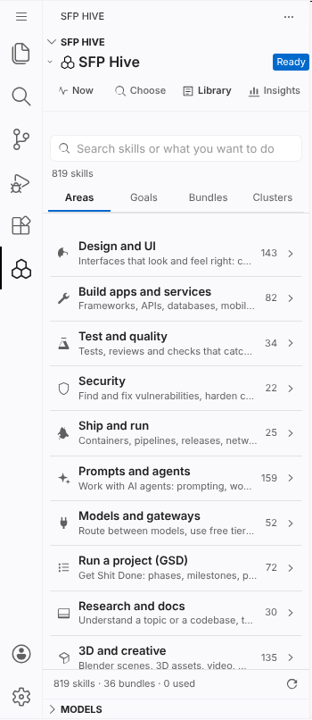
  &nbsp;
  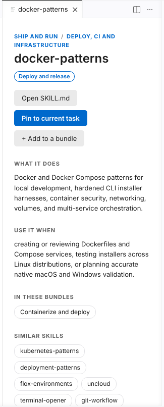
</p>

The full guide covers everything else: other install methods, choosing a skill set, the extension, local models and the router.

<details>
<summary><b>Open the full step-by-step guide</b></summary>
<br>

This guide takes you from a bare machine to an agent that gets the right skills on its own. Every step ends with a **Check**, so you know it worked before you move on. Allow about fifteen minutes; steps 7 to 10 are optional.

| Step | What you get | Needed? |
|---|---|---|
| [1. Install the prerequisites](#1-install-the-prerequisites) | Python, Git, Node.js | Yes |
| [2. Get SFP](#2-get-sfp) | SFP on your machine | Yes |
| [3. Check the install](#3-check-the-install) | A health report | Yes |
| [4. Install skills into your tools](#4-install-skills-into-your-tools) | Skills your agent can use | Yes |
| [5. Add the standing instruction](#5-add-the-standing-instruction) | The agent asks the hive on every real task | Recommended |
| [6. Register the MCP server](#6-register-the-mcp-server) | All 1065 skills on demand, nothing copied | Recommended |
| [7. Install the SFP Hive extension](#7-install-the-sfp-hive-extension) | The sidebar in Antigravity or VS Code | Optional |
| [8. Use SFP in Antigravity](#8-use-sfp-in-antigravity) | Your first task with the hive | Use it |
| [9. Let the hive use local models](#9-optional-let-the-hive-use-local-models) | Meaning, rerank, your taste, skills from research | Optional |
| [9b. Set up the local model router](#9b-optional-set-up-the-local-model-router) | Local models first, free tiers next | Optional |
| [10. Extras](#10-optional-extras) | Companion apps, skills from any Git repo | Optional |

Also: [Claude Code plugin](#claude-code-plugin-instead-of-steps-2-6), [Keeping it current](#keeping-it-current), [When something is wrong](#when-something-is-wrong), [Removing everything](#removing-everything).

> **Windows:** type `python` wherever this guide says `python3`. Run the commands in PowerShell.

### 1. Install the prerequisites

| Program | Why SFP needs it | Get it | Check |
|---|---|---|---|
| Python 3.8 or newer | runs the hive, the MCP server, the router and the checks | [python.org/downloads](https://www.python.org/downloads/) (Windows: tick **Add python.exe to PATH**) | `python3 --version` |
| Git | downloads SFP and keeps it current | [git-scm.com/downloads](https://git-scm.com/downloads) | `git --version` |
| Node.js 18 or newer, with npm | for `npx sfp-hive`, and to build the extension (step 7) | [nodejs.org](https://nodejs.org/) | `node --version` |
| An agent tool | where the skills are used | Antigravity, Claude Code, Cursor, VS Code with Copilot, Windsurf, Codex, Gemini CLI, Kiro and more | |
| Optional: Ollama or LM Studio | local models for meaning, rerank and the router (step 9) | [ollama.com](https://ollama.com/), [lmstudio.ai](https://lmstudio.ai/) | |

**Check:** each command in the last column prints a version number. If one says "not found", install that program and open a new terminal.

### 2. Get SFP

Pick **one** of these.

**A. npm (simplest).**

```bash
npx sfp-hive install          # run once, nothing installed globally
npm install -g sfp-hive       # or keep the `sfp` command around
sfp install
```

**B. One line.** Downloads SFP into `~/.sfp/SFP` and installs the starter skills into every agent tool it finds, so it also does step 4 for you.

```bash
# macOS and Linux
curl -fsSL https://raw.githubusercontent.com/siddu1004/SFP/main/get.sh | sh
```

```powershell
# Windows PowerShell
irm https://raw.githubusercontent.com/siddu1004/SFP/main/get.ps1 | iex
```

Running it again later updates SFP and reinstalls. To use a different folder, set `SFP_DIR` first.

**C. Clone it yourself.** Use this if you want SFP somewhere else, or want to contribute.

```bash
git clone https://github.com/siddu1004/SFP.git
cd SFP
```

**D. Rust.** If you have Cargo: `cargo install --git https://github.com/siddu1004/SFP.git`, then `sfp install`.

**Check:** `sfp help` (A) lists the commands, or the folder holds `catalog.json` (B, C):

```bash
ls ~/.sfp/SFP/catalog.json        # B, or the folder you cloned into for C
```

The `python3` commands below are run **from the SFP folder**: `cd ~/.sfp/SFP` (or your clone). With npm, use `sfp <command>` instead.

### 3. Check the install

```bash
python3 mcp/sfp_hive.py doctor          # or: sfp doctor
```

**Check:** it reports Python, the catalog, the search index, the hive and any local models as working. Anything that is not names the command that fixes it.

### 4. Install skills into your tools

If you used 2A or 2B, this is done; read on only to change what is installed.

SFP has 1065 skills. Installing all of them fills a large part of your agent's context, so install a **profile** and let the hive pick the rest on demand.

```bash
python3 scripts/install.py list                       # all categories, profiles and the tools found on this machine
python3 scripts/install.py install                    # the starter profile into every tool found
```

| Profile | Categories |
|---|---|
| `starter` (default) | sfp, engineering, testing-quality, data-apis, agent-dev |
| `frontend-dev` | sfp, frontend, design-styles, testing-quality, engineering, data-apis |
| `backend-dev` | sfp, backend, languages, testing-quality, devops, security, engineering, data-apis |
| `mobile-dev`, `agent-builder` | see `install.py list` |
| `everything` | all categories (heavy) |

Useful variations:

```bash
python3 scripts/install.py install --profile frontend-dev --tools antigravity     # one profile, one tool
python3 scripts/install.py install --categories frontend,security --tools cursor,codex
python3 scripts/install.py install --project .        # into this project's tool folders instead of your home folder
python3 scripts/install.py install --link             # symlinks, so updates change skills in place
```

`--tools` takes names such as `antigravity`, `claude`, `cursor`, `copilot`, `windsurf`, `codex`, `gemini`, `kiro`, `cline`, `roo`, `opencode`, `trae`, `qoder`; `auto` (the default) means every tool found. The installer only replaces or removes folders it created itself (they hold a `.sfp` marker); `--force` overrides that.

**Check:** restart your agent tool and ask it:

> Use sfp-hive for this task: add tests for the checkout form.

It names a few skills that fit your project, says why, and follows them in order.

### 5. Add the standing instruction

This tells the agent to consult the hive on every substantial task, without you asking each time.

```bash
python3 scripts/install.py rules                          # every tool found (Antigravity: ~/.gemini/GEMINI.md)
python3 scripts/install.py rules --project .              # only this project (AGENTS.md)
```

**Check:** the file named in the output contains an SFP section. Undo with `--remove`.

### 6. Register the MCP server

The MCP server lets any MCP client search and read all 1065 skills on demand, with nothing copied into your tools.

```bash
python3 scripts/install.py mcp                            # every tool found
python3 scripts/install.py mcp --tools antigravity        # Antigravity only: ~/.gemini/config/mcp_config.json
```

It registers a server called `sfp`. The agent gets tools such as `select_skills`, `search_skills`, `get_skill`, `use_skill`, `find_api`, `predict_next`, `give_feedback`, `research_skill` and `grow_skills`.

Or add it to any MCP client by hand:

```json
{ "mcpServers": { "sfp": { "command": "npx", "args": ["-y", "sfp-hive", "mcp"] } } }
```

**Check:** restart the tool; `sfp` is listed among its MCP servers, with its tools. Undo with `--remove`.

### 7. Install the SFP Hive extension

The sidebar for Antigravity and other VS Code-based editors: choose skills for a task, browse the library, see what the hive learned, and run the model router.

```bash
python3 extensions/antigravity-hive/install.py                       # build, test, package, install into every editor found
python3 extensions/antigravity-hive/install.py --editor antigravity  # one editor only
```

It builds the `.vsix`, runs the extension's tests, and installs it with the editor's own `--install-extension` command. If no editor command is on your PATH, it prints the manual steps: in the editor, open **Extensions**, then **...**, then **Install from VSIX...** and pick the built file.

Then reload the editor: `Ctrl+Shift+P` (macOS: `Cmd+Shift+P`), **Developer: Reload Window**.

**Check:**

```bash
python3 extensions/antigravity-hive/verify.py --editor antigravity
```

Every line says `PASS`. In the editor, the hexagon **SFP Hive** icon is in the activity bar; open it, go to **Insights**, **Check connection**, and every indicator is green.

### 8. Use SFP in Antigravity

Open the **SFP Hive** icon in the activity bar. It has three views: **SFP Hive** (the studio), **Skill Library** and **Models**. The studio has four tabs:

| Tab | What it is for |
|---|---|
| **Now** | Follows your work (saved files, test runs, commits) to tell which phase you are in, and shows the skills and bundle for it |
| **Choose** | Type a task; the hive picks a few skills and orders them. Click one to see why it was chosen, `+` to pin another, `x` to drop one |
| **Library** | Browse all 1065 skills by area, goal, bundle and cluster; open a skill, pin it or add it to a bundle |
| **Insights** | What the hive has learned from your feedback, and **Check connection** |

There are three ways to get the skills to the agent:

1. **Automatic (default).** Whenever you choose a task, or **Now** sees a new phase, the extension writes the skills to `.agents/rules/sfp-active-skills.md` in your workspace. The agent reads that rule on every turn, so there is nothing to paste. Turn it off with **SFP Hive: Turn automatic skills on or off**.
2. **Chat.** Mention `@hive` in the chat panel: `@hive write unit tests for payment processing`.
3. **MCP tools** (step 6). The agent calls `select_skills` itself.

After a task, tell the hive how it went: **This skill helped** / **This skill did not help** in the sidebar, or `give_feedback` through MCP. That is how it chooses better next time, and how it learns your taste.

### 9. Optional: let the hive use local models

Start Ollama or LM Studio. Load an embedding model (`bge-m3` works best) and a chat model (`lfm2-24b-a2b` is fast), then:

```bash
python3 mcp/sfp_embed.py build          # embed the library once; later runs only embed what changed
python3 mcp/sfp_intent.py probe         # test each chat model and keep the score and speed (or: sfp models probe)
python3 mcp/sfp_role.py .               # your role, read from this project, and the stacks the library covers thinly
```

The hive then matches tasks by meaning, lets the model rerank weak matches (`SFP_RERANK=auto`, the default; `1` always, `0` never), and learns your taste. When it reports a gap, grow a skill from research:

```bash
sfp mentor grow --topic "tune the PI controller of a buck converter"
sfp research approve <name> --install antigravity     # after you have read the draft
```

**Check:** `sfp doctor` shows **Meaning search** with every skill embedded and your chat model under **Task rewrite**. `SFP_SEMANTIC=0` turns all of this off.

### 9b. Optional: set up the local model router

An OpenAI-compatible router on `127.0.0.1:8787` that sends requests to your local models first, then free tiers, then paid ones, and moves to the next model when one is rate limited, out of quota or down. The hive itself never uses the router; it asks local models directly.

```bash
python3 mcp/sfp_route.py discover        # find models running here (Ollama, LM Studio, llama.cpp, Jan, vLLM)
python3 mcp/sfp_route.py setup --yes     # write the routes from what was found and the API keys you have set
python3 mcp/sfp_route.py serve           # run it; leave this terminal open
```

Point any tool that takes a custom OpenAI endpoint at it: base URL `http://127.0.0.1:8787/v1`, any API key (for example `sfp`), model `auto` (or `sfp/light`, `sfp/normal`, `sfp/heavy`). The **Models** view in the sidebar can start, stop and set it up too.

**Check:** `python3 mcp/sfp_route.py status` lists your models as ready.

### 10. Optional: extras

**Programs some skills need** (OmniRoute, FreeLLMAPI, Strix):

```bash
python3 scripts/install.py apps list
python3 scripts/install.py apps install omniroute          # shows the plan and changes nothing
python3 scripts/install.py apps install omniroute --yes    # runs it
```

**Turn any Git repository into a skill:** in the Library tab press **+** and paste a URL, `owner/repo` or a folder; or

```bash
python3 scripts/repo_to_skill.py https://github.com/owner/repo --install antigravity
```

The skill is written to `~/.sfp/skills/<name>/` and copied into the tool you name.

### Claude Code plugin (instead of steps 2-6)

In Claude Code:

```text
/plugin marketplace add siddu1004/SFP
/plugin install sfp@sfp
/plugin install frontend@sfp
```

`sfp` is the router and hive; add the category plugins you want (`frontend`, `backend`, `testing-quality`, ...). **Check:** `/plugin` lists them as installed. Update later with `/plugin marketplace update sfp`.

### Keeping it current

```bash
sfp update                                             # moves to the newest release and refreshes your skills
```

Updates follow tagged releases, never unreleased work, and never move you back to an older version. Without npm: `python3 scripts/install.py update` from the SFP folder, or re-run the one-line command from step 2B. Set `SFP_AUTO_UPDATE=1` to update automatically when a release lands.

### When something is wrong

| You see | Do this |
|---|---|
| `python3` or `python`: not found | Install Python (step 1); on Windows, reinstall with **Add python.exe to PATH** ticked, then open a new terminal |
| `git is required` | Install Git (step 1) and open a new terminal |
| The agent does not mention any skills | Restart the tool after installing; run step 5 so it consults the hive on its own |
| "SFP checkout not found" in the sidebar | Set the `sfpHive.sfpPath` setting to your SFP folder, then reload the window |
| No SFP Hive icon after installing the extension | **Developer: Reload Window**; then `python3 extensions/antigravity-hive/verify.py` names what is missing |
| The agent uses other skills than the sidebar shows | Choose the task again; check `.agents/rules/sfp-active-skills.md` exists in the workspace and automatic skills are on |
| Search index: stale | `python3 scripts/sync.py`, or update (above) |
| `sfp` missing from the MCP servers | Run step 6 again for that tool and restart it |
| Picks feel slow | `sfp models probe`, so the hive knows which local model answers fastest; or `SFP_RERANK=0` |
| Local models: none found | Start Ollama (port 11434) or LM Studio's server (port 1234), then `sfp models` |
| Anything else | `sfp doctor` names the failing part and the command that fixes it |

### Removing everything

```bash
cd ~/.sfp/SFP
python3 scripts/install.py uninstall              # the skills SFP installed (and nothing else)
python3 scripts/install.py mcp --remove           # the MCP server entries
python3 scripts/install.py rules --remove         # the standing instruction
```

Uninstall **SFP Hive** from the editor's Extensions view. Your history, taste, feedback and settings are in `~/.sfp`; delete that folder to remove them and SFP itself.

</details>

---

## Supported IDEs

<p align="center">
  <picture>
    <source media="(prefers-color-scheme: dark)" srcset="assets/tools-dark.svg">
    
  </picture>
</p>

### 1. Quick Install by Operating System

| Operating System | Recommended (`npx`) | One-Liner Script (`~/.sfp/SFP`) | Notes |
|---|---|---|---|
| **Windows 10 / 11** (PowerShell) | `npx sfp-hive install` | `irm https://raw.githubusercontent.com/siddu1004/SFP/main/get.ps1 \| iex` | Tick **Add python.exe to PATH** when installing Python; run `python` instead of `python3` |
| **macOS** (Zsh / Bash) | `npx sfp-hive install` | `curl -fsSL https://raw.githubusercontent.com/siddu1004/SFP/main/get.sh \| sh` | Works on Apple Silicon (`arm64`) and Intel (`x86_64`) |
| **Linux** (Ubuntu, Debian, Fedora, Arch, WSL2) | `npx sfp-hive install` | `curl -fsSL https://raw.githubusercontent.com/siddu1004/SFP/main/get.sh \| sh` | Uses symlinks cleanly with `--link` |
| **Rust / Cargo** (Any OS) | `cargo install --git https://github.com/siddu1004/SFP.git` | `sfp install` | Native CLI wrapper around the Python hive |

### 2. Every Supported IDE & Agent (Skills, MCP & Standing Rules)

| IDE / Agent Tool | `--tools` ID | Skills Folder | MCP Config File | Standing Rules File | One-Command Setup |
|---|---|---|---|---|---|
| **Claude Code** | `claude` | `~/.claude/skills` | Plugin / `~/.claude.json` | `~/.claude/CLAUDE.md` | `/plugin marketplace add siddu1004/SFP` then `/plugin install sfp@sfp` |
| **Google Antigravity** | `antigravity` | `~/.gemini/config/skills` | `~/.gemini/config/mcp_config.json` | `~/.gemini/GEMINI.md` | `npx sfp-hive install --tools antigravity` |
| **Cursor** | `cursor` | `~/.cursor/skills` | `~/.cursor/mcp.json` | `~/.cursor/rules/sfp.mdc` | `npx sfp-hive install --tools cursor` |
| **VS Code / GitHub Copilot** | `copilot` (`vscode`) | `~/.copilot/skills` | VS Code `mcp.json` | `~/.copilot/copilot-instructions.md` | `npx sfp-hive install --tools copilot` |
| **OpenAI Codex** | `codex` | `~/.agents/skills` | `~/.codex/config.toml` | `~/.codex/AGENTS.md` | `npx sfp-hive install --tools codex` |
| **Windsurf** | `windsurf` | `~/.codeium/windsurf/skills` | `~/.codeium/windsurf/mcp_config.json` | `~/.codeium/windsurf/memories/global_rules.md` | `npx sfp-hive install --tools windsurf` |
| **Gemini CLI** | `gemini` | `~/.gemini/skills` | `~/.gemini/settings.json` | `~/.gemini/GEMINI.md` | `npx sfp-hive install --tools gemini` |
| **Kiro** | `kiro` | `~/.kiro/skills` | `~/.kiro/settings/mcp.json` | `~/.kiro/steering/sfp.md` | `npx sfp-hive install --tools kiro` |
| **Cline** | `cline` | `~/.cline/skills` | `~/.cline/mcp_settings.json` | `~/.cline/AGENTS.md` | `npx sfp-hive install --tools cline` |
| **Roo Code** | `roo` | `~/.roo/skills` | `~/.roo/mcp_settings.json` | `~/.roo/rules/sfp.md` | `npx sfp-hive install --tools roo` |
| **OpenCode** | `opencode` | `~/.config/opencode/skills` | `~/.config/opencode/mcp.json` | `~/.config/opencode/AGENTS.md` | `npx sfp-hive install --tools opencode` |
| **Trae** | `trae` | `~/.trae/skills` | `~/.trae/mcp.json` | `~/.trae/user_rules.md` | `npx sfp-hive install --tools trae` |
| **Qoder** | `qoder` | `~/.qoder/skills` | `~/.qoder/mcp.json` | `~/.qoder/AGENTS.md` | `npx sfp-hive install --tools qoder` |
| **Pi** | `pi` | `~/.pi/agent/skills` | `~/.pi/mcp.json` | `~/.pi/agent/AGENTS.md` | `npx sfp-hive install --tools pi` |
| **Grok Build** | `grok` | `~/.grok/skills` | `~/.grok/mcp.json` | `~/.grok/AGENTS.md` | `npx sfp-hive install --tools grok` |
| **Mistral Vibe** | `vibe` | `~/.vibe/skills` | `~/.vibe/mcp.json` | `~/.vibe/AGENTS.md` | `npx sfp-hive install --tools vibe` |
| **Hermes** | `hermes` | `~/.hermes/skills` | `~/.hermes/mcp.json` | `~/.hermes/AGENTS.md` | `npx sfp-hive install --tools hermes` |

```bash
# Install starter skills, MCP server, and standing rules across multiple tools at once:
npx sfp-hive install --tools claude,cursor,antigravity,codex
npx sfp-hive mcp --tools claude,cursor,antigravity,codex
npx sfp-hive rules --tools claude,cursor,antigravity,codex
```

---

## Sources and Licenses

SFP's selection engine, installer, and MCP server are licensed under the [MIT License](LICENSE). The 1065 skills come from 91 repositories, and each keeps the license and copyright of its original author. Attributions are listed in [NOTICE.md](NOTICE.md) and [SKILLS.md](SKILLS.md).

<p align="center"><sub>Built by <a href="https://github.com/siddu1004">siddu1004</a>. If SFP saves your agent some context, a star helps others find it.</sub></p>
