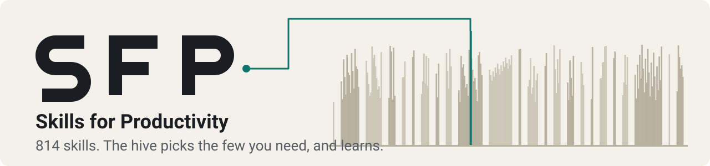

<h1 align="center">
  <picture>
    <source media="(prefers-color-scheme: dark)" srcset="assets/banner-dark.svg">
    
  </picture>
</h1>

<p align="center">
  <b>SFP gives your AI coding agent 558 skills, sorted by what you build.</b><br>
  Install a handful. One skill, <code>sfp</code>, finds the rest.
</p>

<p align="center">
  
  
  
  
</p>

## Quick Start

Install the starter set into every IDE it finds (macOS and Linux):

```bash
curl -fsSL https://raw.githubusercontent.com/siddu1004/SFP/main/get.sh | sh
```

Restart your IDE, then check it worked. Ask your agent: "Use sfp to find a skill for reviewing my UI for accessibility." It should name a skill, such as `accessibility-audit`, and follow it.

Want your IDE to reach every skill without installing it? Add the MCP server too:

```bash
curl -fsSL https://raw.githubusercontent.com/siddu1004/SFP/main/get.sh | sh -s -- mcp
```

It registers `sfp` in each IDE it finds and keeps your other MCP servers. See [MCP Server](#mcp-server) for Windows and the tools it adds.

On Windows or in Claude Code? See [Windows](#windows) and [Claude Code](#claude-code). For presets and single IDEs, see [all install options](#install).

## Why SFP

Good agent skills exist, but they are scattered across dozens of repos. Each has its own install steps, its own folder layout and its own idea of which IDE you use.

Installing many of them has a cost you do not see. An agent reads the name and description of every installed skill at the start of every session. Measured on this library, all 558 descriptions come to about 44,153 tokens. That is 22% of a 200k-token window, spent before you type a word.

So you pick between two bad options: install a few skills and miss the good ones, or install many and spend a fifth of your context on a catalog.

SFP removes the choice in three moves:

1. **Sort.** 24 categories group skills by what you build, and presets group categories by role.
2. **Route.** One small skill, `sfp`, holds an index of everything. It costs about 159 tokens, which is 278 times less than loading every description, and it finds the right skill when a task needs one.
3. **Install once.** One command puts the right skills in the right folder for each of 16 IDEs and CLIs. Tools with no skills folder get the same library over MCP.

## What Makes SFP Different

- **It loads skills on demand, not all at once.** Most collections ask you to install everything or pick by hand. Here the router reads a skill only when your task calls for it. The cost table below shows the difference in tokens.
- **Skills are sorted by what you build, not by who wrote them.** SFP merges 23 sources into categories by job. A backend developer finds Postgres, migrations, API design and Docker together.
- **One library for 16 IDEs.** You do not hunt for each tool's skills folder or format. The installer knows them, and Claude Code gets proper plugins.
- **A bridge for tools with no skills folder.** The MCP server lets any MCP client search the library and read skills and their bundled files.
- **Every source is traceable.** SFP reads the original projects, not copies of copies. `sources.lock.json` pins the exact commit of each. Every skill keeps its license, and this page lists what was left out and why.
- **Apps, not just prompts.** Some skills need a program behind them. The `career` launcher sets one up at a pinned commit, and the free API finder ships its own search script.
- **It measures itself.** The search and cost figures on this page are computed from the repo by the script that builds it, and tests keep search quality from quietly getting worse.

## What Is What

| Term | What it is |
|---|---|
| Skill | A folder with a `SKILL.md`, and sometimes scripts or reference files, that an agent loads when a task matches. Example: `database-migrations`. |
| Category | A group of skills by job, such as `backend` or `security`. There are 24. Each is also a Claude Code plugin. |
| Preset | A ready-made list of categories for a kind of work, such as `frontend-dev`. Install one name instead of choosing categories. |
| `sfp` (the router) | The one skill that knows all the others. It searches the index and reads the skill your task needs, installed or not. |
| Installer | `install.sh` and `install.ps1`. They copy skills into each IDE's folder and never touch a skill they did not create. |
| MCP server | `mcp/sfp_mcp.py`. It gives MCP clients six read-only tools to search the library and read skills. |
| Launcher | A skill that sets up an app before it works, such as `career-ops`. |
| Catalog | `catalog.json` and `SKILLS.md`. A generated list of every skill, its category, source and license. |
| Sync | `scripts/sync.py`. It pulls the latest skills from every source and rebuilds everything, including this page. |

```text
SFP/
  plugins/<category>/skills/<skill>/   the skills, one folder each (generated)
  mcp/sfp_mcp.py                       the MCP server
  scripts/install.py, sync.py          the installer, and the script that rebuilds everything
  templates/                           the sfp router, the career launcher, the API finder, this README
  vendor/                              snapshots of plugins that have no public repo
  archive/fork-patches/                commits the old forks held, kept as patches
  tests/                               protocol, installer-facing and search-quality tests
  sources.json, categories.json        where skills come from and how they are sorted
```

## What It Does for Your IDE

### Measured

**What each way of installing costs your agent.** Every installed skill puts its name and description into each session. These figures come from the real text of this library, at about 4 characters per token.

| What you install | Skills your agent can use | Skill descriptions it carries each session | Share of a 200k-token window |
|---|---:|---:|---:|
| `sfp` alone (the rest on demand) | 1 + all 557 through `sfp` | about 159 tokens | 0.1% |
| `starter` preset | 117 | about 10,196 tokens | 5.1% |
| `frontend-dev` preset | 184 | about 13,024 tokens | 6.5% |
| `backend-dev` preset | 126 | about 11,203 tokens | 5.6% |
| `mobile-dev` preset | 69 | about 5,714 tokens | 2.9% |
| `agent-builder` preset | 188 | about 14,251 tokens | 7.1% |
| `everything` | 558 | about 44,153 tokens | 22.1% |

Installing everything carries about 278 times the descriptions of `sfp` alone. With `sfp` and the MCP server you still reach every skill, and you pay for a skill only when it is used. A skill's full text then costs a median of about 1,582 tokens, and 90% are under 4,662.

**How often `sfp` finds the right skill.** I wrote 91 plain-language tasks, such as "add a postgres migration without downtime", and marked which skills would be a correct answer. The search behind `sfp` and the MCP server returns:

| The right skill is | Share of the 91 tasks |
|---|---:|
| The first result | 76% |
| In the top 3 | 90% |
| In the top 5 | 92% |

Before the ranking fixes in this repo, the same tasks scored 65% first and 84% in the top 3. The figures are recomputed from `tests/search_*.json` every time the README is rebuilt, and `python3 -m unittest discover -s tests` fails if search quality drops below a set floor.

### Not measured

- **Whether skills make your agent's work better on real tasks.** I have not run a benchmark of finished work with and without SFP. The figures above show cost and findability, not quality of results.
- **Time saved.** It depends on your work and your agent.
- **Exact token counts.** The estimate is characters divided by 4. Your IDE's tokenizer and how it lists skills will differ.

### Where search still misses

Search is keyword-based, with no embeddings. It does best when your task shares words with the skill. It misses when they do not: "scrape product prices" does not surface `data-scraper-agent`, because "scraper" and "scrape" are different stems. When `sfp` misses, name the skill, or ask it to list a category. The tasks were written and marked by one person, and one of the three sets exposed a bug with `C++` that I fixed afterwards, so treat the figures as slightly optimistic.

## Pick a Preset

| Preset | Good for | Categories |
|---|---|---|
| `starter` | A first install: the router, engineering practice, testing, data APIs and agent-building tools. This is the default. | `sfp` `engineering` `testing-quality` `data-apis` `agent-dev` |
| `frontend-dev` | UI, design styles, testing and engineering practice. | `sfp` `frontend` `design-styles` `testing-quality` `engineering` `data-apis` |
| `backend-dev` | Services and databases, languages, DevOps and security. | `sfp` `backend` `languages` `testing-quality` `devops` `security` `engineering` `data-apis` |
| `mobile-dev` | Android, iOS, Flutter and React Native. | `sfp` `mobile` `languages` `testing-quality` `engineering` |
| `agent-builder` | Agents, MCP and plugins, AI, gateways and memory. | `sfp` `agents` `agent-dev` `ai-ml` `ai-gateway` `data-apis` `memory` |
| `everything` | Every category. Heavy: expect your agent to carry hundreds of descriptions. | all |

<details>
<summary>All 24 categories</summary>

| Category | Skills | What is in it |
|---|---:|---|
| `sfp` | 1 | The router: finds the right skill for any task, installed or not. |
| `frontend` | 62 | UI design and components, motion, accessibility, UX research and critique, React, Vue, Next.js, Angular, Vite. Includes Impeccable, the Taste skills, Emil Kowalski's animation skills and the Vercel web interface guidelines. |
| `design-styles` | 67 | 67 named visual styles to build in: brutalism, glassmorphism, editorial, retro, shadcn and more. |
| `backend` | 27 | Backend frameworks, APIs and databases (Django, FastAPI, Spring Boot, Laravel, NestJS, Rails, Postgres, Redis, Prisma). |
| `mobile` | 13 | Android, iOS, Flutter, React Native, Kotlin Multiplatform and Swift. |
| `languages` | 8 | Language idioms, standards and testing for Go, Rust, Python, C++, C#, F#, Java, Kotlin, Perl and .NET. |
| `testing-quality` | 32 | TDD, end-to-end tests, verification loops, code review, regression and quality gates. |
| `devops` | 15 | Docker, Kubernetes, deployment, git and GitHub workflows, terminals, green-PR and merge automation. |
| `security` | 21 | Strix autonomous pentesting, OWASP testing, secure coding for each framework, and agent security hardening. |
| `agents` | 33 | Agent-driven work: autonomous loops, orchestration, councils, dev teams, planning and feature pipelines. |
| `agent-dev` | 62 | Building for agents: skills, plugins, hooks, MCP servers, harnesses, token budgets, context compression and Cowork plugin tools. |
| `ai-ml` | 10 | LLM pipelines, prompts, evals, RAG, PyTorch, ML engineering, recommender systems and AI media. |
| `ai-gateway` | 45 | Driving an OmniRoute AI gateway: routing, providers, budgets, caching, compression, MCP and A2A. |
| `data-apis` | 7 | About 2,100 free APIs you can search, FreeLLMAPI, internet reach across 16 platforms, search and scraping. |
| `content-media` | 26 | Writing, marketing and persuasion audits, SEO, video, slides, social posting, brand guidelines, canvas and generative art. |
| `business-ops` | 27 | Billing, finance, investors, market research, leads, contracts, email, tickets, internal comms and a chief-of-staff ops check. |
| `industry` | 13 | Domain playbooks: healthcare (HIPAA, EMR, CDSS), logistics, customs, inventory, production and energy. |
| `networking` | 10 | Network engineering and homelab: Cisco IOS, BGP, VLANs, WireGuard, Pi-hole, config validation. |
| `research-docs` | 18 | Deep research, scientific databases, literature review, docs, ADRs and a teach-me tutor. |
| `web3` | 9 | DeFi, EVM, prediction markets, Itô baskets and compute, and trading-agent security. |
| `engineering` | 15 | General engineering practice: architecture, standards, error handling, performance, benchmarks and refactoring. |
| `science-hardware` | 6 | Math proof and olympiad work, Blender, and M5Stack and Cardputer hardware. |
| `career` | 1 | AI job search: evaluate offers, tailor CVs, scan portals, track applications. |
| `memory` | 30 | claude-mem's skills: search past work, timelines, handoffs and planning with persistent memory. |
| `session-memory` | plugin | Persistent memory across Claude Code sessions (claude-mem), with search, timelines and handoffs. Claude Code only: it needs claude-mem's hooks and worker. |
</details>

## Who Gets the Most From It

| You are | Install | You get, for example | Try asking |
|---|---|---|---|
| A frontend developer | `frontend-dev` | `impeccable`, `design-taste-frontend`, `animate`, `accessibility-audit`, `break-ui` | "Critique this page and fix the hierarchy." |
| A backend developer | `backend-dev` | `postgres-patterns`, `database-migrations`, `api-design`, `docker-patterns`, `tdd-workflow` | "Plan a zero-downtime migration for this table." |
| A mobile developer | `mobile-dev` | `swiftui-patterns`, `dart-flutter-patterns`, `android-clean-architecture`, `compose-multiplatform-patterns` | "Review this Flutter screen for state-management problems." |
| Building agents, plugins or MCP servers | `agent-builder` | `skill-creator`, `hook-development`, `mcp-builder`, `agent-eval`, `mem-search` | "Help me design an MCP server for our ticket system." |
| Security-minded | `backend-dev` and `security` | `penetration-testing-with-strix`, `owasp-top-10-testing`, `find-security-vulnerabilities-in-code`, `security-review` | "Check this service against the OWASP top 10." |
| A founder or marketer | `business-ops` and `content-media` | `investor-materials`, `marketing-campaign`, `article-writing`, `persuasion-audit`, `price-framing` | "Draft this month's investor update." |
| Job hunting | `career` | `career-ops` | "Evaluate this job posting against my CV." |
| Using an IDE with no skills folder | the MCP server | every skill, through `search_skills` and `get_skill` | "Search SFP for a skill that fits this task." |

## Use It Well

1. **Start with a preset, not everything.** Pick the one that matches your work. You can add a category later.
2. **Describe the task and let `sfp` pick.** Say what you want, for example "use sfp to find a skill for adding rate limiting". One or two skills usually fit.
3. **Name the skill when you know it.** "Use the `impeccable` skill to critique this page" skips the search.
4. **Chain skills for a whole job.**
   - Ship a page: `design-taste-frontend`, then `accessibility-audit`, then `break-ui`.
   - Ship a service: `api-design`, then `database-migrations`, then `tdd-workflow`, then `security-review`.
   - Ship a plugin: `skill-creator`, then `hook-development`, then `mcp-builder`.
5. **Grow your install from use.** As a rule of thumb, when you ask `sfp` for the same category three times, install it. Run `./install.sh list` to see what is available.
6. **Use the MCP server where skills folders do not exist.** It gives the same skills to any MCP client.
7. **Keep it current.** Run your install line again. It updates only the folders it created.

Prompts to try:

```text
Use sfp to find a skill for stress-testing this form with long names and empty values.
Use sfp: I need a free API for currency exchange rates. Show auth and CORS for each.
Use the skill-creator skill to turn this checklist into a skill.
Search SFP for a skill that helps me write an architecture decision record.
```

## Install

Everything needs `git`. Outside Claude Code's plugin route it also needs Python 3.

### macOS and Linux

Choose what to install:

```bash
# Everything, into every IDE found
curl -fsSL https://raw.githubusercontent.com/siddu1004/SFP/main/get.sh | sh -s -- --profile everything

# One IDE, one preset
curl -fsSL https://raw.githubusercontent.com/siddu1004/SFP/main/get.sh | sh -s -- --tools cursor --profile frontend-dev
```

### Windows

In PowerShell:

```powershell
irm https://raw.githubusercontent.com/siddu1004/SFP/main/get.ps1 | iex
```

To choose what to install:

```powershell
& ([scriptblock]::Create((irm https://raw.githubusercontent.com/siddu1004/SFP/main/get.ps1))) --tools cursor --profile frontend-dev
```

### Claude Code

Run these inside Claude Code:

```text
/plugin marketplace add siddu1004/SFP
/plugin install sfp@sfp
/plugin install frontend@sfp
```

Replace `frontend` with any category from the [category list](#pick-a-preset). Plugins update with `/plugin update`.

### From a clone

<details>
<summary>Read the installer first, then run it</summary>

```bash
git clone https://github.com/siddu1004/SFP.git && cd SFP
./install.sh list                                  # categories, presets, tools found
./install.sh --profile backend-dev                 # a preset
./install.sh --categories security,devops,memory   # exact categories
./install.sh --tools cursor,codex                  # only these tools
./install.sh --project .                           # into this project's tool folders
./install.sh --link                                # symlink, so git pull updates skills (macOS, Linux)
./install.sh uninstall --tools cursor              # remove what it installed
```

On Windows, use `.\install.ps1` in place of `./install.sh`.
</details>

### Let your agent install it

<details>
<summary>Paste this prompt into any agent</summary>

> Clone https://github.com/siddu1004/SFP, run its `install.sh` (or `install.ps1` on Windows) with `--tools <this tool>`, then restart me so the skills load.
</details>

To update, run the same install line again. The installer replaces only folders it created. A skill you made with the same name stays unless you add `--force`.

## Full Integration: SFP, ECC and OmniRoute

SFP carries the **skills** of ECC and OmniRoute. The other parts of those projects need their own install: ECC's agents, hooks and rules, and the OmniRoute gateway that routes your IDE to many model providers. The short version, in order:

```bash
# 1. SFP skills and router
curl -fsSL https://raw.githubusercontent.com/siddu1004/SFP/main/get.sh | sh
# 2. SFP MCP server
curl -fsSL https://raw.githubusercontent.com/siddu1004/SFP/main/get.sh | sh -s -- mcp
# 3. ECC: agents, hooks, commands (Claude Code; Node.js 18+)
npx ecc-universal@2.2.3 setup
# 4. OmniRoute gateway, then point your IDE at http://localhost:20128/v1
npm install -g omniroute && omniroute
omniroute setup-claude        # or setup-codex, setup-cursor, setup-opencode ...
```

Use one ECC install method per IDE, and install only `sfp` plus non-ECC categories from SFP if you add the ECC plugin, so you do not get skills twice. The [full integration guide](docs/INTEGRATION.md) has every command per IDE, the Codex and Cursor routes, MCP for OmniRoute, a verification table, updating and removal. I have not run ECC's or OmniRoute's installers myself: their commands come from each project's own documentation.

## Supported IDEs

Claude Code, Codex, Cursor, Gemini CLI, Antigravity, GitHub Copilot, Windsurf, Kiro, OpenCode, Pi, Grok Build, Qoder, Trae, Rovo Dev, Mistral Vibe and Hermes.

Name them with `--tools`:

```text
claude codex cursor gemini antigravity copilot windsurf kiro opencode pi grok qoder trae rovodev vibe hermes
```

<details>
<summary>Where each tool keeps its skills</summary>

| Tool | Your home folder | A project (`--project`) |
|---|---|---|
| Claude Code | `~/.claude/skills` (or plugins) | `.claude/skills` |
| Codex | `~/.agents/skills` | `.agents/skills` |
| Cursor | `~/.cursor/skills` | `.cursor/skills` |
| Gemini CLI | `~/.gemini/skills` | `.gemini/skills` |
| Antigravity | `~/.gemini/config/skills` | `.agent/skills` |
| GitHub Copilot | `~/.copilot/skills` | `.github/skills` |
| Windsurf | `~/.codeium/windsurf/skills` | `.windsurf/skills` |
| Kiro | `~/.kiro/skills` | `.kiro/skills` |
| OpenCode | `~/.config/opencode/skills` | `.opencode/skills` |
| Pi | `~/.pi/agent/skills` | `.pi/skills` |
| Grok Build, Qoder, Trae, Rovo Dev, Vibe, Hermes | `~/.<tool>/skills` | `.<tool>/skills` |

A tool counts as found when its home folder exists, for example `~/.cursor`. Use `--tools` to install into one that is not found yet.

I could not confirm the Windsurf and Copilot paths against their docs. If one is wrong for your version, fix it in the `TOOLS` table in `scripts/install.py`.
</details>

## MCP Server

SFP also runs as an MCP server. Any MCP client can search and read all 558 skills on demand, with nothing copied into a skills folder. This helps IDEs and agents that support MCP but not skills.

Register it in your IDEs with one command. It fetches SFP first if you do not have it:

```bash
curl -fsSL https://raw.githubusercontent.com/siddu1004/SFP/main/get.sh | sh -s -- mcp
```

On Windows, in PowerShell:

```powershell
& ([scriptblock]::Create((irm https://raw.githubusercontent.com/siddu1004/SFP/main/get.ps1))) mcp
```

To pick IDEs, add `--tools cursor,claude`. To undo it, add `--remove`. SFP lives in `~/.sfp/SFP`, so later you can run `~/.sfp/SFP/install.sh mcp`, or `./install.sh mcp` from a clone.

Claude Code by hand:

```bash
claude mcp add --scope user sfp -- python3 /path/to/SFP/mcp/sfp_mcp.py
```

Any other MCP client: add a stdio server that runs `python3 /path/to/SFP/mcp/sfp_mcp.py`.

| Tool | What it does |
|---|---|
| `search_skills` | Finds skills by task or keyword, optionally within one category |
| `get_skill` | Returns a skill's full `SKILL.md` and the files it bundles |
| `read_skill_file` | Reads one bundled file, such as a reference doc or script |
| `list_categories` | Lists categories, skill counts and install presets |
| `find_api` | Searches the free API list by keyword, auth, CORS and HTTPS |
| `install_command` | Gives the command that installs a category or preset for good |

Every skill is also a resource at `sfp://skill/{name}`, and two prompts, `use_skill` and `find_skill_for`, load a skill into a chat.

The server is read-only, needs only Python 3 and makes no network calls. A skill it returns is third-party instruction text that your agent will follow, so the same trust applies as when you install it.

I tested it with Claude Code, including a real session that found and read a skill through the tools. The Cursor, Gemini CLI, Windsurf, Kiro and Codex settings follow each tool's documented format but were not run against those tools.

## Free APIs

The `public-apis` skill bundles a list of about 2,100 free APIs in 51 categories, plus a search script. Your agent can run it directly:

```bash
python3 plugins/data-apis/skills/public-apis/scripts/find_api.py weather --auth none --cors yes
python3 plugins/data-apis/skills/public-apis/scripts/find_api.py --category Finance --limit 10
python3 plugins/data-apis/skills/public-apis/scripts/find_api.py --categories
```

Filters: `--auth none|apiKey|OAuth`, `--cors yes|no`, `--https yes|no` and `--json`. It needs only Python 3.

## Questions

**Will it slow my agent down?** Only through the descriptions of the skills you install, as the cost table shows. `sfp` alone is about 159 tokens, and the MCP server adds nothing until a tool is called.

**Why not install everything?** It works, and `--profile everything` does it. It also puts about 44,153 tokens of descriptions, 22% of a 200k window, into every session, and gives your agent 558 descriptions to choose between.

**Does `sfp` always pick the right skill?** No. On the 91 test tasks the right skill was in the top 3 results 90% of the time. When it misses, name the skill or ask for a category.

**Is it safe?** A skill is third-party instruction text that your agent will follow, so read a skill before you trust it, as you would a script. The installer writes only into skills folders and `~/.sfp`, and backs up an MCP config before changing it. The MCP server is read-only and makes no network calls. SFP's own scripts send nothing anywhere. Individual skills can do their own network work, such as Impeccable downloading its engine on first use.

**Can I keep my own skills?** Yes. A skill you made with the same name is left alone unless you pass `--force`.

**Which IDEs have you tested?** Claude Code end to end: plugin install from GitHub, the MCP connection, and a real session using the tools. For the other IDEs the installer was tested on fake home folders, and the folder paths follow each tool's documentation. The Windsurf and Copilot paths are unconfirmed.

**Does it work offline?** After installing, yes, for skills that do not need the network. The first install needs GitHub.

**How do I remove it?** Run `./install.sh uninstall --tools cursor` for skills, `./install.sh mcp --remove` for the MCP server, and `/plugin uninstall <category>@sfp` in Claude Code.

## Good to Know

- **career** is a launcher. The first time you use it, it clones the original career-ops project at a pinned commit into `~/.sfp/apps/career-ops` and applies a small patch (`templates/career/patches/data-root.patch`). Then run `npm install` there once. Your CV, tracker and reports live in `~/career-ops`, so updates never touch them.
- **session-memory** needs Claude Code's hooks and a background worker, so other IDEs skip it. The `memory` skills expect claude-mem, so most need it installed.
- **ai-gateway** skills drive an OmniRoute server. **security** skills drive the Strix CLI. Each skill explains how to set up what it needs.
- **Impeccable** (in `frontend`) downloads its engine on first use.

## Keep It Fresh

Pull the latest skills from every source into SFP, then commit the result:

```bash
python3 scripts/sync.py            # rebuild the plugins, catalog, README and banner
python3 scripts/sync.py --report   # also show what each category got
```

- **Add a source:** add an entry to `sources.json` with `repo`, `license`, a `default` category and `skills` paths, then sync.
- **Move a skill:** add its name to `names` in `categories.json`, or adjust a pattern, then sync.
- **Add a category:** add it under `categories` in `categories.json`. Names cannot start with `claude-` or `anthropic-`.

The README, banner, `plugins/`, `catalog.json` and `SKILLS.md` are generated. Edit `templates/README.md.tpl` and the JSON files, not the outputs.

## Sources and Licenses

Each skill keeps the license of the project it came from. [NOTICE.md](NOTICE.md) lists every source, and each category folder holds copies of its licenses in `plugins/<category>/LICENSES/`. The full skill list is in [SKILLS.md](SKILLS.md).

<details>
<summary>Where every source landed (23 sources)</summary>

Every skill in these repos is in SFP, except test fixtures and translated example copies. Repos with no skill of their own got one written for them. Plugins with no public repo are kept as snapshots in `vendor/`.

SFP reads the original repos directly, and `sources.lock.json` records the exact commit of each one that was integrated. It does not depend on any fork. The extra commits the forks held are saved as patches in [archive/fork-patches](archive/fork-patches).

| Source | Where it is in SFP |
|---|---|
| pbakaus/impeccable | `frontend`: Impeccable, 24 design commands |
| Imaidazo/taste-skill-plugin | `frontend`: the Taste skills |
| emilkowalski/skills | `frontend`: Emil Kowalski's skills |
| vercel-labs/web-interface-guidelines | `frontend`: a UI review checklist |
| design-skills | `frontend`: 10 UX design skills |
| bergside/awesome-design-skills | `design-styles` |
| usestrix/strix | `security` |
| anthropics/claude-plugins-official | `agent-dev` and others: every skill it ships. Its other plugins point to third-party repos |
| affaan-m/everything-claude-code | spread across `agents`, `agent-dev`, `backend`, `frontend`, `testing-quality` and more |
| diegosouzapw/OmniRoute | `ai-gateway`, plus 6 maintenance skills in `devops` |
| thedotmack/claude-mem | `memory`, and the optional `session-memory` plugin |
| Panniantong/Agent-Reach | `data-apis` |
| public-apis/public-apis | `data-apis`: a searchable skill over about 2,100 free APIs |
| tashfeenahmed/freellmapi | `data-apis`: a skill with the project's docs |
| harry0703/MoneyPrinterTurbo | `content-media` |
| marketing-psychology | `content-media`: 5 persuasion and behavior skills |
| Anthropic example skills | 8 Apache-2.0 skills: algorithmic art, brand guidelines, canvas design, internal comms, MCP builder, Slack GIF creator, theme factory, web artifacts builder |
| teach-me | `research-docs` |
| task-observer, headroom | `agent-dev` |
| cowork-plugin-management | `agent-dev` |
| gia-chief-of-staff | `business-ops` |
| career-ops-hq/career-ops | `career`: a launcher that sets up the project at a pinned commit with SFP's patch |

**Left out on purpose:** anything whose license does not allow republishing. That covers Greenhouse's customer-only plugin, Anthropic's docx, pdf, pptx, xlsx and browser skills (all rights reserved), and the noncommercial-only `claude-mem-cowork` plugin.
</details>
