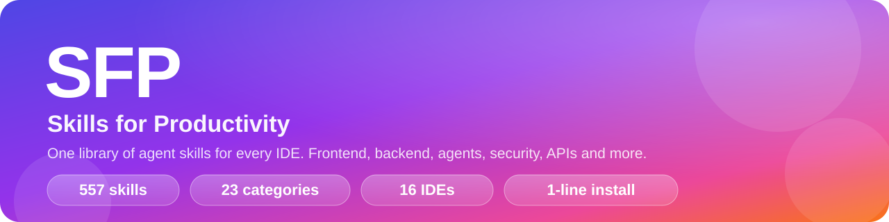
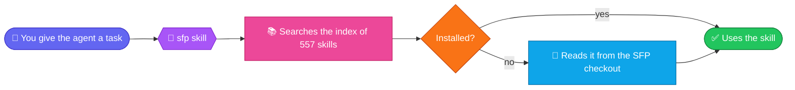

<p align="center">
  
</p>

<p align="center">
  
  
  
  
  
  
</p>

<p align="center">
  <b>557 agent skills from 23 sources, sorted by what you build.</b><br>
  One <code>sfp</code> skill knows all of them and sends your agent to the right one.<br>
  Works in Claude Code, Codex, Cursor, Gemini CLI, Antigravity, Copilot, Windsurf, Kiro, OpenCode and more.
</p>

---

## ✨ Features

| | |
|---|---|
| 🧭 **One router skill** | `sfp` holds an index of every skill, picks the right one for the task, and reads it straight from the checkout. No need to install all 557 |
| 🗂️ **Sorted by what you build** | 23 categories: frontend, backend, mobile, security, agent-driven work, AI, data and more. Not by which repo a skill came from |
| 🔌 **Works in 16 IDEs and CLIs** | Claude Code gets plugins; every other tool gets plain `SKILL.md` folders in the right place |
| ⚡ **One-line install** | A `curl` or PowerShell line, a preset for your kind of work, and you're done. Needs only Python 3 |
| 🎛️ **Presets** | `frontend-dev`, `backend-dev`, `mobile-dev`, `agent-builder`, `starter` or `everything` |
| 🌐 **Free APIs on tap** | A searchable list of about 2,100 free APIs your agent can query directly, with auth, HTTPS and CORS for each |
| 🔒 **Safe installs** | Only touches folders it created. Your own skills are never overwritten unless you say so |
| 🔄 **Easy to keep fresh** | One command pulls the latest skills from every source repo and rebuilds the catalog |

## 🧭 How the router works



Agents read the description of every installed skill at the start of a session, and 557 descriptions is too much to carry. So install `sfp` plus the categories you use every day, and let `sfp` reach the rest on demand. The installer records where the checkout is in `~/.sfp/root` so it can.

## 🚀 Install

Pick the line for your setup. Everything needs `git`; outside Claude Code's plugin route it also needs Python 3.

<details open>
<summary><b>🟠 Claude Code</b></summary>

```
/plugin marketplace add siddu1004/SFP
/plugin install sfp@sfp
/plugin install frontend@sfp
/plugin install backend@sfp
```

Swap `frontend` and `backend` for any category in the table below.
</details>

<details open>
<summary><b>🍎🐧 macOS and Linux, any IDE</b></summary>

Installs the starter set into every tool it finds:

```bash
curl -fsSL https://raw.githubusercontent.com/siddu1004/SFP/main/get.sh | sh
```

Everything, into every IDE:

```bash
curl -fsSL https://raw.githubusercontent.com/siddu1004/SFP/main/get.sh | sh -s -- --profile everything
```

One IDE, one preset:

```bash
curl -fsSL https://raw.githubusercontent.com/siddu1004/SFP/main/get.sh | sh -s -- --tools cursor --profile frontend-dev
```
</details>

<details open>
<summary><b>🪟 Windows PowerShell, any IDE</b></summary>

```powershell
irm https://raw.githubusercontent.com/siddu1004/SFP/main/get.ps1 | iex
```

Everything, or one IDE and preset:

```powershell
& ([scriptblock]::Create((irm https://raw.githubusercontent.com/siddu1004/SFP/main/get.ps1))) --profile everything
& ([scriptblock]::Create((irm https://raw.githubusercontent.com/siddu1004/SFP/main/get.ps1))) --tools cursor --profile frontend-dev
```
</details>

<details>
<summary><b>📦 From a clone (read the installer first)</b></summary>

```bash
git clone https://github.com/siddu1004/SFP.git && cd SFP
./install.sh list                                      # categories, presets, which tools were found
./install.sh --profile backend-dev                     # a preset
./install.sh --categories security,devops,memory       # exact categories
./install.sh --tools cursor,codex                      # only these tools
./install.sh --project .                               # into this project's .cursor/, .agents/ ... folders
./install.sh --link                                    # symlink so `git pull` updates skills in place (macOS / Linux)
./install.sh uninstall --tools cursor
```

On Windows use `.\install.ps1` in place of `./install.sh`.
</details>

<details>
<summary><b>🤖 Let your agent do it</b></summary>

Paste this to any agent:

> Clone https://github.com/siddu1004/SFP, run its `install.sh` (or `install.ps1` on Windows) with `--tools <this tool>`, then restart me so the skills load.
</details>

Re-run the same line any time to update. The installer only replaces or removes folders it created itself; a skill you made with the same name is left alone unless you pass `--force`.

`--tools` takes: `claude` `codex` `cursor` `gemini` `antigravity` `copilot` `windsurf` `kiro` `opencode` `pi` `grok` `qoder` `trae` `rovodev` `vibe` `hermes`.

## 🎛️ Presets

| Preset | Gets you |
|---|---|
| 🌱 `starter` (default) | `sfp`, engineering, testing-quality, data-apis, agent-dev |
| 🎨 `frontend-dev` | `sfp`, frontend, design-styles, testing-quality, engineering, data-apis |
| ⚙️ `backend-dev` | `sfp`, backend, languages, testing-quality, devops, security, engineering, data-apis |
| 📱 `mobile-dev` | `sfp`, mobile, languages, testing-quality, engineering |
| 🤖 `agent-builder` | `sfp`, agents, agent-dev, ai-ml, ai-gateway, data-apis, memory |
| 🌍 `everything` | every category (heavy) |

Edit them in `sources.json`.

## 🗂️ Categories

Each category is its own Claude Code plugin and lives in `plugins/<category>/skills/`. The full list of skills is in [SKILLS.md](SKILLS.md).

| | Category | Skills | What's in it |
|---|---|---:|---|
| 🧭 | `sfp` | 1 | The router: finds the right skill for any task, installed or not |
| 🎨 | `frontend` | 62 | UI design, components, motion, accessibility, React, Vue, Next.js, Angular, Vite. Includes Impeccable, the Taste skills, Emil Kowalski's animation skills, 10 UX design skills (research, critique, journey mapping, UX writing) and the Vercel web interface guidelines |
| 🖌️ | `design-styles` | 67 | Named visual styles: brutalism, glassmorphism, editorial, retro, shadcn and more |
| ⚙️ | `backend` | 27 | Django, FastAPI, Spring Boot, Laravel, NestJS, Rails, Postgres, MySQL, Redis, Prisma, API design |
| 📱 | `mobile` | 13 | Android, iOS, Flutter, React Native, Kotlin Multiplatform, Swift |
| 🔤 | `languages` | 8 | Go, Rust, Python, C++, Java, Kotlin, Perl idioms and standards |
| 🧪 | `testing-quality` | 32 | TDD, end-to-end tests, verification loops, code review, regression, quality gates |
| 🚢 | `devops` | 15 | Docker, Kubernetes, deployment, git and GitHub workflows, terminals, green-PR and merge automation |
| 🛡️ | `security` | 21 | Strix autonomous pentesting, OWASP testing, secure coding per framework, agent hardening |
| 🤖 | `agents` | 33 | Agent-driven work: autonomous loops, orchestration, councils, dev teams, feature pipelines |
| 🧰 | `agent-dev` | 62 | Building for agents: skills, plugins, hooks, MCP servers, harnesses, token budgets, context compression, an MCP builder and Cowork plugin tools |
| 🧠 | `memory` | 30 | claude-mem's skills: search past work, timelines, handoffs, planning with persistent memory |
| 🔮 | `ai-ml` | 10 | LLM pipelines, prompts, evals, PyTorch, ML engineering, recommenders |
| 🚪 | `ai-gateway` | 45 | Driving an OmniRoute AI gateway: routing, providers, budgets, caching, MCP, A2A |
| 🌐 | `data-apis` | 7 | About 2,100 free APIs, FreeLLMAPI, internet reach across 16 platforms, search, scraping |
| ✍️ | `content-media` | 26 | Writing, marketing and persuasion audits, SEO, video, slides, social posting, brand guidelines, canvas and generative art |
| 💼 | `business-ops` | 27 | Billing, finance, investors, market research, leads, contracts, email, tickets, internal comms, a chief-of-staff ops check |
| 🏭 | `industry` | 13 | Healthcare, logistics, customs, inventory, production, energy |
| 🛜 | `networking` | 10 | Cisco IOS, BGP, VLANs, WireGuard, Pi-hole, homelab |
| 🔬 | `research-docs` | 18 | Deep research, scientific databases, literature review, docs, ADRs, a teach-me tutor |
| ⛓️ | `web3` | 9 | DeFi, EVM, prediction markets, trading-agent security |
| 📐 | `engineering` | 15 | Architecture, standards, error handling, performance, benchmarks |
| 🔧 | `science-hardware` | 6 | Math proofs, Blender, M5Stack and Cardputer |
| 💼 | `career` | plugin | AI job search: evaluate offers, tailor CVs, scan portals, track applications (career-ops) |
| 🗃️ | `session-memory` | plugin | claude-mem's full plugin with hooks and worker. Claude Code only |

`ecc-full` and `omniroute-full` are optional Claude Code plugins that add the hooks, agents and commands of Everything Claude Code and OmniRoute. Their skills are already spread across the categories above, so install either the full plugin or the categories.

## 🌐 Free APIs for any need

The `public-apis` skill (category `data-apis`) holds a bundled list of about 2,100 free APIs in 51 categories and a search script, so an agent can query it directly:

```bash
python3 plugins/data-apis/skills/public-apis/scripts/find_api.py weather --auth none --cors yes
python3 plugins/data-apis/skills/public-apis/scripts/find_api.py --category Finance --limit 10
python3 plugins/data-apis/skills/public-apis/scripts/find_api.py --categories
```

Filters: `--auth none|apiKey|OAuth`, `--cors yes|no`, `--https yes|no`, `--json`. It needs only Python 3.

## 🔌 Supported IDEs and CLIs

| Tool | Your home folder | A project (`--project`) |
|---|---|---|
| 🟠 Claude Code | `~/.claude/skills` (or plugins) | `.claude/skills` |
| 🟢 Codex | `~/.agents/skills` | `.agents/skills` |
| 🔵 Cursor | `~/.cursor/skills` | `.cursor/skills` |
| 💎 Gemini CLI | `~/.gemini/skills` | `.gemini/skills` |
| 🚀 Antigravity | `~/.gemini/config/skills` | `.agent/skills` |
| ⚫ GitHub Copilot | `~/.copilot/skills` | `.github/skills` |
| 🌊 Windsurf | `~/.codeium/windsurf/skills` | `.windsurf/skills` |
| 🟣 Kiro | `~/.kiro/skills` | `.kiro/skills` |
| 🟡 OpenCode | `~/.config/opencode/skills` | `.opencode/skills` |
| 🥧 Pi | `~/.pi/agent/skills` | `.pi/skills` |
| ➕ Grok Build, Qoder, Trae, Rovo Dev, Vibe, Hermes | `~/.<tool>/skills` | `.<tool>/skills` |

A tool counts as found when its home folder exists (for example `~/.cursor`). Name tools with `--tools` to install into one that isn't found yet. The Windsurf and Copilot paths are my best reading of their docs; if one is wrong for your version, fix it in the `TOOLS` table in `scripts/install.py`.

### Skills with extra needs

- 💼 **career** runs from its own checkout, cloned into `~/.sfp/apps/career-ops`. Set it up once there with `npm install`. Your CV, tracker and reports are kept separately in `~/career-ops`.
- 🗃️ **session-memory** needs Claude Code's hooks and a background worker, so other tools skip it. The `memory` skills work without it but are written for claude-mem, so most want it installed.
- 🚪 **ai-gateway** skills drive an OmniRoute server, and 🛡️ **security** skills drive the Strix CLI. Each skill explains how to install what it needs.
- 🎨 **Impeccable** (in `frontend`) downloads its engine binary on first use.

## 📦 Where everything came from

Every skill in these repos is in SFP, except the maintainers' own test fixtures and translated example copies. Repos with no skill of their own got one written for them. Plugins with no public source repo are kept as snapshots in `vendor/`, each with its license.

**Left out on purpose:** anything whose license does not allow republishing (Greenhouse's customer-only plugin, and Anthropic's docx, pdf, pptx, xlsx and browser skills, which are marked all rights reserved), and the `claude-mem-cowork` plugin, which is noncommercial-only.

| Repo | Where it is in SFP |
|---|---|
| impeccable | `frontend` (Impeccable, 24 design commands) |
| taste-skill-for-claude-and-antigravity | `frontend` (8 taste skills) |
| skills-claude-antigravity | `frontend` (Emil Kowalski's 15 skills) |
| vercel-labs/web-interface-guidelines | `frontend` (a review checklist, pulled from the upstream repo) |
| awesome-design-skills | `design-styles` (67 styles) |
| strix | `security` (9 skills) |
| claude-plugins-official | `agent-dev` and others (every skill it ships; its other ~290 entries are pointers to third-party repos) |
| ECC | spread across `agents`, `agent-dev`, `backend`, `frontend`, `testing-quality` and more (313 skills) |
| OmniRoute | `ai-gateway` (45) and `devops` (6 maintenance skills) |
| claude-mem | `memory` (31 skills) and the optional `session-memory` plugin |
| Agent-Reach | `data-apis` |
| public-apis | `data-apis`, as a searchable skill over about 2,100 free APIs |
| freellmapi | `data-apis`, a skill with the project's docs bundled |
| MoneyPrinterTurbo | `content-media` |
| teach-me | `research-docs` |
| marketing-psychology | `content-media` (5 persuasion and behaviour skills) |
| design-skills | `frontend` (10 UX design skills) |
| task-observer, headroom | `agent-dev` |
| gia-chief-of-staff | `business-ops` |
| cowork-plugin-management | `agent-dev` (Cowork plugin tools) |
| Anthropic example skills | `content-media`, `frontend`, `agent-dev`, `business-ops` (8 Apache-2.0 skills: algorithmic art, brand guidelines, canvas design, internal comms, MCP builder, Slack GIF creator, theme factory, web artifacts builder) |
| career-ops | `career` (installed from its own repo) |

## 🛠️ Keep it fresh and extend it

```bash
python3 scripts/sync.py            # pull the latest skills from every source repo and rebuild
python3 scripts/sync.py --report   # also show what each category got
```

- ➕ **New repo:** add an entry to `sources.json` (`repo`, `license`, `default` category, `skills` glob paths to folders that contain a `SKILL.md`), then sync.
- 🔀 **Wrong category:** add the skill's name to `names` in `categories.json`, or adjust a regex under `patterns`, then sync. Exact names win over patterns, and sources marked `"fixed": true` keep their `default` unless a name is listed.
- 🗂️ **New category:** add it under `categories` in `categories.json`. Names must not start with `claude-` or `anthropic-`; Claude Code reserves them.
- 🏷️ A skill whose name is already taken by a different skill gets a prefix (`collision_prefix` in its source). `name_prefix` prefixes every skill from a source.

Do not edit `plugins/`, `catalog.json`, `SKILLS.md` or `.claude-plugin/marketplace.json` by hand; the sync regenerates them.

## 📜 Sources and licenses

Each category keeps a copy of its source licenses in `plugins/<category>/LICENSES/`, and [NOTICE.md](NOTICE.md) lists every source. Each skill keeps its original license.
