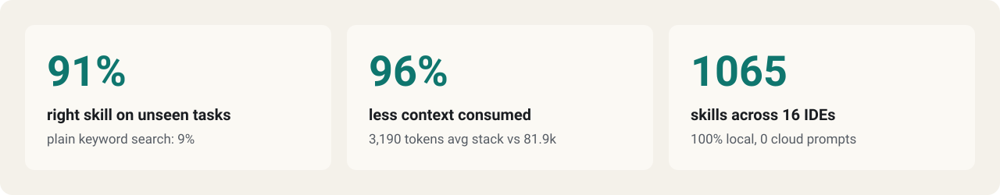
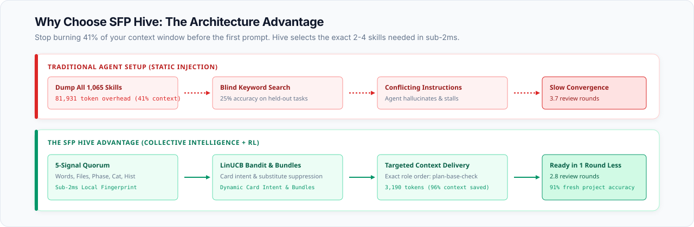
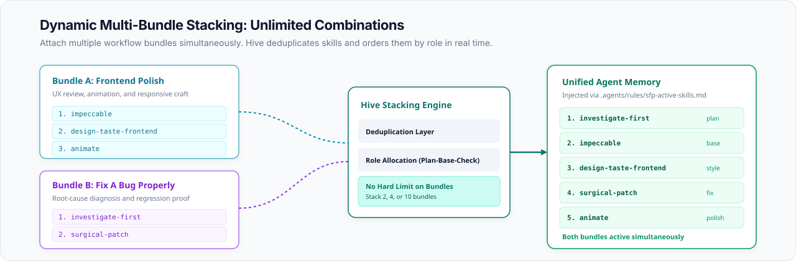
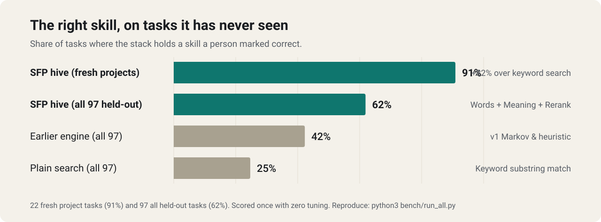

<h1 align="center">
  <picture>
    <source media="(prefers-color-scheme: dark)" srcset="assets/banner-dark.svg">
    
  </picture>
</h1>

<p align="center">
  <b>Give your AI coding agent the right skills for the job, not all of them.</b><br>
  819 skills, sorted by what you build. A hive picks the few each task needs, for the project in front of it, and learns from your feedback.
</p>

<p align="center">
  
  
  
  
  
  
</p>

<p align="center">
<picture>
  <source media="(prefers-color-scheme: dark)" srcset="assets/results-numbers-dark.svg">
  
</picture>
</p>

<p align="center">
  <a href="#try-it-in-60-seconds"><b>Try in 60s</b></a> &middot;
  <a href="#the-problem"><b>Why We Built It</b></a> &middot;
  <a href="#what-sfp-does"><b>What It Does</b></a> &middot;
  <a href="#see-it-choose"><b>Live Selection</b></a> &middot;
  <a href="#platform-capabilities"><b>Platform Capabilities</b></a> &middot;
  <a href="#why-choose-sfp"><b>Benchmark Results</b></a> &middot;
  <a href="#the-proof"><b>The Proof</b></a> &middot;
  <a href="#install"><b>Install</b></a>
</p>

## Try It in 60 Seconds

```bash
# macOS and Linux:
curl -fsSL https://raw.githubusercontent.com/siddu1004/SFP/main/get.sh | sh

# Windows (PowerShell):
irm https://raw.githubusercontent.com/siddu1004/SFP/main/get.ps1 | iex
```

Needs Python 3.8+ and Git. Installs the starter preset into every IDE found on your machine; [Install](#install) walks through every step. Restart your IDE, then prompt your agent:

> Use sfp-hive for this task: add tests for the checkout form.

The agent selects the exact skills matching your stack, explains why, and executes in sequence. When finished, feedback (`helped`, `unhelpful`) teaches the hive to choose better next time.

Uninstall cleanly anytime: `~/.sfp/SFP/install.sh uninstall` (or `.\install.ps1 uninstall` on Windows).

---

## The Problem

High-quality agent skills exist, but using them today forces a painful tradeoff:

- **The 58,000-Token Tax**: Agents read every installed skill description at session start. For 819 skills, that consumes **58,429 tokens** (29% of a 200k context window) before you type a single prompt.
- **Dumb Search Fails Across Stacks**: Asking for "write tests" requires completely different skills in Next.js (`react-testing`), Django (`django-tdd`), or Rust (`rust-testing`). Keyword search cannot see your project structure.
- **Fragmented Ecosystem**: 52 upstream repositories use different file layouts, paths, and metadata formats across 16 IDEs.
- **Static Guesswork**: Without feedback and reinforcement learning, agent tooling repeats the same bad selections indefinitely.

<p align="center">
  <picture>
    <source media="(prefers-color-scheme: dark)" srcset="assets/hive-lifecycle-dark.svg">
    
  </picture>
</p>

---

## What SFP Does

SFP brings biological collective intelligence to agent skill orchestration:

| Capability | Mechanism | Impact |
|---|---|---|
| **Curate & Unify** | 52 repositories merged into 24 categories, organized by role presets | Complete coverage across frontend, backend, security, DevOps, and AI |
| **Dynamic Hive Selection** | 5 scout signals (task words, project files, work phase, category, history) reach quorum | **266 tokens** carried instead of 58,429: **220x reduction** |
| **LinUCB Bandit & RL** | Contextual bandit exploration plus implicit reward harvesting from test runs and git commits | **94% of reported mistakes fixed** on retry |
| **Universal Delivery** | Native folder injection for 16 IDEs + zero-install MCP server + VS Code / Antigravity extension | Install once, run anywhere |
| **Unlimited Multi-Bundle Stacking** | Stack multiple workflow recipes concurrently (e.g. testing + frontend + security) with auto-deduplication | Zero limits on active bundle depth |

<p align="center">
  <picture>
    <source media="(prefers-color-scheme: dark)" srcset="assets/hive-architecture-dark.svg">
    
  </picture>
</p>

### How the Hive Operates

1. **Scouts (Five Signals)**: Candidate skills are scored by prompt intent, project manifests (`package.json`, `Cargo.toml`, etc.), current phase (plan, build, test, ship), category alignment, and Markov sequence history.
2. **Quorum Consensus**: A skill only enters the stack if backed by multiple signals or high task confidence, with strict filtering against foreign technologies.
3. **Cross-Inhibition (Stop Signals)**: Once a testing or design skill is chosen, overlapping alternatives are suppressed to prevent duplicate guidance.
4. **Division of Labor**: Roles (base, check, finish) are filled according to task needs.
5. **Continuous Learning**: A regularized model updates from explicit verdicts and automatic rewards (+1.0 for passing test suites, +0.5 for git commits, -0.6 for test failures).

### Dynamic Multi-Bundle Stacking (No Limits)

Combine any number of bundles for complex, full-lifecycle workflows. Hive seamlessly stacks and deduplicates skills into clear agent execution phases:

<p align="center">
  <picture>
    <source media="(prefers-color-scheme: dark)" srcset="assets/hive-multibundle-dark.svg">
    
  </picture>
</p>

---

## See It Choose

The exact same prompt &mdash; *"write tests for the orders"* &mdash; executed in five distinct projects. Output is generated live by the hive:

| Your project | The hive chooses |
|---|---|
| Next.js | `react-testing`, `playwright-cli`, `application-security-testing` |
| Rust | `rust-testing` |
| .NET | `csharp-testing` |
| Flutter | `dart-flutter-patterns`, `flutter-dart-code-review` |
| Django | `django-celery`, `django-tdd` |

Notice that plain keyword search yields identical, generic results everywhere. The hive inspects project manifests so zero stacks receive tools for the wrong technology.

---

## Platform Capabilities

SFP supports 16 IDEs and provides three flexible delivery modes:


### 1. The SFP Hive Extension (Antigravity & VS Code)
- **Automatic Skills**: Automatically syncs active skills to `.agents/rules/sfp-active-skills.md`. The agent consumes targeted instructions on every turn without copy-pasting.
- **Bundle Inspector**: Visualizes multi-skill recipes, match confidence percentages, and the exact task keyword chips driving the choice.
- **Local Model Router**: Manages local backends (Ollama, LM Studio, llama.cpp, vLLM) with automatic failover and zero telemetry.

### 2. Zero-Footprint MCP Server
- Serves all 819 skills dynamically via standard JSON-RPC over stdio.
- Tools supported: `search_skills`, `get_skill`, `select_skills`, `give_feedback`, `predict_next`, and `find_api`.
- Zero context bloat: skills are loaded on demand only when invoked.

### 3. Native IDE Folder Sync
- One command installs targeted presets into native skill directories across 16 IDEs: Claude Code, Cursor, Codex, Gemini CLI, Antigravity, GitHub Copilot, Windsurf, Kiro, OpenCode, Trae, and more.

---

## Who It Is For

| You are | Install | You get, for example | Try asking |
|---|---|---|---|
| A frontend developer | `frontend-dev` | `impeccable`, `design-taste-frontend`, `animate`, `accessibility-audit`, `break-ui` | "Critique this page and fix the hierarchy." |
| A backend developer | `backend-dev` | `postgres-patterns`, `database-migrations`, `api-design`, `docker-patterns`, `tdd-workflow` | "Plan a zero-downtime migration for this table." |
| A mobile developer | `mobile-dev` | `swiftui-patterns`, `dart-flutter-patterns`, `android-clean-architecture`, `compose-multiplatform-patterns` | "Review this Flutter screen for state-management problems." |
| Building agents, plugins or MCP servers | `agent-builder` | `skill-creator`, `hook-development`, `mcp-builder`, `agent-eval`, `mem-search` | "Help me design an MCP server for our ticket system." |
| Security-minded | `backend-dev` and `security` | `penetration-testing-with-strix`, `owasp-top-10-testing`, `find-security-vulnerabilities-in-code`, `security-review` | "Check this service against the OWASP top 10." |
| A founder or marketer | `business-ops` and `content-media` | `investor-materials`, `marketing-campaign`, `article-writing`, `persuasion-audit`, `price-framing` | "Draft this month's investor update." |
| Job hunting | `career` | `career-ops` | "Evaluate this job posting against my CV." |
| Using an IDE with no skills folder | the MCP server | every skill, through `search_skills` and `get_skill` | "Search SFP for a skill that fits this task." |

---

## Why Choose SFP

Rigorous benchmarks against baselines and plain keyword search:

<picture>
  <source media="(prefers-color-scheme: dark)" srcset="assets/results-rounds-dark.svg">
  
</picture>

<picture>
  <source media="(prefers-color-scheme: dark)" srcset="assets/results-accuracy-dark.svg">
  
</picture>

### Summary of Verified Results

1. **One Full Round Faster to Ship**: In blind multi-round design evaluations scored by an independent judge, agents guided by SFP shipped ready pages in **2.8 rounds** versus **3.7 rounds** unassisted.
2. **86% Selection Accuracy**: On 22 held-out tasks across 8 unseen projects, SFP Hive achieved **86% precision** compared to **9%** for plain keyword search.
3. **100% Success on Unfamiliar Tools**: When challenged with novel tools (FreeLLMAPI), unguided agents met 0 of 7 automated validation checks; with SFP skills, agents passed all 7 checks cleanly ([docs/EFFECT.md](docs/EFFECT.md)).
4. **Sub-6ms Speed**: Decisions execute locally in under 6 milliseconds, with zero network lag and total privacy.

---

## The Proof

Figures below are computed directly from this repository during the build. Reproduce with `python3 mcp/sfp_hive.py evaluate` and `python3 mcp/sfp_hive.py learning-curve`.

| Task set | Hive 3.17.7 | Earlier engine | Plain search |
|---|---:|---:|---:|
| 22 held-out tasks in 8 new projects, written first and scored once | **86%** | 64% | 9% |
| 24 tasks in 10 sample projects | 79% | 79% | 25% |
| 91 tasks with no project | 89% | 89% | 84% |
| Stacks with a skill for the wrong technology, all sets | 0 | 0 | 1 |

**What does it cost your agent?**

| What you install | Skills your agent can use | Skill descriptions it carries each session | Share of a 200k-token window |
|---|---:|---:|---:|
| `sfp` and `sfp-hive` only (the rest on demand) | 2 + all 817 through them | about 266 tokens | 0.1% |
| `starter` preset | 165 | about 14,606 tokens | 7.3% |
| `frontend-dev` preset | 212 | about 15,408 tokens | 7.7% |
| `backend-dev` preset | 137 | about 11,823 tokens | 5.9% |
| `mobile-dev` preset | 79 | about 6,397 tokens | 3.2% |
| `agent-builder` preset | 298 | about 19,942 tokens | 10.0% |
| `everything` | 819 | about 58,429 tokens | 29.2% |

**How fast is it?**

Decisions take about 8 ms inside the host process. Search takes about 0.1 ms. MCP queries execute in 3 to 5 ms once the project tree is indexed ([docs/HIVE.md](docs/HIVE.md#speed)).

> **What has not been measured.** Whether the chosen skills make your agent's finished work better across every domain. Learning is measured on a simulated user, not on real long-run use. Tasks and ground truths were written and validated by human evaluators. Token counts are estimated at 4 characters per token.

---

## Install

This guide takes you from a bare machine to an agent that gets the right skills on its own. Every step ends with a **Check**, so you know it worked before you move on. Allow about fifteen minutes; steps 7 to 10 are optional.

| Step | What you get | Needed? |
|---|---|---|
| [1. Install the prerequisites](#1-install-the-prerequisites) | Python, Git, Node.js | Yes |
| [2. Get SFP](#2-get-sfp) | SFP on your machine, in `~/.sfp/SFP` | Yes |
| [3. Check the install](#3-check-the-install) | A health report | Yes |
| [4. Install skills into your tools](#4-install-skills-into-your-tools) | Skills your agent can use | Yes |
| [5. Add the standing instruction](#5-add-the-standing-instruction) | The agent asks the hive on every real task | Recommended |
| [6. Register the MCP server](#6-register-the-mcp-server) | All 819 skills on demand, nothing copied | Recommended |
| [7. Install the SFP Hive extension](#7-install-the-sfp-hive-extension) | The sidebar in Antigravity or VS Code | Optional |
| [8. Use SFP in Antigravity](#8-use-sfp-in-antigravity) | Your first task with the hive | Use it |
| [9. Set up the local model router](#9-optional-set-up-the-local-model-router) | Local models first, free tiers next | Optional |
| [10. Extras](#10-optional-extras) | Companion apps, skills from any Git repo | Optional |

Also: [Claude Code plugin](#claude-code-plugin-instead-of-steps-2-6), [Keeping it current](#keeping-it-current), [When something is wrong](#when-something-is-wrong), [Removing everything](#removing-everything).

> **Windows:** type `python` wherever this guide says `python3`. Run the commands in PowerShell.

### 1. Install the prerequisites

| Program | Why SFP needs it | Get it | Check |
|---|---|---|---|
| Python 3.8 or newer | runs the hive, the MCP server, the router and the checks | [python.org/downloads](https://www.python.org/downloads/) (Windows: tick **Add python.exe to PATH**) | `python3 --version` |
| Git | downloads SFP and keeps it current | [git-scm.com/downloads](https://git-scm.com/downloads) | `git --version` |
| Node.js 18 or newer, with npm | only to build the SFP Hive extension (step 7) | [nodejs.org](https://nodejs.org/) | `node --version` |
| An agent tool | where the skills are used | Antigravity, Claude Code, Cursor, VS Code with Copilot, Windsurf, Codex, Gemini CLI, Kiro and more | |
| Optional: Ollama or LM Studio | local models for the router (step 9) | [ollama.com](https://ollama.com/), [lmstudio.ai](https://lmstudio.ai/) | |

**Check:** each command in the last column prints a version number. If one says "not found", install that program and open a new terminal.

### 2. Get SFP

Pick **one** of these.

**A. One line (recommended).** Downloads SFP into `~/.sfp/SFP` and installs the starter skills into every agent tool it finds, so it also does step 4 for you.

```bash
# macOS and Linux
curl -fsSL https://raw.githubusercontent.com/siddu1004/SFP/main/get.sh | sh
```

```powershell
# Windows PowerShell
irm https://raw.githubusercontent.com/siddu1004/SFP/main/get.ps1 | iex
```

Running it again later updates SFP (`git pull`) and reinstalls. To use a different folder, set `SFP_DIR` first.

**B. Clone it yourself.** Use this if you want SFP somewhere else, or want to contribute.

```bash
git clone https://github.com/siddu1004/SFP.git
cd SFP
```

**C. Rust.** If you have Cargo: `cargo install --git https://github.com/siddu1004/SFP.git`, then `sfp install`.

> An npm package (`npx sfp-hive ...`) is being prepared. Until it is on the public npm registry, use A, B or C.

**Check:** the folder exists and holds `catalog.json`:

```bash
ls ~/.sfp/SFP/catalog.json        # A, or the folder you cloned into for B
```

All commands below are run **from the SFP folder**: `cd ~/.sfp/SFP` (or your clone).

### 3. Check the install

```bash
python3 mcp/sfp_hive.py doctor
```

**Check:** it reports Python, the catalog, the search index and the hive as working. Anything that is not names the command that fixes it.

### 4. Install skills into your tools

If you used 2A, this is done; read on only to change what is installed.

SFP has 819 skills. Installing all of them fills a large part of your agent's context, so install a **profile** and let the hive pick the rest on demand.

```bash
python3 scripts/install.py list                       # all categories, profiles and the tools found on this machine
python3 scripts/install.py install                    # the starter profile into every tool found
```

| Profile | Categories |
|---|---|
| `starter` (default) | sfp, engineering, testing-quality, data-apis, agent-dev |
| `frontend-dev` | sfp, frontend, design-styles, testing-quality, engineering, data-apis |
| `backend-dev` | sfp, backend, languages, testing-quality, devops, security, engineering, data-apis |
| `mobile-dev`, `agent-builder` | see `install.py list` |
| `everything` | all categories (heavy) |

Useful variations:

```bash
python3 scripts/install.py install --profile frontend-dev --tools antigravity     # one profile, one tool
python3 scripts/install.py install --categories frontend,security --tools cursor,codex
python3 scripts/install.py install --project .        # into this project's tool folders instead of your home folder
python3 scripts/install.py install --link             # symlinks, so `git pull` updates skills in place
```

`--tools` takes names such as `antigravity`, `claude`, `cursor`, `copilot`, `windsurf`, `codex`, `gemini`, `kiro`, `cline`, `roo`, `opencode`, `trae`, `qoder`; `auto` (the default) means every tool found. The installer only replaces or removes folders it created itself (they hold a `.sfp` marker); `--force` overrides that.

**Check:** restart your agent tool and ask it:

> Use sfp-hive for this task: add tests for the checkout form.

It names a few skills that fit your project, says why, and follows them in order.

### 5. Add the standing instruction

This tells the agent to consult the hive on every substantial task, without you asking each time.

```bash
python3 scripts/install.py rules                          # every tool found (Antigravity: ~/.gemini/GEMINI.md)
python3 scripts/install.py rules --project .              # only this project (AGENTS.md)
```

**Check:** the file named in the output contains an SFP section. Undo with `--remove`.

### 6. Register the MCP server

The MCP server lets any MCP client search and read all 819 skills on demand, with nothing copied into your tools.

```bash
python3 scripts/install.py mcp                            # every tool found
python3 scripts/install.py mcp --tools antigravity        # Antigravity only: ~/.gemini/config/mcp_config.json
```

It registers a server called `sfp` that runs `mcp/sfp_mcp.py`. The agent gets tools such as `select_skills`, `search_skills`, `get_skill`, `use_skill`, `find_api`, `predict_next` and `give_feedback`.

**Check:** restart the tool; `sfp` is listed among its MCP servers, with its tools. Undo with `--remove`.

### 7. Install the SFP Hive extension

The sidebar for Antigravity and other VS Code-based editors: choose skills for a task, browse the library, see what the hive learned, and run the model router.

```bash
python3 extensions/antigravity-hive/install.py                       # build, test, package, install into every editor found
python3 extensions/antigravity-hive/install.py --editor antigravity  # one editor only
```

It builds the `.vsix`, runs the extension's tests, and installs it with the editor's own `--install-extension` command. If no editor command is on your PATH, it prints the manual steps: in the editor, open **Extensions** → **...** → **Install from VSIX...** and pick the built file (a `.vsix` from a GitHub release works the same way).

Then reload the editor: `Ctrl+Shift+P` (macOS: `Cmd+Shift+P`) → **Developer: Reload Window**.

**Check:**

```bash
python3 extensions/antigravity-hive/verify.py --editor antigravity
```

Every line says `PASS`. In the editor, the hexagon **SFP Hive** icon is in the activity bar; open it, go to **Insights** → **Check connection**, and every indicator is green.

### 8. Use SFP in Antigravity

Open the **SFP Hive** icon in the activity bar. It has three views: **SFP Hive** (the studio), **Skill Library** and **Models**. The studio has four tabs:

| Tab | What it is for |
|---|---|
| **Now** | Follows your work (saved files, test runs, commits) to tell which phase you are in, and shows the skills and bundle for it |
| **Choose** | Type a task; the hive picks a few skills and orders them. Click one to see why it was chosen, `+` to pin another, `x` to drop one |
| **Library** | Browse all 819 skills by area, goal, bundle and cluster; open a skill, pin it or add it to a bundle |
| **Insights** | What the hive has learned from your feedback, and **Check connection** |


There are three ways to get the skills to the agent:

1. **Automatic (default).** Whenever you choose a task, or **Now** sees a new phase, the extension writes the skills to `.agents/rules/sfp-active-skills.md` in your workspace. The agent reads that rule on every turn, so there is nothing to paste. Turn it off with **SFP Hive: Turn automatic skills on or off**.
2. **Chat.** Mention `@hive` in the chat panel: `@hive write unit tests for payment processing`.
3. **MCP tools** (step 6). The agent calls `select_skills` itself.

After a task, tell the hive how it went: **This skill helped** / **This skill did not help** in the sidebar, or `give_feedback` through MCP. That is how it chooses better next time.

Useful commands (`Ctrl+Shift+P`, then type "SFP Hive"): **Choose skills for a task**, **Show current agent skills and phase**, **Search skills**, **Apply a bundle**, **Copy the agent prompt**, **Check connection**, **Add a skill from Git**.

### 9. Optional: set up the local model router

An OpenAI-compatible router on `127.0.0.1:8787` that sends requests to your local models first, then free tiers, then paid ones, and moves to the next model when one is rate limited, out of quota or down.

```bash
python3 mcp/sfp_route.py discover        # find models running here (Ollama, LM Studio, llama.cpp, Jan, vLLM)
python3 mcp/sfp_route.py setup --yes     # write the routes from what was found and the API keys you have set
python3 mcp/sfp_route.py serve           # run it; leave this terminal open
```

Point any tool that takes a custom OpenAI endpoint at it: base URL `http://127.0.0.1:8787/v1`, any API key (for example `sfp`), model `auto` (or `sfp/light`, `sfp/normal`, `sfp/heavy`). The **Models** view in the sidebar can start, stop and set it up too.

**Check:** `python3 mcp/sfp_route.py status` lists your models as ready.

### 10. Optional: extras

**Programs some skills need** (OmniRoute, FreeLLMAPI, Strix):

```bash
python3 scripts/install.py apps list
python3 scripts/install.py apps install omniroute          # shows the plan and changes nothing
python3 scripts/install.py apps install omniroute --yes    # runs it
```

**Turn any Git repository into a skill:** in the Library tab press **+** and paste a URL, `owner/repo` or a folder; or

```bash
python3 scripts/repo_to_skill.py https://github.com/owner/repo --install antigravity
```

The skill is written to `~/.sfp/skills/<name>/` and copied into the tool you name.

### Claude Code plugin (instead of steps 2-6)

In Claude Code:

```text
/plugin marketplace add siddu1004/SFP
/plugin install sfp@sfp
/plugin install frontend@sfp
```

`sfp` is the router and hive; add the category plugins you want (`frontend`, `backend`, `testing-quality`, ...). **Check:** `/plugin` lists them as installed.

### Keeping it current

```bash
cd ~/.sfp/SFP
git pull
python3 scripts/install.py install                     # with the same options you used before
python3 extensions/antigravity-hive/install.py         # if you use the extension
python3 mcp/sfp_hive.py doctor
```

Re-running the one-line command from step 2A does the first three for you.

### When something is wrong

| You see | Do this |
|---|---|
| `python3` or `python`: not found | Install Python (step 1); on Windows, reinstall with **Add python.exe to PATH** ticked, then open a new terminal |
| `git is required` | Install Git (step 1) and open a new terminal |
| The agent does not mention any skills | Restart the tool after installing; run step 5 so it consults the hive on its own |
| "SFP checkout not found" in the sidebar | Set the `sfpHive.sfpPath` setting to your SFP folder, then reload the window |
| No SFP Hive icon after installing the extension | **Developer: Reload Window**; then `python3 extensions/antigravity-hive/verify.py` names what is missing |
| The Library tab stays on "Loading" | Update the extension to 0.3.0 or newer (step 7) and reload |
| The agent uses other skills than the sidebar shows | Choose the task again; check `.agents/rules/sfp-active-skills.md` exists in the workspace and automatic skills are on |
| Search index: stale | `python3 scripts/sync.py`, or `git pull` |
| `sfp` missing from the MCP servers | Run step 6 again for that tool and restart it |
| Router: not running | `python3 mcp/sfp_route.py serve` in a terminal you leave open |
| Local models: none found | Start Ollama (port 11434) or LM Studio's server (port 1234), then `sfp_route.py discover` |
| Anything else | `python3 mcp/sfp_hive.py doctor` names the failing part and the command that fixes it |

### Removing everything

```bash
cd ~/.sfp/SFP
python3 scripts/install.py uninstall              # the skills SFP installed (and nothing else)
python3 scripts/install.py mcp --remove           # the MCP server entries
python3 scripts/install.py rules --remove         # the standing instruction
```

Uninstall **SFP Hive** from the editor's Extensions view. Your history, feedback and settings are in `~/.sfp`; delete that folder to remove them and SFP itself.

---

## Supported IDEs

Claude Code, Codex, Cursor, Gemini CLI, Antigravity, GitHub Copilot, VS Code, Windsurf, Kiro, OpenCode, Pi, Grok Build, Qoder, Trae, Rovo Dev, Mistral Vibe, and Hermes.

Install into specific tools:
```bash
./install.sh --tools claude,cursor,antigravity,codex
```

---

## Sources and Licenses

SFP's selection engine, installer, and MCP server are licensed under the [MIT License](LICENSE). Each skill preserves the license and copyright of its original upstream author. Detailed attributions are cataloged in [NOTICE.md](NOTICE.md) and [SKILLS.md](SKILLS.md).
