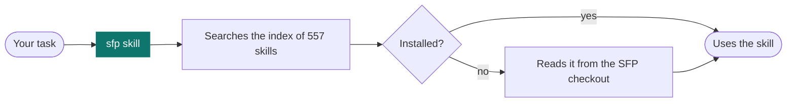

<h1 align="center">
  <picture>
    <source media="(prefers-color-scheme: dark)" srcset="assets/banner-dark.svg">
    
  </picture>
</h1>

<p align="center">
  <b>SFP gives your AI coding agent 557 skills, sorted by what you build.</b><br>
  Install a handful. One skill, <code>sfp</code>, finds the rest.
</p>

<p align="center">
  
  
  
  
</p>

## Quick Start

Install the starter set into every IDE it finds (macOS and Linux):

```bash
curl -fsSL https://raw.githubusercontent.com/siddu1004/SFP/main/get.sh | sh
```

Restart your IDE, then give your agent a task. `sfp` picks the skill.

Want your IDE to reach every skill without installing it? Add the MCP server too:

```bash
curl -fsSL https://raw.githubusercontent.com/siddu1004/SFP/main/get.sh | sh -s -- mcp
```

It registers `sfp` in each IDE it finds and keeps your other MCP servers. See [MCP Server](#mcp-server) for Windows and the tools it adds.

On Windows or in Claude Code? See [Windows](#windows) and [Claude Code](#claude-code). For presets and single IDEs, see [all install options](#install).

## How It Works

A skill is a folder with a `SKILL.md` that an agent loads when a task matches.

Agents read the description of every installed skill when a session starts. 557 descriptions is too many to carry. So you install `sfp` plus the categories you use daily, and `sfp` handles the rest:



In words: `sfp` searches an index of every skill. If the skill is installed, your agent uses it. If not, `sfp` reads it straight from this checkout. The installer saves the checkout path in `~/.sfp/root` so it can.

What you get:

- **Skills sorted by what you build.** 23 categories, from frontend and backend to security and agents.
- **One install line for 16 IDEs and CLIs.** Claude Code gets plugins. Every other tool gets plain skill folders.
- **Presets.** Pick `frontend-dev`, `backend-dev`, `mobile-dev` or `agent-builder`, or take them all.
- **Safe installs.** The installer only touches folders it created. Your own skills stay as they are.
- **A free API finder.** Your agent can search about 2,100 APIs and filter by auth, HTTPS and CORS.
- **An [MCP server](#mcp-server).** Tools that support MCP can reach every skill without installing any.

## Install

Everything needs `git`. Outside Claude Code's plugin route it also needs Python 3.

### macOS and Linux

Choose what to install:

```bash
# Everything, into every IDE found
curl -fsSL https://raw.githubusercontent.com/siddu1004/SFP/main/get.sh | sh -s -- --profile everything

# One IDE, one preset
curl -fsSL https://raw.githubusercontent.com/siddu1004/SFP/main/get.sh | sh -s -- --tools cursor --profile frontend-dev
```

### Windows

In PowerShell:

```powershell
irm https://raw.githubusercontent.com/siddu1004/SFP/main/get.ps1 | iex
```

To choose what to install:

```powershell
& ([scriptblock]::Create((irm https://raw.githubusercontent.com/siddu1004/SFP/main/get.ps1))) --tools cursor --profile frontend-dev
```

### Claude Code

Run these inside Claude Code:

```text
/plugin marketplace add siddu1004/SFP
/plugin install sfp@sfp
/plugin install frontend@sfp
```

Replace `frontend` with any category from the [category list](#pick-a-preset). Plugins update with `/plugin update`.

### From a clone

<details>
<summary>Read the installer first, then run it</summary>

```bash
git clone https://github.com/siddu1004/SFP.git && cd SFP
./install.sh list                                  # categories, presets, tools found
./install.sh --profile backend-dev                 # a preset
./install.sh --categories security,devops,memory   # exact categories
./install.sh --tools cursor,codex                  # only these tools
./install.sh --project .                           # into this project's tool folders
./install.sh --link                                # symlink, so git pull updates skills (macOS, Linux)
./install.sh uninstall --tools cursor              # remove what it installed
```

On Windows, use `.\install.ps1` in place of `./install.sh`.
</details>

### Let your agent install it

<details>
<summary>Paste this prompt into any agent</summary>

> Clone https://github.com/siddu1004/SFP, run its `install.sh` (or `install.ps1` on Windows) with `--tools <this tool>`, then restart me so the skills load.
</details>

To update, run the same install line again. The installer replaces only folders it created. A skill you made with the same name stays unless you add `--force`.

## Pick a Preset

| Preset | Good for | Categories |
|---|---|---|
| `starter` | A first install: the router, engineering practice, testing, data APIs and agent-building tools. This is the default. | `sfp` `engineering` `testing-quality` `data-apis` `agent-dev` |
| `frontend-dev` | UI, design styles, testing and engineering practice. | `sfp` `frontend` `design-styles` `testing-quality` `engineering` `data-apis` |
| `backend-dev` | Services and databases, languages, DevOps and security. | `sfp` `backend` `languages` `testing-quality` `devops` `security` `engineering` `data-apis` |
| `mobile-dev` | Android, iOS, Flutter and React Native. | `sfp` `mobile` `languages` `testing-quality` `engineering` |
| `agent-builder` | Agents, MCP and plugins, AI, gateways and memory. | `sfp` `agents` `agent-dev` `ai-ml` `ai-gateway` `data-apis` `memory` |
| `everything` | Every category. Heavy: expect your agent to carry hundreds of descriptions. | all |

<details>
<summary>All 23 categories</summary>

| Category | Skills | What is in it |
|---|---:|---|
| `sfp` | 1 | The router: finds the right skill for any task, installed or not. |
| `frontend` | 62 | UI design and components, motion, accessibility, UX research and critique, React, Vue, Next.js, Angular, Vite. Includes Impeccable, the Taste skills, Emil Kowalski's animation skills and the Vercel web interface guidelines. |
| `design-styles` | 67 | 67 named visual styles to build in: brutalism, glassmorphism, editorial, retro, shadcn and more. |
| `backend` | 27 | Backend frameworks, APIs and databases (Django, FastAPI, Spring Boot, Laravel, NestJS, Rails, Postgres, Redis, Prisma). |
| `mobile` | 13 | Android, iOS, Flutter, React Native, Kotlin Multiplatform and Swift. |
| `languages` | 8 | Language idioms, standards and testing for Go, Rust, Python, C++, C#, F#, Java, Kotlin, Perl and .NET. |
| `testing-quality` | 32 | TDD, end-to-end tests, verification loops, code review, regression and quality gates. |
| `devops` | 15 | Docker, Kubernetes, deployment, git and GitHub workflows, terminals, green-PR and merge automation. |
| `security` | 21 | Strix autonomous pentesting, OWASP testing, secure coding for each framework, and agent security hardening. |
| `agents` | 33 | Agent-driven work: autonomous loops, orchestration, councils, dev teams, planning and feature pipelines. |
| `agent-dev` | 62 | Building for agents: skills, plugins, hooks, MCP servers, harnesses, token budgets, context compression and Cowork plugin tools. |
| `ai-ml` | 10 | LLM pipelines, prompts, evals, RAG, PyTorch, ML engineering, recommender systems and AI media. |
| `ai-gateway` | 45 | Driving an OmniRoute AI gateway: routing, providers, budgets, caching, compression, MCP and A2A. |
| `data-apis` | 7 | About 2,100 free APIs you can search, FreeLLMAPI, internet reach across 16 platforms, search and scraping. |
| `content-media` | 26 | Writing, marketing and persuasion audits, SEO, video, slides, social posting, brand guidelines, canvas and generative art. |
| `business-ops` | 27 | Billing, finance, investors, market research, leads, contracts, email, tickets, internal comms and a chief-of-staff ops check. |
| `industry` | 13 | Domain playbooks: healthcare (HIPAA, EMR, CDSS), logistics, customs, inventory, production and energy. |
| `networking` | 10 | Network engineering and homelab: Cisco IOS, BGP, VLANs, WireGuard, Pi-hole, config validation. |
| `research-docs` | 18 | Deep research, scientific databases, literature review, docs, ADRs and a teach-me tutor. |
| `web3` | 9 | DeFi, EVM, prediction markets, Itô baskets and compute, and trading-agent security. |
| `engineering` | 15 | General engineering practice: architecture, standards, error handling, performance, benchmarks and refactoring. |
| `science-hardware` | 6 | Math proof and olympiad work, Blender, and M5Stack and Cardputer hardware. |
| `memory` | 30 | claude-mem's skills: search past work, timelines, handoffs and planning with persistent memory. |
| `career` | plugin | AI job search: evaluate offers, tailor CVs, scan job portals and track applications. Runs from its own checkout. |
| `session-memory` | plugin | Persistent memory across Claude Code sessions (claude-mem), with search, timelines and handoffs. Claude Code only: it needs claude-mem's hooks and worker. |
</details>

## Supported IDEs

Claude Code, Codex, Cursor, Gemini CLI, Antigravity, GitHub Copilot, Windsurf, Kiro, OpenCode, Pi, Grok Build, Qoder, Trae, Rovo Dev, Mistral Vibe and Hermes.

Name them with `--tools`:

```text
claude codex cursor gemini antigravity copilot windsurf kiro opencode pi grok qoder trae rovodev vibe hermes
```

<details>
<summary>Where each tool keeps its skills</summary>

| Tool | Your home folder | A project (`--project`) |
|---|---|---|
| Claude Code | `~/.claude/skills` (or plugins) | `.claude/skills` |
| Codex | `~/.agents/skills` | `.agents/skills` |
| Cursor | `~/.cursor/skills` | `.cursor/skills` |
| Gemini CLI | `~/.gemini/skills` | `.gemini/skills` |
| Antigravity | `~/.gemini/config/skills` | `.agent/skills` |
| GitHub Copilot | `~/.copilot/skills` | `.github/skills` |
| Windsurf | `~/.codeium/windsurf/skills` | `.windsurf/skills` |
| Kiro | `~/.kiro/skills` | `.kiro/skills` |
| OpenCode | `~/.config/opencode/skills` | `.opencode/skills` |
| Pi | `~/.pi/agent/skills` | `.pi/skills` |
| Grok Build, Qoder, Trae, Rovo Dev, Vibe, Hermes | `~/.<tool>/skills` | `.<tool>/skills` |

A tool counts as found when its home folder exists, for example `~/.cursor`. Use `--tools` to install into one that is not found yet.

I could not confirm the Windsurf and Copilot paths against their docs. If one is wrong for your version, fix it in the `TOOLS` table in `scripts/install.py`.
</details>

## Free APIs

The `public-apis` skill bundles a list of about 2,100 free APIs in 51 categories, plus a search script. Your agent can run it directly:

```bash
python3 plugins/data-apis/skills/public-apis/scripts/find_api.py weather --auth none --cors yes
python3 plugins/data-apis/skills/public-apis/scripts/find_api.py --category Finance --limit 10
python3 plugins/data-apis/skills/public-apis/scripts/find_api.py --categories
```

Filters: `--auth none|apiKey|OAuth`, `--cors yes|no`, `--https yes|no` and `--json`. It needs only Python 3.

## MCP Server

SFP also runs as an MCP server. Any MCP client can search and read all 557 skills on demand, with nothing copied into a skills folder. This helps IDEs and agents that support MCP but not skills.

Register it in your IDEs with one command. It fetches SFP first if you do not have it:

```bash
curl -fsSL https://raw.githubusercontent.com/siddu1004/SFP/main/get.sh | sh -s -- mcp
```

On Windows, in PowerShell:

```powershell
& ([scriptblock]::Create((irm https://raw.githubusercontent.com/siddu1004/SFP/main/get.ps1))) mcp
```

To pick IDEs, add `--tools cursor,claude`. To undo it, add `--remove`. SFP lives in `~/.sfp/SFP`, so later you can run `~/.sfp/SFP/install.sh mcp`, or `./install.sh mcp` from a clone.

Claude Code by hand:

```bash
claude mcp add --scope user sfp -- python3 /path/to/SFP/mcp/sfp_mcp.py
```

Any other MCP client: add a stdio server that runs `python3 /path/to/SFP/mcp/sfp_mcp.py`.

| Tool | What it does |
|---|---|
| `search_skills` | Finds skills by task or keyword, optionally within one category |
| `get_skill` | Returns a skill's full `SKILL.md` and the files it bundles |
| `read_skill_file` | Reads one bundled file, such as a reference doc or script |
| `list_categories` | Lists categories, skill counts and install presets |
| `find_api` | Searches the free API list by keyword, auth, CORS and HTTPS |
| `install_command` | Gives the command that installs a category or preset for good |

Every skill is also a resource at `sfp://skill/{name}`, and two prompts, `use_skill` and `find_skill_for`, load a skill into a chat.

The server is read-only, needs only Python 3 and makes no network calls. A skill it returns is third-party instruction text that your agent will follow, so the same trust applies as when you install it.

I tested it with Claude Code, including a real session that found and read a skill through the tools. The Cursor, Gemini CLI, Windsurf, Kiro and Codex settings follow each tool's documented format but were not run against those tools.

## Good to Know

- **career** runs from its own checkout in `~/.sfp/apps/career-ops`. Run `npm install` there once. Your CV, tracker and reports live in `~/career-ops`, so updates never touch them.
- **session-memory** needs Claude Code's hooks and a background worker, so other IDEs skip it. The `memory` skills expect claude-mem, so most need it installed.
- **ai-gateway** skills drive an OmniRoute server. **security** skills drive the Strix CLI. Each skill explains how to set up what it needs.
- **Impeccable** (in `frontend`) downloads its engine on first use.

## Keep It Fresh

Pull the latest skills from every source into SFP, then commit the result:

```bash
python3 scripts/sync.py            # rebuild the plugins, catalog, README and banner
python3 scripts/sync.py --report   # also show what each category got
```

- **Add a source:** add an entry to `sources.json` with `repo`, `license`, a `default` category and `skills` paths, then sync.
- **Move a skill:** add its name to `names` in `categories.json`, or adjust a pattern, then sync.
- **Add a category:** add it under `categories` in `categories.json`. Names cannot start with `claude-` or `anthropic-`.

The README, banner, `plugins/`, `catalog.json` and `SKILLS.md` are generated. Edit `templates/README.md.tpl` and the JSON files, not the outputs.

## Sources and Licenses

Each skill keeps the license of the project it came from. [NOTICE.md](NOTICE.md) lists every source, and each category folder holds copies of its licenses in `plugins/<category>/LICENSES/`. The full skill list is in [SKILLS.md](SKILLS.md).

<details>
<summary>Where every source landed (23 sources)</summary>

Every skill in these repos is in SFP, except test fixtures and translated example copies. Repos with no skill of their own got one written for them. Plugins with no public repo are kept as snapshots in `vendor/`.

SFP reads the original repos directly, and `sources.lock.json` records the exact commit of each one that was integrated. It does not depend on anyone's fork, except that `career` installs from a fork branch.

| Source | Where it is in SFP |
|---|---|
| pbakaus/impeccable | `frontend`: Impeccable, 24 design commands |
| Imaidazo/taste-skill-plugin | `frontend`: the Taste skills |
| emilkowalski/skills | `frontend`: Emil Kowalski's skills |
| vercel-labs/web-interface-guidelines | `frontend`: a UI review checklist |
| design-skills | `frontend`: 10 UX design skills |
| bergside/awesome-design-skills | `design-styles` |
| usestrix/strix | `security` |
| anthropics/claude-plugins-official | `agent-dev` and others: every skill it ships. Its other plugins point to third-party repos |
| affaan-m/everything-claude-code | spread across `agents`, `agent-dev`, `backend`, `frontend`, `testing-quality` and more |
| diegosouzapw/OmniRoute | `ai-gateway`, plus 6 maintenance skills in `devops` |
| thedotmack/claude-mem | `memory`, and the optional `session-memory` plugin |
| Panniantong/Agent-Reach | `data-apis` |
| public-apis/public-apis | `data-apis`: a searchable skill over about 2,100 free APIs |
| tashfeenahmed/freellmapi | `data-apis`: a skill with the project's docs |
| harry0703/MoneyPrinterTurbo | `content-media` |
| marketing-psychology | `content-media`: 5 persuasion and behavior skills |
| Anthropic example skills | 8 Apache-2.0 skills: algorithmic art, brand guidelines, canvas design, internal comms, MCP builder, Slack GIF creator, theme factory, web artifacts builder |
| teach-me | `research-docs` |
| task-observer, headroom | `agent-dev` |
| cowork-plugin-management | `agent-dev` |
| gia-chief-of-staff | `business-ops` |
| career-ops-hq/career-ops | `career`, installed from its own repo |

**Left out on purpose:** anything whose license does not allow republishing. That covers Greenhouse's customer-only plugin, Anthropic's docx, pdf, pptx, xlsx and browser skills (all rights reserved), and the noncommercial-only `claude-mem-cowork` plugin.
</details>
