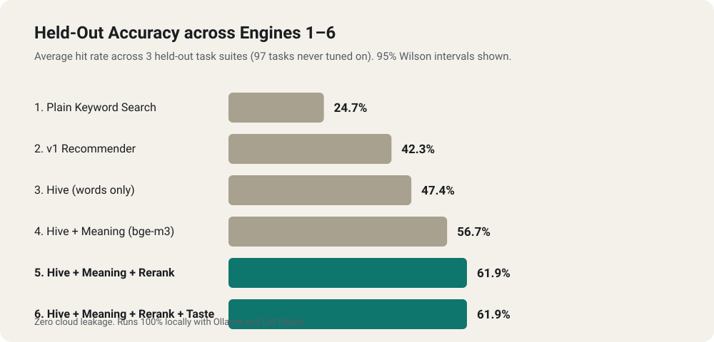
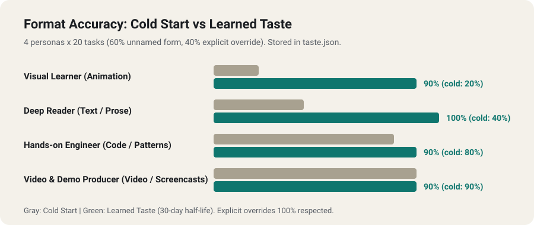
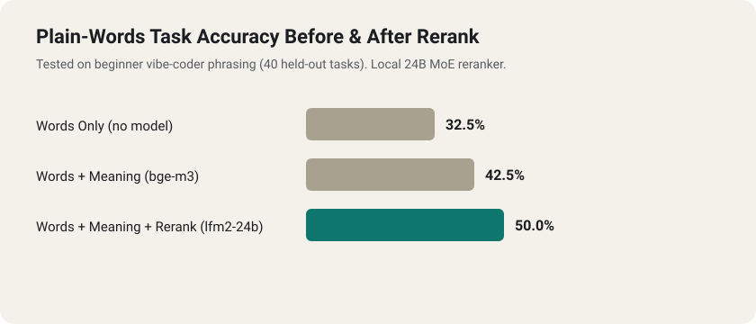
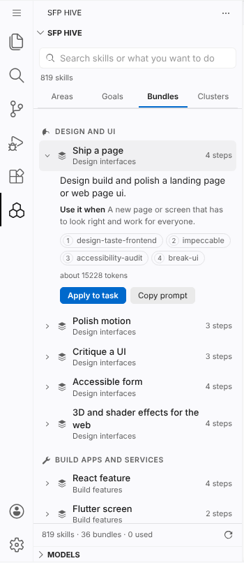

<h1 align="center">
  <picture>
    <source media="(prefers-color-scheme: dark)" srcset="assets/banner-dark.svg">
    
  </picture>
</h1>

<h3 align="center">The right skills for the job, not all of them.</h3>

<p align="center">
  1065 agent skills, one hive that picks the few each task needs.<br>
  It reads your project, understands what you mean, and learns how <i>you</i> like to work.
</p>

<p align="center">
  <a href="https://www.npmjs.com/package/sfp-hive"></a>
  
  
  
  
</p>

<p align="center">
  <code>npx sfp-hive install</code>
</p>

<table align="center">
  <tr>
    <td align="center" width="33%"><h3>62%</h3>right skill on tasks it never saw,<br>against <b>25%</b> for keyword search</td>
    <td align="center" width="33%"><h3>94%</h3>less context than loading<br>every skill's description</td>
    <td align="center" width="33%"><h3>0</h3>prompts sent to the cloud:<br>local models, on your machine</td>
  </tr>
</table>

<p align="center">
  <sub>Held-out figures from <a href="bench/RESULTS.md">bench/RESULTS.md</a> (version 3.19.0, words + meaning + rerank, 97 tasks never used for tuning).</sub>
</p>

<p align="center">
  <a href="#try-it-in-60-seconds"><b>Try it</b></a> &middot;
  <a href="#how-sfp-picks"><b>How it picks</b></a> &middot;
  <a href="#see-it-choose"><b>See it choose</b></a> &middot;
  <a href="#it-learns-how-you-learn"><b>It learns you</b></a> &middot;
  <a href="#the-proof"><b>The proof</b></a> &middot;
  <a href="#install"><b>Install</b></a>
</p>

---

## Try It in 60 Seconds

| Where you are | Run this |
|---|---|
| Any machine with Node.js | `npx sfp-hive install` |
| macOS and Linux | `curl -fsSL https://raw.githubusercontent.com/siddu1004/SFP/main/get.sh \| sh` |
| Windows PowerShell | `irm https://raw.githubusercontent.com/siddu1004/SFP/main/get.ps1 \| iex` |
| Claude Code | `/plugin marketplace add siddu1004/SFP`, then `/plugin install sfp@sfp` |

Needs Python 3.8+ (and Git for the one-line scripts). It installs the starter preset into every IDE it finds. Restart your IDE, then ask your agent:

> Use sfp-hive for this task: add tests for the checkout form.

The agent loads a few skills that fit your stack, says why it chose each one, and follows them in order. Tell it `helped` or `unhelpful` afterwards and the hive chooses better next time.

---

## The Problem

Great agent skills exist. Using them today means a bad trade.

- **The context tax.** An agent reads every installed skill's description at the start of each session. All 1065 cost **81,931 tokens**, 41% of a 200k window, before you type a word.
- **Search cannot see your project.** "Write tests" needs `react-testing` in Next.js, `django-tdd` in Django and `rust-testing` in Rust. A keyword search gives all three the same answer.
- **People do not talk in keywords.** "My app is slow when lots of people use it" shares no word with the skills that fix it.
- **Everyone learns differently.** Asked to explain a concept, one developer wants an animation, another wants clear prose. A fixed list cannot know which you are.

SFP fixes all four: it carries 266 tokens instead of 81,931 (**308x less**), reads your project, understands meaning, and learns your taste.

---

## How SFP Picks

<p align="center">
  <picture>
    <source media="(prefers-color-scheme: dark)" srcset="assets/hive-architecture-dark.svg">
    
  </picture>
</p>

Every task goes through five layers. Each one is optional except the first, and each runs on your machine.

| Layer | What it does | Needs |
|---|---|---|
| **1. Words and your project** | Five scouts vote on every candidate: the task's words, your project files (`package.json`, `Cargo.toml`, `go.mod` ...), the phase of work, the category and what usually comes next. A skill joins only with a quorum, and never one for the wrong technology. | Nothing |
| **2. Meaning** | A local embedding model finds skills close to what you *mean*, so "make the login not get hacked" still finds the security skills. | Ollama or LM Studio with `bge-m3` |
| **3. A model's judgement** | When the words are weak, a local chat model reads the 20 closest candidates and picks the best. It never overrules a skill that fits your project's technology. | A local chat model (`lfm2-24b-a2b` is fast) |
| **4. Skill cards** | Each of the 1065 skills has a card: its job, what it produces (code, text, animation, video, diagram ...), its style and depth. Two skills that do the same job are never stacked. | Nothing |
| **5. Your taste** | From your feedback, SFP learns which formats and skills help *you*, with a 30-day memory. A format you name in the task always wins over taste. | Your feedback |

<p align="center">
  <picture>
    <source media="(prefers-color-scheme: dark)" srcset="bench/charts/headline-dark.svg">
    
  </picture>
</p>

When nothing in the library fits, the hive says so instead of guessing, and offers to grow a skill for it from research ([It learns how you learn](#it-learns-how-you-learn)).

<details>
<summary><b>Stacking whole bundles</b></summary>
<br>

Bundles are named sets of skills for one job ("Fix a bug properly", "Accessible form"). When a task fits one well, the hive attaches it whole and in order; several can stack, with duplicates removed.

<p align="center">
  <picture>
    <source media="(prefers-color-scheme: dark)" srcset="assets/hive-multibundle-dark.svg">
    
  </picture>
</p>

</details>

---

## See It Choose

The same words, *"write tests for the orders"*, in five different projects. This table is generated by the hive itself every time the README is built:

| Your project | The hive chooses |
|---|---|
| Next.js | `react-testing`, `playwright-cli` |
| Rust | `rust-testing` |
| .NET | `csharp-testing` |
| Flutter | `dart-flutter-patterns`, `flutter-dart-code-review` |
| Django | `django-celery`, `django-tdd` |

A keyword search would give all five the same list. The hive reads each project, so no stack gets a skill for the wrong technology.

And the same question from people who work differently:

| What you ask | Who is asking | SFP picks | Why |
|---|---|---|---|
| *"explain how attention works in transformers"* | Learns from animation | `manim-video` | Their feedback favours animated explanations |
| *"explain how attention works in transformers"* | Learns from reading | `teach-me` | Their feedback favours clear, structured prose |
| *"just give me a text summary of attention"* | Learns from animation | `teach-me` | They named a format, so it beats their taste |
| *"showcase the new checkout flow"* | Makes demo videos | `remotion-video-creation` | Their feedback favours video walkthroughs |
| *"check for sneaky memory leaks in the goroutines"* | A Go project | `golang-patterns`, `golang-testing` | Meaning bridges the words, the project picks Go |

<sub>Rows from the 3.19.0 benchmark runs in <a href="bench/RESULTS.md">bench/RESULTS.md</a>; the learners are simulated users with a seeded history.</sub>

---

## It Learns How You Learn

A parent who notices a child lighting up at music finds them a good teacher. SFP does the same for you.

**Taste.** Every time a skill helps, SFP remembers what kind of help it was: an animation, a step-by-step text, hands-on code, a video. Over time it hands you the kind you learn from best.

```bash
sfp taste            # what SFP has learned about you
sfp taste --reset    # start again from neutral
```

<p align="center">
  <picture>
    <source media="(prefers-color-scheme: dark)" srcset="bench/charts/taste-dark.svg">
    
  </picture>
</p>

**The mentor.** SFP watches what you lean towards and where its library falls short. When it sees a gap, it goes to the research library (OpenAlex, arXiv, Semantic Scholar), picks well-cited papers, has a local model read them and writes a practical skill for you. Every skill it writes is a draft until you approve it.

```bash
sfp mentor                        # your areas, gaps, and the research topics it suggests
sfp mentor grow                   # read the best papers and draft skills for those topics
sfp mentor grow --topic "RAG evaluation"
sfp research drafts               # review what it wrote
sfp research approve <name>       # only you add a skill to the library
```

Only the search queries leave your machine. Your history stays in `~/.sfp`, as numbers and word stems, never your task text.

---

## Choose Models

SFP works with no model at all. With local models it understands more, and it finds them itself: Ollama, LM Studio, llama.cpp, Jan and vLLM.

```bash
sfp models                 # every model found, its size, and how it did when probed
sfp models probe           # give each one three test tasks and keep the score and speed
```

SFP picks the model that answers best, not the one with the biggest name, and skips draft models that cannot answer on their own. Want a hosted model too?

```bash
sfp models add groq https://api.groq.com/openai/v1 llama-3.3-70b-versatile --key-env GROQ_API_KEY
sfp models add deep https://api.deepseek.com/v1 deepseek-reasoner --key-env DEEPSEEK_API_KEY --research-only
```

API keys are never written to a file: SFP reads them from the environment variable you name. A model added with `--research-only` only reads papers and drafts skills; your coding tasks never reach it.

---

## Who It Is For

| You are | Install | You get, for example | Try asking |
|---|---|---|---|
| A frontend developer | `frontend-dev` | `impeccable`, `design-taste-frontend`, `animate`, `accessibility-audit`, `break-ui` | "Critique this page and fix the hierarchy." |
| A backend developer | `backend-dev` | `postgres-patterns`, `database-migrations`, `api-design`, `docker-patterns`, `tdd-workflow` | "Plan a zero-downtime migration for this table." |
| A mobile developer | `mobile-dev` | `swiftui-patterns`, `dart-flutter-patterns`, `android-clean-architecture`, `compose-multiplatform-patterns` | "Review this Flutter screen for state-management problems." |
| Building agents, plugins or MCP servers | `agent-builder` | `skill-creator`, `hook-development`, `mcp-builder`, `agent-eval`, `mem-search` | "Help me design an MCP server for our ticket system." |
| Security-minded | `backend-dev` and `security` | `penetration-testing-with-strix`, `owasp-top-10-testing`, `find-security-vulnerabilities-in-code`, `security-review` | "Check this service against the OWASP top 10." |
| Learning something new | the starter preset | `teach-me`, `manim-video`, `understand-explain` | "Explain how a B-tree splits a node." |
| A founder or marketer | `business-ops` and `content-media` | `investor-materials`, `marketing-campaign`, `article-writing`, `persuasion-audit`, `price-framing` | "Draft this month's investor update." |
| Job hunting | `career` | `career-ops` | "Evaluate this job posting against my CV." |
| Using an IDE with no skills folder | the MCP server | every skill, through `search_skills` and `get_skill` | "Search SFP for a skill that fits this task." |

**Three ways in.** Native skill folders in 16 IDEs; an MCP server that serves all 1065 skills on demand with nothing copied; and the **SFP Hive** sidebar for Antigravity and VS Code, which follows your work and keeps the agent's skills current on every turn.

---

## The Proof

Every number here is reproducible. The first table is recomputed from this repository each time the README is built, with words only, so it is the same on every machine (`python3 mcp/sfp_hive.py evaluate`).

| Task set | Hive 3.19.0 | Earlier engine | Plain search |
|---|---:|---:|---:|
| 22 held-out tasks in 8 new projects, written first and scored once | **91%** | 64% | 9% |
| 24 tasks in 10 sample projects | 79% | 79% | 25% |
| 91 tasks with no project | 87% | 87% | 84% |
| Stacks with a skill for the wrong technology, all sets | 0 | 0 | 0 |

With local models switched on (`python3 bench/run_all.py`, full method and 95% intervals in [bench/RESULTS.md](bench/RESULTS.md)), on the 97 tasks never used for tuning:

| Engine | Fresh projects (22) | Reworded (35) | Plain words (40) | All held out |
|---|---:|---:|---:|---:|
| Plain keyword search | 9% | 26% | 33% | 25% |
| Hive, words only | 91% | 34% | 35% | 47% |
| Hive + meaning | 91% | 40% | 53% | 57% |
| **Hive + meaning + rerank** | **91%** | **51%** | **55%** | **62%** |

<p align="center">
  <picture>
    <source media="(prefers-color-scheme: dark)" srcset="bench/charts/plain-words-dark.svg">
    
  </picture>
</p>

**Does it make the work better?** In blind design reviews, agents with SFP shipped a page a reviewer would accept in **2.8 rounds** against **3.7** without skills. Given a tool they had never seen, agents without skills passed 0 of 7 checks and with SFP passed all 7 ([docs/EFFECT.md](docs/EFFECT.md)).

<p align="center">
  <picture>
    <source media="(prefers-color-scheme: dark)" srcset="assets/results-rounds-dark.svg">
    
  </picture>
</p>

**What does it cost your agent?**

| What you install | Skills your agent can use | Skill descriptions it carries each session | Share of a 200k-token window |
|---|---:|---:|---:|
| `sfp` and `sfp-hive` only (the rest on demand) | 2 + all 1063 through them | about 266 tokens | 0.1% |
| `starter` preset | 174 | about 15,355 tokens | 7.7% |
| `frontend-dev` preset | 225 | about 16,541 tokens | 8.3% |
| `backend-dev` preset | 151 | about 13,382 tokens | 6.7% |
| `mobile-dev` preset | 84 | about 6,886 tokens | 3.4% |
| `agent-builder` preset | 309 | about 20,658 tokens | 10.3% |
| `everything` | 1065 | about 81,931 tokens | 41.0% |

**How fast is it?**

Words only, a decision takes about 7 ms inside the host process. With meaning it takes about 0.2 s, and when the local model reranks, a second or two more. Search takes about 0.1 ms ([docs/HIVE.md](docs/HIVE.md#speed)).

> **What has not been measured.** Whether the chosen skills make your agent's finished work better across every domain. Learning is measured on a simulated user, not on real long-run use. Taste is measured on simulated learners whose history includes skills they liked. Token counts are estimated at 4 characters per token.

---

## Install

This guide takes you from a bare machine to an agent that gets the right skills on its own. Every step ends with a **Check**, so you know it worked before you move on. Allow about fifteen minutes; steps 7 to 10 are optional.

| Step | What you get | Needed? |
|---|---|---|
| [1. Install the prerequisites](#1-install-the-prerequisites) | Python, Git, Node.js | Yes |
| [2. Get SFP](#2-get-sfp) | SFP on your machine | Yes |
| [3. Check the install](#3-check-the-install) | A health report | Yes |
| [4. Install skills into your tools](#4-install-skills-into-your-tools) | Skills your agent can use | Yes |
| [5. Add the standing instruction](#5-add-the-standing-instruction) | The agent asks the hive on every real task | Recommended |
| [6. Register the MCP server](#6-register-the-mcp-server) | All 1065 skills on demand, nothing copied | Recommended |
| [7. Install the SFP Hive extension](#7-install-the-sfp-hive-extension) | The sidebar in Antigravity or VS Code | Optional |
| [8. Use SFP in Antigravity](#8-use-sfp-in-antigravity) | Your first task with the hive | Use it |
| [9. Let the hive use local models](#9-optional-let-the-hive-use-local-models) | Meaning, rerank, your taste, skills from research | Optional |
| [9b. Set up the local model router](#9b-optional-set-up-the-local-model-router) | Local models first, free tiers next | Optional |
| [10. Extras](#10-optional-extras) | Companion apps, skills from any Git repo | Optional |

Also: [Claude Code plugin](#claude-code-plugin-instead-of-steps-2-6), [Keeping it current](#keeping-it-current), [When something is wrong](#when-something-is-wrong), [Removing everything](#removing-everything).

> **Windows:** type `python` wherever this guide says `python3`. Run the commands in PowerShell.

### 1. Install the prerequisites

| Program | Why SFP needs it | Get it | Check |
|---|---|---|---|
| Python 3.8 or newer | runs the hive, the MCP server, the router and the checks | [python.org/downloads](https://www.python.org/downloads/) (Windows: tick **Add python.exe to PATH**) | `python3 --version` |
| Git | downloads SFP and keeps it current | [git-scm.com/downloads](https://git-scm.com/downloads) | `git --version` |
| Node.js 18 or newer, with npm | for `npx sfp-hive`, and to build the extension (step 7) | [nodejs.org](https://nodejs.org/) | `node --version` |
| An agent tool | where the skills are used | Antigravity, Claude Code, Cursor, VS Code with Copilot, Windsurf, Codex, Gemini CLI, Kiro and more | |
| Optional: Ollama or LM Studio | local models for meaning, rerank and the router (step 9) | [ollama.com](https://ollama.com/), [lmstudio.ai](https://lmstudio.ai/) | |

**Check:** each command in the last column prints a version number. If one says "not found", install that program and open a new terminal.

### 2. Get SFP

Pick **one** of these.

**A. npm (simplest).**

```bash
npx sfp-hive install          # run once, nothing installed globally
npm install -g sfp-hive       # or keep the `sfp` command around
sfp install
```

**B. One line.** Downloads SFP into `~/.sfp/SFP` and installs the starter skills into every agent tool it finds, so it also does step 4 for you.

```bash
# macOS and Linux
curl -fsSL https://raw.githubusercontent.com/siddu1004/SFP/main/get.sh | sh
```

```powershell
# Windows PowerShell
irm https://raw.githubusercontent.com/siddu1004/SFP/main/get.ps1 | iex
```

Running it again later updates SFP and reinstalls. To use a different folder, set `SFP_DIR` first.

**C. Clone it yourself.** Use this if you want SFP somewhere else, or want to contribute.

```bash
git clone https://github.com/siddu1004/SFP.git
cd SFP
```

**D. Rust.** If you have Cargo: `cargo install --git https://github.com/siddu1004/SFP.git`, then `sfp install`.

**Check:** `sfp help` (A) lists the commands, or the folder holds `catalog.json` (B, C):

```bash
ls ~/.sfp/SFP/catalog.json        # B, or the folder you cloned into for C
```

The `python3` commands below are run **from the SFP folder**: `cd ~/.sfp/SFP` (or your clone). With npm, use `sfp <command>` instead.

### 3. Check the install

```bash
python3 mcp/sfp_hive.py doctor          # or: sfp doctor
```

**Check:** it reports Python, the catalog, the search index, the hive and any local models as working. Anything that is not names the command that fixes it.

### 4. Install skills into your tools

If you used 2A or 2B, this is done; read on only to change what is installed.

SFP has 1065 skills. Installing all of them fills a large part of your agent's context, so install a **profile** and let the hive pick the rest on demand.

```bash
python3 scripts/install.py list                       # all categories, profiles and the tools found on this machine
python3 scripts/install.py install                    # the starter profile into every tool found
```

| Profile | Categories |
|---|---|
| `starter` (default) | sfp, engineering, testing-quality, data-apis, agent-dev |
| `frontend-dev` | sfp, frontend, design-styles, testing-quality, engineering, data-apis |
| `backend-dev` | sfp, backend, languages, testing-quality, devops, security, engineering, data-apis |
| `mobile-dev`, `agent-builder` | see `install.py list` |
| `everything` | all categories (heavy) |

Useful variations:

```bash
python3 scripts/install.py install --profile frontend-dev --tools antigravity     # one profile, one tool
python3 scripts/install.py install --categories frontend,security --tools cursor,codex
python3 scripts/install.py install --project .        # into this project's tool folders instead of your home folder
python3 scripts/install.py install --link             # symlinks, so updates change skills in place
```

`--tools` takes names such as `antigravity`, `claude`, `cursor`, `copilot`, `windsurf`, `codex`, `gemini`, `kiro`, `cline`, `roo`, `opencode`, `trae`, `qoder`; `auto` (the default) means every tool found. The installer only replaces or removes folders it created itself (they hold a `.sfp` marker); `--force` overrides that.

**Check:** restart your agent tool and ask it:

> Use sfp-hive for this task: add tests for the checkout form.

It names a few skills that fit your project, says why, and follows them in order.

### 5. Add the standing instruction

This tells the agent to consult the hive on every substantial task, without you asking each time.

```bash
python3 scripts/install.py rules                          # every tool found (Antigravity: ~/.gemini/GEMINI.md)
python3 scripts/install.py rules --project .              # only this project (AGENTS.md)
```

**Check:** the file named in the output contains an SFP section. Undo with `--remove`.

### 6. Register the MCP server

The MCP server lets any MCP client search and read all 1065 skills on demand, with nothing copied into your tools.

```bash
python3 scripts/install.py mcp                            # every tool found
python3 scripts/install.py mcp --tools antigravity        # Antigravity only: ~/.gemini/config/mcp_config.json
```

It registers a server called `sfp`. The agent gets tools such as `select_skills`, `search_skills`, `get_skill`, `use_skill`, `find_api`, `predict_next`, `give_feedback`, `research_skill` and `grow_skills`.

Or add it to any MCP client by hand:

```json
{ "mcpServers": { "sfp": { "command": "npx", "args": ["-y", "sfp-hive", "mcp"] } } }
```

**Check:** restart the tool; `sfp` is listed among its MCP servers, with its tools. Undo with `--remove`.

### 7. Install the SFP Hive extension

The sidebar for Antigravity and other VS Code-based editors: choose skills for a task, browse the library, see what the hive learned, and run the model router.

```bash
python3 extensions/antigravity-hive/install.py                       # build, test, package, install into every editor found
python3 extensions/antigravity-hive/install.py --editor antigravity  # one editor only
```

It builds the `.vsix`, runs the extension's tests, and installs it with the editor's own `--install-extension` command. If no editor command is on your PATH, it prints the manual steps: in the editor, open **Extensions**, then **...**, then **Install from VSIX...** and pick the built file.

Then reload the editor: `Ctrl+Shift+P` (macOS: `Cmd+Shift+P`), **Developer: Reload Window**.

**Check:**

```bash
python3 extensions/antigravity-hive/verify.py --editor antigravity
```

Every line says `PASS`. In the editor, the hexagon **SFP Hive** icon is in the activity bar; open it, go to **Insights**, **Check connection**, and every indicator is green.

### 8. Use SFP in Antigravity

Open the **SFP Hive** icon in the activity bar. It has three views: **SFP Hive** (the studio), **Skill Library** and **Models**. The studio has four tabs:

| Tab | What it is for |
|---|---|
| **Now** | Follows your work (saved files, test runs, commits) to tell which phase you are in, and shows the skills and bundle for it |
| **Choose** | Type a task; the hive picks a few skills and orders them. Click one to see why it was chosen, `+` to pin another, `x` to drop one |
| **Library** | Browse all 1065 skills by area, goal, bundle and cluster; open a skill, pin it or add it to a bundle |
| **Insights** | What the hive has learned from your feedback, and **Check connection** |



There are three ways to get the skills to the agent:

1. **Automatic (default).** Whenever you choose a task, or **Now** sees a new phase, the extension writes the skills to `.agents/rules/sfp-active-skills.md` in your workspace. The agent reads that rule on every turn, so there is nothing to paste. Turn it off with **SFP Hive: Turn automatic skills on or off**.
2. **Chat.** Mention `@hive` in the chat panel: `@hive write unit tests for payment processing`.
3. **MCP tools** (step 6). The agent calls `select_skills` itself.

After a task, tell the hive how it went: **This skill helped** / **This skill did not help** in the sidebar, or `give_feedback` through MCP. That is how it chooses better next time, and how it learns your taste.

### 9. Optional: let the hive use local models

Start Ollama or LM Studio. Load an embedding model (`bge-m3` works best) and a chat model (`lfm2-24b-a2b` is fast), then:

```bash
python3 mcp/sfp_embed.py build          # embed the library once; later runs only embed what changed
python3 mcp/sfp_intent.py probe         # test each chat model and keep the score and speed (or: sfp models probe)
python3 mcp/sfp_role.py .               # your role, read from this project, and the stacks the library covers thinly
```

The hive then matches tasks by meaning, lets the model rerank weak matches (`SFP_RERANK=auto`, the default; `1` always, `0` never), and learns your taste. When it reports a gap, grow a skill from research:

```bash
sfp mentor grow --topic "tune the PI controller of a buck converter"
sfp research approve <name> --install antigravity     # after you have read the draft
```

**Check:** `sfp doctor` shows **Meaning search** with every skill embedded and your chat model under **Task rewrite**. `SFP_SEMANTIC=0` turns all of this off.

### 9b. Optional: set up the local model router

An OpenAI-compatible router on `127.0.0.1:8787` that sends requests to your local models first, then free tiers, then paid ones, and moves to the next model when one is rate limited, out of quota or down. The hive itself never uses the router; it asks local models directly.

```bash
python3 mcp/sfp_route.py discover        # find models running here (Ollama, LM Studio, llama.cpp, Jan, vLLM)
python3 mcp/sfp_route.py setup --yes     # write the routes from what was found and the API keys you have set
python3 mcp/sfp_route.py serve           # run it; leave this terminal open
```

Point any tool that takes a custom OpenAI endpoint at it: base URL `http://127.0.0.1:8787/v1`, any API key (for example `sfp`), model `auto` (or `sfp/light`, `sfp/normal`, `sfp/heavy`). The **Models** view in the sidebar can start, stop and set it up too.

**Check:** `python3 mcp/sfp_route.py status` lists your models as ready.

### 10. Optional: extras

**Programs some skills need** (OmniRoute, FreeLLMAPI, Strix):

```bash
python3 scripts/install.py apps list
python3 scripts/install.py apps install omniroute          # shows the plan and changes nothing
python3 scripts/install.py apps install omniroute --yes    # runs it
```

**Turn any Git repository into a skill:** in the Library tab press **+** and paste a URL, `owner/repo` or a folder; or

```bash
python3 scripts/repo_to_skill.py https://github.com/owner/repo --install antigravity
```

The skill is written to `~/.sfp/skills/<name>/` and copied into the tool you name.

### Claude Code plugin (instead of steps 2-6)

In Claude Code:

```text
/plugin marketplace add siddu1004/SFP
/plugin install sfp@sfp
/plugin install frontend@sfp
```

`sfp` is the router and hive; add the category plugins you want (`frontend`, `backend`, `testing-quality`, ...). **Check:** `/plugin` lists them as installed. Update later with `/plugin marketplace update sfp`.

### Keeping it current

```bash
sfp update                                             # moves to the newest release and refreshes your skills
```

Updates follow tagged releases, never unreleased work, and never move you back to an older version. Without npm: `python3 scripts/install.py update` from the SFP folder, or re-run the one-line command from step 2B. Set `SFP_AUTO_UPDATE=1` to update automatically when a release lands.

### When something is wrong

| You see | Do this |
|---|---|
| `python3` or `python`: not found | Install Python (step 1); on Windows, reinstall with **Add python.exe to PATH** ticked, then open a new terminal |
| `git is required` | Install Git (step 1) and open a new terminal |
| The agent does not mention any skills | Restart the tool after installing; run step 5 so it consults the hive on its own |
| "SFP checkout not found" in the sidebar | Set the `sfpHive.sfpPath` setting to your SFP folder, then reload the window |
| No SFP Hive icon after installing the extension | **Developer: Reload Window**; then `python3 extensions/antigravity-hive/verify.py` names what is missing |
| The agent uses other skills than the sidebar shows | Choose the task again; check `.agents/rules/sfp-active-skills.md` exists in the workspace and automatic skills are on |
| Search index: stale | `python3 scripts/sync.py`, or update (above) |
| `sfp` missing from the MCP servers | Run step 6 again for that tool and restart it |
| Picks feel slow | `sfp models probe`, so the hive knows which local model answers fastest; or `SFP_RERANK=0` |
| Local models: none found | Start Ollama (port 11434) or LM Studio's server (port 1234), then `sfp models` |
| Anything else | `sfp doctor` names the failing part and the command that fixes it |

### Removing everything

```bash
cd ~/.sfp/SFP
python3 scripts/install.py uninstall              # the skills SFP installed (and nothing else)
python3 scripts/install.py mcp --remove           # the MCP server entries
python3 scripts/install.py rules --remove         # the standing instruction
```

Uninstall **SFP Hive** from the editor's Extensions view. Your history, taste, feedback and settings are in `~/.sfp`; delete that folder to remove them and SFP itself.

---

## Supported IDEs

Claude Code, Codex, Cursor, Gemini CLI, Antigravity, GitHub Copilot, VS Code, Windsurf, Kiro, OpenCode, Pi, Grok Build, Qoder, Trae, Rovo Dev, Mistral Vibe, and Hermes.

```bash
./install.sh --tools claude,cursor,antigravity,codex
```

---

## Sources and Licenses

SFP's selection engine, installer, and MCP server are licensed under the [MIT License](LICENSE). The 1065 skills come from 91 repositories, and each keeps the license and copyright of its original author. Attributions are listed in [NOTICE.md](NOTICE.md) and [SKILLS.md](SKILLS.md).

<p align="center"><sub>Built by <a href="https://github.com/siddu1004">siddu1004</a>. If SFP saves your agent some context, a star helps others find it.</sub></p>
