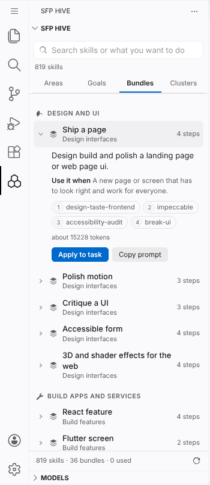

# Installing SFP, A to Z

This guide takes you from a bare machine to an agent that gets the right skills on its own. Every step ends with a **Check**, so you know it worked before you move on. Allow about fifteen minutes; steps 7 to 10 are optional.

| Step | What you get | Needed? |
|---|---|---|
| [1. Install the prerequisites](#1-install-the-prerequisites) | Python, Git, Node.js | Yes |
| [2. Get SFP](#2-get-sfp) | SFP on your machine, in `~/.sfp/SFP` | Yes |
| [3. Check the install](#3-check-the-install) | A health report | Yes |
| [4. Install skills into your tools](#4-install-skills-into-your-tools) | Skills your agent can use | Yes |
| [5. Add the standing instruction](#5-add-the-standing-instruction) | The agent asks the hive on every real task | Recommended |
| [6. Register the MCP server](#6-register-the-mcp-server) | All 819 skills on demand, nothing copied | Recommended |
| [7. Install the SFP Hive extension](#7-install-the-sfp-hive-extension) | The sidebar in Antigravity or VS Code | Optional |
| [8. Use SFP in Antigravity](#8-use-sfp-in-antigravity) | Your first task with the hive | — |
| [9. Set up the local model router](#9-optional-set-up-the-local-model-router) | Local models first, free tiers next | Optional |
| [10. Extras](#10-optional-extras) | Companion apps, skills from any Git repo | Optional |

Also: [Claude Code plugin](#claude-code-plugin-instead-of-steps-2-6), [Keeping it current](#keeping-it-current), [When something is wrong](#when-something-is-wrong), [Removing everything](#removing-everything).

> **Windows:** type `python` wherever this guide says `python3`. Run the commands in PowerShell.

---

## 1. Install the prerequisites

| Program | Why SFP needs it | Get it | Check |
|---|---|---|---|
| Python 3.8 or newer | runs the hive, the MCP server, the router and the checks | [python.org/downloads](https://www.python.org/downloads/) (Windows: tick **Add python.exe to PATH**) | `python3 --version` |
| Git | downloads SFP and keeps it current | [git-scm.com/downloads](https://git-scm.com/downloads) | `git --version` |
| Node.js 18 or newer, with npm | only to build the SFP Hive extension (step 7) | [nodejs.org](https://nodejs.org/) | `node --version` |
| An agent tool | where the skills are used | Antigravity, Claude Code, Cursor, VS Code with Copilot, Windsurf, Codex, Gemini CLI, Kiro and more | |
| Optional: Ollama or LM Studio | local models for the router (step 9) | [ollama.com](https://ollama.com/), [lmstudio.ai](https://lmstudio.ai/) | |

**Check:** each command in the last column prints a version number. If one says "not found", install that program and open a new terminal.

## 2. Get SFP

Pick **one** of these.

**A. One line (recommended).** Downloads SFP into `~/.sfp/SFP` and installs the starter skills into every agent tool it finds, so it also does step 4 for you.

```bash
# macOS and Linux
curl -fsSL https://raw.githubusercontent.com/siddu1004/SFP/main/get.sh | sh
```

```powershell
# Windows PowerShell
irm https://raw.githubusercontent.com/siddu1004/SFP/main/get.ps1 | iex
```

Running it again later updates SFP (`git pull`) and reinstalls. To use a different folder, set `SFP_DIR` first.

**B. Clone it yourself.** Use this if you want SFP somewhere else, or want to contribute.

```bash
git clone https://github.com/siddu1004/SFP.git
cd SFP
```

**C. Rust.** If you have Cargo: `cargo install --git https://github.com/siddu1004/SFP.git`, then `sfp install`.

> An npm package (`npx sfp-hive ...`) is being prepared. Until it is on the public npm registry, use A, B or C.

**Check:** the folder exists and holds `catalog.json`:

```bash
ls ~/.sfp/SFP/catalog.json        # A, or the folder you cloned into for B
```

All commands below are run **from the SFP folder**: `cd ~/.sfp/SFP` (or your clone).

## 3. Check the install

```bash
python3 mcp/sfp_hive.py doctor
```

**Check:** it reports Python, the catalog, the search index and the hive as working. Anything that is not names the command that fixes it.

## 4. Install skills into your tools

If you used 2A, this is done; read on only to change what is installed.

SFP has 819 skills. Installing all of them costs your agent about 58,000 tokens of context, so install a **profile** and let the hive pick the rest on demand.

```bash
python3 scripts/install.py list                       # all categories, profiles and the tools found on this machine
python3 scripts/install.py install                    # the starter profile into every tool found
```

| Profile | Categories |
|---|---|
| `starter` (default) | sfp, engineering, testing-quality, data-apis, agent-dev |
| `frontend-dev` | sfp, frontend, design-styles, testing-quality, engineering, data-apis |
| `backend-dev` | sfp, backend, languages, testing-quality, devops, security, engineering, data-apis |
| `mobile-dev`, `agent-builder` | see `install.py list` |
| `everything` | all categories (heavy) |

Useful variations:

```bash
python3 scripts/install.py install --profile frontend-dev --tools antigravity     # one profile, one tool
python3 scripts/install.py install --categories frontend,security --tools cursor,codex
python3 scripts/install.py install --project .        # into this project's tool folders instead of your home folder
python3 scripts/install.py install --link             # symlinks, so `git pull` updates skills in place
```

`--tools` takes names such as `antigravity`, `claude`, `cursor`, `copilot`, `windsurf`, `codex`, `gemini`, `kiro`, `cline`, `roo`, `opencode`, `trae`, `qoder`; `auto` (the default) means every tool found. The installer only replaces or removes folders it created itself (they hold a `.sfp` marker); `--force` overrides that.

**Check:** restart your agent tool and ask it:

> Use sfp-hive for this task: add tests for the checkout form.

It names a few skills that fit your project, says why, and follows them in order.

## 5. Add the standing instruction

This tells the agent to consult the hive on every substantial task, without you asking each time.

```bash
python3 scripts/install.py rules                          # every tool found (Antigravity: ~/.gemini/GEMINI.md)
python3 scripts/install.py rules --project .              # only this project (AGENTS.md)
```

**Check:** the file named in the output contains an SFP section. Undo with `--remove`.

## 6. Register the MCP server

The MCP server lets any MCP client search and read all 819 skills on demand, with nothing copied into your tools.

```bash
python3 scripts/install.py mcp                            # every tool found
python3 scripts/install.py mcp --tools antigravity        # Antigravity only: ~/.gemini/config/mcp_config.json
```

It registers a server called `sfp` that runs `mcp/sfp_mcp.py`. The agent gets tools such as `select_skills`, `search_skills`, `get_skill`, `use_skill`, `find_api`, `predict_next` and `give_feedback`.

**Check:** restart the tool; `sfp` is listed among its MCP servers, with its tools. Undo with `--remove`.

## 7. Install the SFP Hive extension

The sidebar for Antigravity and other VS Code-based editors: choose skills for a task, browse the library, see what the hive learned, and run the model router.

```bash
python3 extensions/antigravity-hive/install.py                       # build, test, package, install into every editor found
python3 extensions/antigravity-hive/install.py --editor antigravity  # one editor only
```

It builds the `.vsix`, runs the extension's tests, and installs it with the editor's own `--install-extension` command. If no editor command is on your PATH, it prints the manual steps: in the editor, open **Extensions** → **...** → **Install from VSIX...** and pick the built file (a `.vsix` from a GitHub release works the same way).

Then reload the editor: `Ctrl+Shift+P` (macOS: `Cmd+Shift+P`) → **Developer: Reload Window**.

**Check:**

```bash
python3 extensions/antigravity-hive/verify.py --editor antigravity
```

Every line says `PASS`. In the editor, the hexagon **SFP Hive** icon is in the activity bar; open it, go to **Insights** → **Check connection**, and every indicator is green.

## 8. Use SFP in Antigravity

Open the **SFP Hive** icon in the activity bar. It has three views: **SFP Hive** (the studio), **Skill Library** and **Models**. The studio has four tabs:

| Tab | What it is for |
|---|---|
| **Now** | Follows your work (saved files, test runs, commits) to tell which phase you are in, and shows the skills and bundle for it |
| **Choose** | Type a task; the hive picks a few skills and orders them. Click one to see why it was chosen, `+` to pin another, `✕` to drop one |
| **Library** | Browse all 819 skills by area, goal, bundle and cluster; open a skill, pin it or add it to a bundle |
| **Insights** | What the hive has learned from your feedback, and **Check connection** |



There are three ways to get the skills to the agent:

1. **Automatic (default).** Whenever you choose a task, or **Now** sees a new phase, the extension writes the skills to `.agents/rules/sfp-active-skills.md` in your workspace. The agent reads that rule on every turn, so there is nothing to paste. Turn it off with **SFP Hive: Turn automatic skills on or off**.
2. **Chat.** Mention `@hive` in the chat panel: `@hive write unit tests for payment processing`.
3. **MCP tools** (step 6). The agent calls `select_skills` itself.

After a task, tell the hive how it went: **This skill helped** / **This skill did not help** in the sidebar, or `give_feedback` through MCP. That is how it chooses better next time.

Useful commands (`Ctrl+Shift+P`, then type "SFP Hive"): **Choose skills for a task**, **Show current agent skills and phase**, **Search skills**, **Apply a bundle**, **Copy the agent prompt**, **Check connection**, **Add a skill from Git**.

## 9. Optional: set up the local model router

An OpenAI-compatible router on `127.0.0.1:8787` that sends requests to your local models first, then free tiers, then paid ones, and moves to the next model when one is rate limited, out of quota or down.

```bash
python3 mcp/sfp_route.py discover        # find models running here (Ollama, LM Studio, llama.cpp, Jan, vLLM)
python3 mcp/sfp_route.py setup --yes     # write the routes from what was found and the API keys you have set
python3 mcp/sfp_route.py serve           # run it; leave this terminal open
```

Point any tool that takes a custom OpenAI endpoint at it: base URL `http://127.0.0.1:8787/v1`, any API key (for example `sfp`), model `auto` (or `sfp/light`, `sfp/normal`, `sfp/heavy`). The **Models** view in the sidebar can start, stop and set it up too.

**Check:** `python3 mcp/sfp_route.py status` lists your models as ready.

## 10. Optional: extras

**Programs some skills need** (OmniRoute, FreeLLMAPI, Strix):

```bash
python3 scripts/install.py apps list
python3 scripts/install.py apps install omniroute          # shows the plan and changes nothing
python3 scripts/install.py apps install omniroute --yes    # runs it
```

**Turn any Git repository into a skill:** in the Library tab press **+** and paste a URL, `owner/repo` or a folder; or

```bash
python3 scripts/repo_to_skill.py https://github.com/owner/repo --install antigravity
```

The skill is written to `~/.sfp/skills/<name>/` and copied into the tool you name.

---

## Claude Code plugin (instead of steps 2-6)

In Claude Code:

```text
/plugin marketplace add siddu1004/SFP
/plugin install sfp@sfp
/plugin install frontend@sfp
```

`sfp` is the router and hive; add the category plugins you want (`frontend`, `backend`, `testing-quality`, ...). **Check:** `/plugin` lists them as installed.

## Keeping it current

```bash
cd ~/.sfp/SFP
git pull
python3 scripts/install.py install                     # with the same options you used before
python3 extensions/antigravity-hive/install.py         # if you use the extension
python3 mcp/sfp_hive.py doctor
```

Re-running the one-line command from step 2A does the first three for you.

## When something is wrong

| You see | Do this |
|---|---|
| `python3` or `python`: not found | Install Python (step 1); on Windows, reinstall with **Add python.exe to PATH** ticked, then open a new terminal |
| `git is required` | Install Git (step 1) and open a new terminal |
| The agent does not mention any skills | Restart the tool after installing; run step 5 so it consults the hive on its own |
| "SFP checkout not found" in the sidebar | Set the `sfpHive.sfpPath` setting to your SFP folder, then reload the window |
| No SFP Hive icon after installing the extension | **Developer: Reload Window**; then `python3 extensions/antigravity-hive/verify.py` names what is missing |
| The Library tab stays on "Loading" | Update the extension to 0.3.0 or newer (step 7) and reload |
| The agent uses other skills than the sidebar shows | Choose the task again; check `.agents/rules/sfp-active-skills.md` exists in the workspace and automatic skills are on |
| Search index: stale | `python3 scripts/sync.py`, or `git pull` |
| `sfp` missing from the MCP servers | Run step 6 again for that tool and restart it |
| Router: not running | `python3 mcp/sfp_route.py serve` in a terminal you leave open |
| Local models: none found | Start Ollama (port 11434) or LM Studio's server (port 1234), then `sfp_route.py discover` |
| Anything else | `python3 mcp/sfp_hive.py doctor` names the failing part and the command that fixes it |

## Removing everything

```bash
cd ~/.sfp/SFP
python3 scripts/install.py uninstall              # the skills SFP installed (and nothing else)
python3 scripts/install.py mcp --remove           # the MCP server entries
python3 scripts/install.py rules --remove         # the standing instruction
```

Uninstall **SFP Hive** from the editor's Extensions view. Your history, feedback and settings are in `~/.sfp`; delete that folder to remove them and SFP itself.
