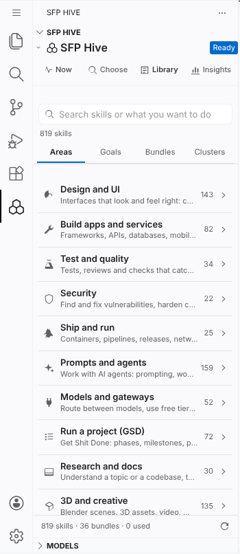
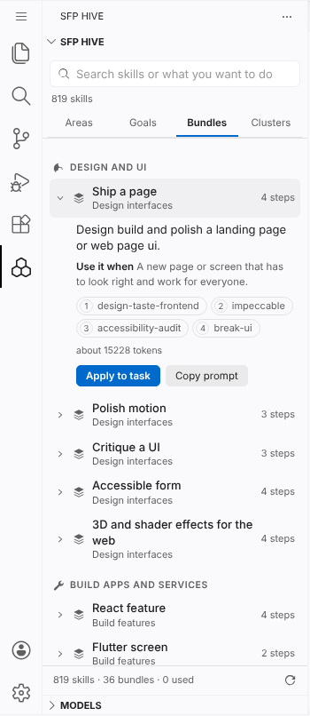
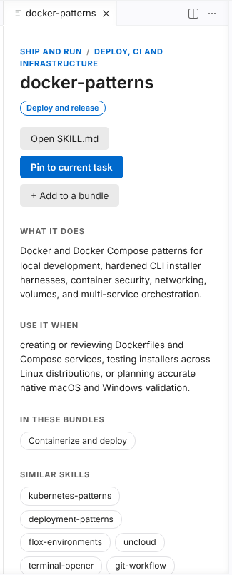

# SFP Hive for VS Code and Antigravity

SFP Hive connects your editor to hundreds of productivity skills, automatically selecting and attaching the right instructions as you work. It watches workspace activity, suggests curated skill bundles, and routes local model inference directly from your IDE.

## Visual Tour

### Areas
Browse 819 skills organized across 11 functional domains:

### Bundles
Attach multi-skill workflows ready to run in order:

### Skill Detail
Inspect prompts, capabilities, examples, and required programs:

## Troubleshooting
If something does not work, run **Check connection** (`sfpHive.doctor` in the Command Palette, or the **Check connection** button in Insights and Models). It verifies your SFP checkout, index health, data directories, model router, and tool connections.

## Settings

Configure SFP Hive via Settings (`Ctrl+,` or `Cmd+,`) under **Extensions > SFP Hive**:

| Setting | Default | Description |
|---|---|---|
| `sfpHive.sfpPath` | `""` | Folder of your SFP checkout. Empty uses the path recorded in `~/.sfp/root`. |
| `sfpHive.python` | `""` | Python 3 executable. Empty defaults to `python3` (`python` on Windows). |
| `sfpHive.maxSkills` | `4` | Maximum skills to select for a single task (1–8). |
| `sfpHive.copyPromptAfterChoosing` | `true` | Automatically copy the constructed agent prompt to the clipboard. |
| `sfpHive.installTool` | `"antigravity"` | Installer target tool (`antigravity`, `copilot`, `cursor`, `windsurf`). |
| `sfpHive.follow` | `true` | Monitor workspace activity to track phase of work and suggest relevant skills. |
| `sfpHive.followCommands` | `true` | Track terminal shell executions when integration is active. |
| `sfpHive.autoAttach` | `true` | Automatically attach live skill suggestions while typing in chat. |
| `sfpHive.autoAttachDelayMs` | `350` | Debounce delay in milliseconds before querying the hive while typing. |
