<div align="center">

[简体中文](README.md) | **English**

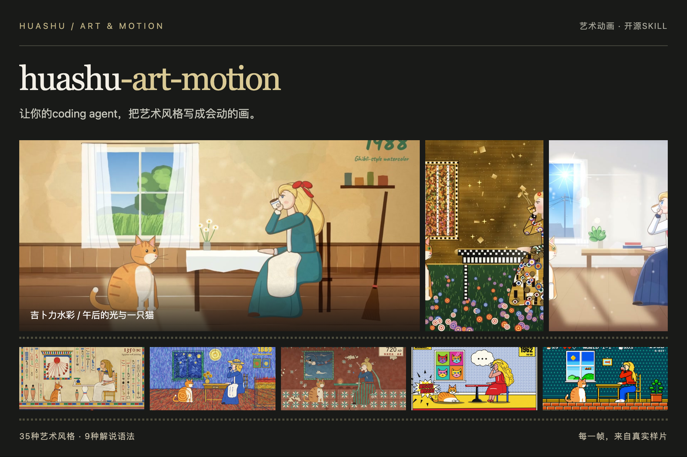

# huashu-art-motion · Art in Motion

Let your coding agent turn art styles into paintings that move.

36 art styles · 9 explainer animation grammars · 8 types of parameterized clips · Reference code for narrated films

```sh
npx skills add alchaincyf/huashu-art-motion
```

[Watch animations](#animation-showcase) · [Explore styles](#see-the-results) · [Get started](#whats-included) · [Download full demos](https://github.com/alchaincyf/huashu-art-motion/releases/latest)

</div>

The skill instructions and most reference documents are in Chinese. This README provides an English guide; it does not translate the installed skill itself.

## News

- 2026-10: [Open Design](https://github.com/nexu-io/open-design), an open-source AI design workspace from nexu-io, lists huashu-art-motion as a design source in its [motion-design skill](https://github.com/nexu-io/open-design/blob/main/skills/motion-design/SOURCES.md) and includes an adapted copy at [skills/huashu-art-motion](https://github.com/nexu-io/open-design/tree/main/skills/huashu-art-motion), with the MIT license and upstream link kept. We're glad to see this approach to art animation used in another open-source project, and thank the Open Design team. More projects, feedback and contributions are welcome.

## Animation showcase

### Featured demo: Huashu enters Super Mario

Turn yourself into a pixel-art hero and play through a whole level. Bricks, pipes, level movement, and transitions are built in code; the character is composited from generated frames. These clips come directly from the 65-second film.

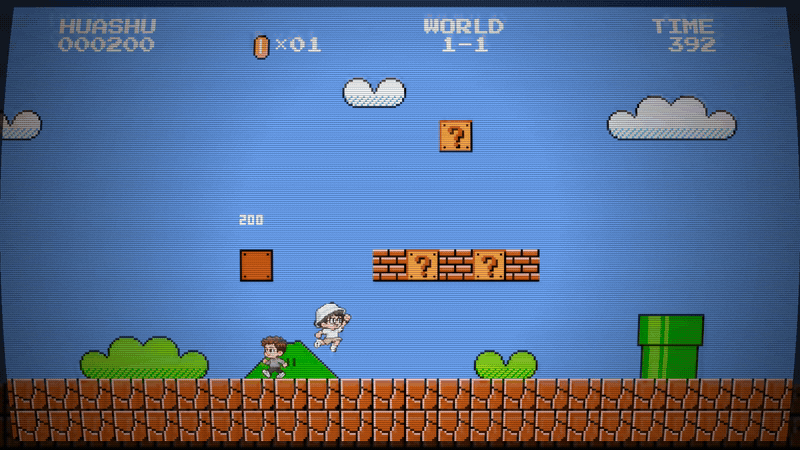

Even eating a mushroom requires choosing a subscription: OpenAI or Claude? Choose Claude, and a starburst power-up drops in to make Huashu grow.

<table><tr>
<td width="50%">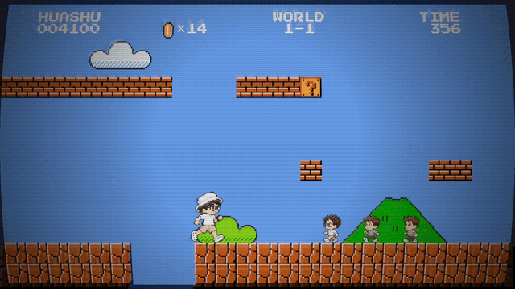<br/>Stomp and kick · Pixel Sam and Dario cameo as enemies</td>
<td width="50%">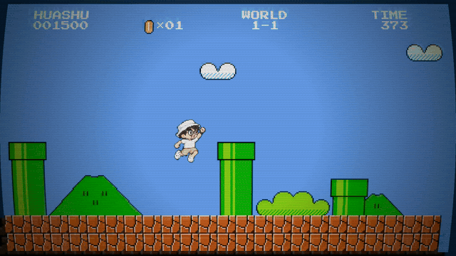<br/>Down the pipe · Coin chamber and scanline whip transition</td>
</tr></table>

These show the finished film. The GIFs are silent and loop. See [clip timestamps and export settings](assets/showcase/mario-clips.md).

### Clawd: Night at the Museum

Clawd, Claude Code's pixel mascot, jumps out of the terminal on a security guard's computer, explores New York's Metropolitan Museum of Art with a flashlight, crosses Central Park to the natural history museum, and returns before dawn to pose as an exhibit. The film runs 98 seconds across 16 scenes, with no narration. Its music is synthesized in code too.

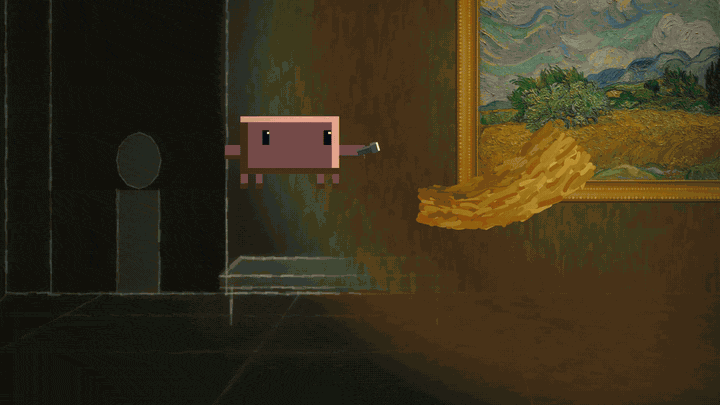

Inside Van Gogh's *Wheat Field with Cypresses*, brushstroke directions come from the original painting's structure tensor, and Clawd is redrawn in impasto.

<table><tr>
<td width="50%">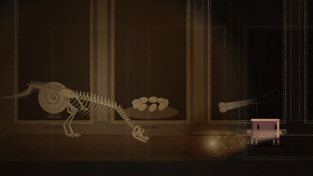<br/>T. rex skeleton · Chasing the flashlight</td>
<td width="50%">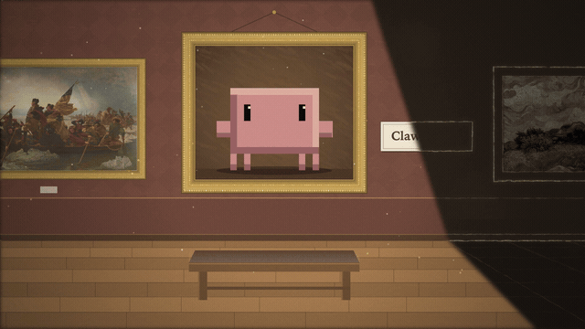<br/>Dawn · Posing as an exhibit, with one blink</td>
</tr></table>

The darkness is rendered as a charcoal night scene; color appears only where the flashlight shines. The five paintings Clawd enters—by Van Gogh, Seurat, Vermeer, Rembrandt, and Leutze—are CC0 originals from The Met's Open Access collection, redrawn in code using each painter's brushwork. Find the full film in [Releases](https://github.com/alchaincyf/huashu-art-motion/releases/latest), with [clip timestamps and notes](assets/showcase/clawd-clips.md).

### Huashu walks through famous paintings

The paintings actually move. These three clips come from the same journey film: scenes are drawn in code, and characters are composited from generated frames.

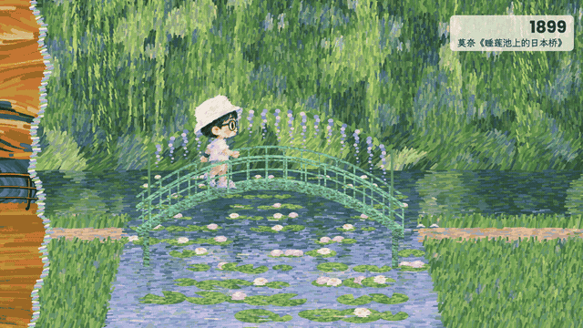

Skipping a stone by the Japanese Bridge.

<table><tr>
<td width="50%">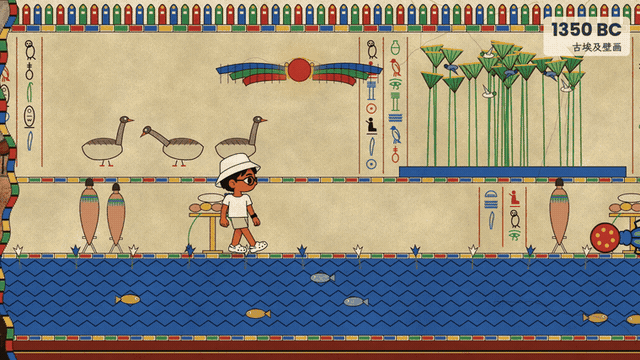<br/>Ancient Egypt · Scarab beetle</td>
<td width="50%">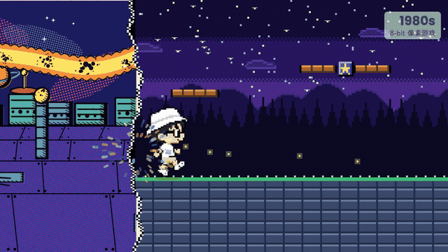<br/>8-bit · Coins from blocks</td>
</tr></table>

## See the results

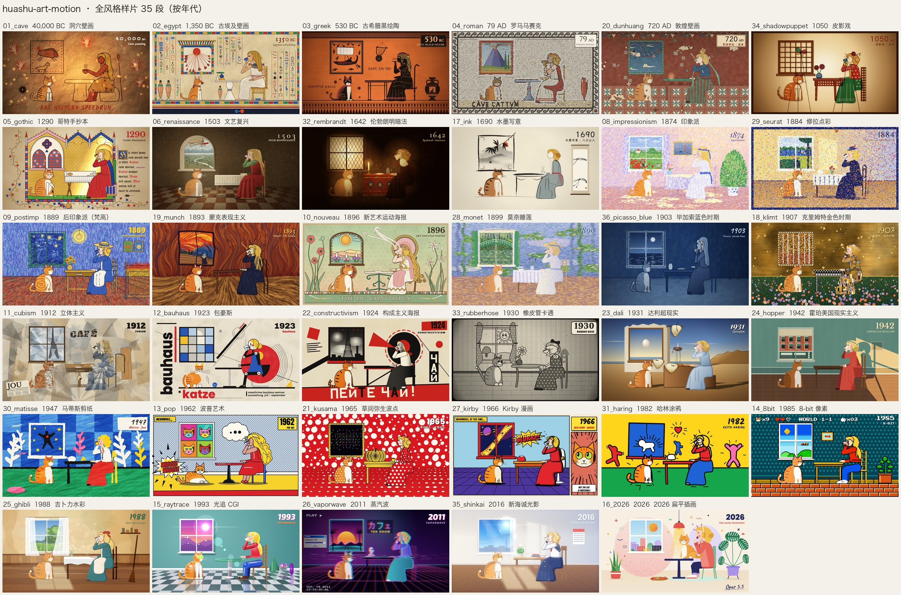

One frame from each of 35 animated demos: the same girl, orange-and-white cat, and table travel from caves in 40,000 BCE to 2026. Every scene moves: Van Gogh's starry sky turns, mosaic colors flow across stones, and ink washes carry the image into the next era.

The shared composition is part of the art-history speedrun: styles change while the scene stays the same. It is not a prescribed composition for these styles. For a new subject, design a new composition rather than reusing this room.

👉 [Download the all-style demo (MP4)](https://github.com/alchaincyf/huashu-art-motion/releases/latest)

The long-scroll demo follows a character walking from left to right. At each boundary, both the world and the character change art style. The repository includes three sample worlds: Egyptian murals → Monet's *Japanese Bridge* → 8-bit.

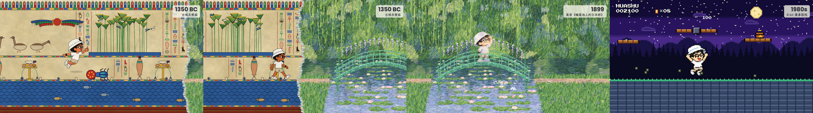

Eight explainer animation grammars each have a runnable demo film; the images below show one frame per shot. A ninth, presenter-led finance explainers, includes a grammar card and a full-film code snapshot that requires your own character assets. Whiteboard works well for drawing relationships alongside narration; Vox works well for graphics and information collage.

| | |
|---|---|
| 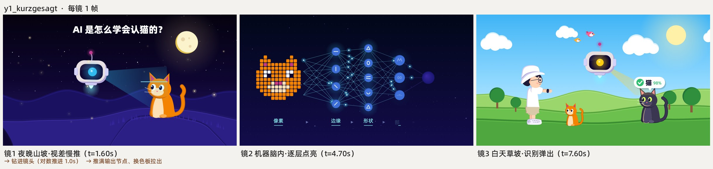 Kurzgesagt: flat shapes without outlines, journeys across scales | 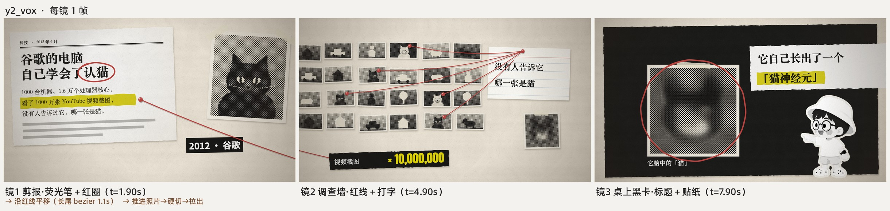 Vox: clippings, red lines, highlighter marks |
|  Whiteboard: a pen tip reveals the line drawing | 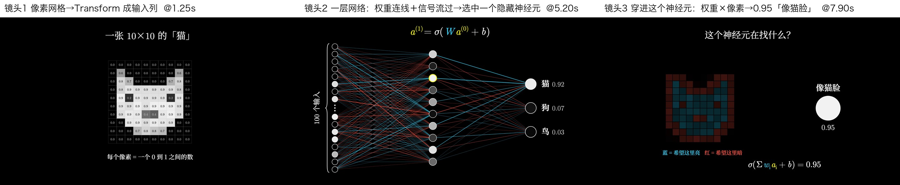 3Blue1Brown: one object transforms into the next |
|  Storytime: reaction close-ups and pauses for jokes |  Kinetic type: key words land with impact |
|  Keynote UI: light spots, frosted-glass cards, large numbers | 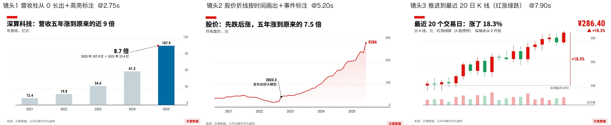 Finance charts: axes first, then data, with one thing highlighted |

---

## What it can do

| You ask | It does |
|---|---|
| “Recreate this animation” or “Break down this clip” | Runs the breakdown script to measure transitions, a beat grid, and motion heatmaps for each segment, then recreates the underlying mechanisms in code |
| “Make an animation in the style of Van Gogh, Monet, or Bauhaus” | Designs one frame first, then animates it; 36 style recipe cards provide starting points |
| “Make an art animation from my narration” | Builds a shot list → chooses styles → adds a camera to a world canvas → outputs a visual track |
| “Make a film of someone walking through famous paintings” | Uses the long-scroll skeleton: one segment file per world, a hero moving rightward, style changes at boundaries, and a camera that only moves forward |
| “Make an animated segment for an explainer video” | Chooses a grammar for the narration and renders a JSON spec into a frame-accurate clip, in landscape or portrait, with optional transparency |
| “I need a person in the scene” | Uses an image-generation model for character frames; code handles compositing, frame changes, and materials |
| “Add music and time it to the action” | Synthesizes music in code using a BPM grid, motifs passed between instruments, and a closing sequence of sound effects |

Before delivery, `qa.py` measures stability, efficiency, motion, smoothness, and cues for text-box framing. An agent that did not make the film then reviews the finished output. Finally, `deliver.py` handles delivery in one command: the film must first pass an anti-slideshow gate. If almost the entire film lacks fast action within shots, delivery is blocked. Once it passes, the script copies the film and writes delivery notes using measured facts.

---

## What's included

| Component | Quantity / location |
|---|---|
| Art-style recipe cards: parameters, motif motion, signature transitions, and current limitations | 36 cards in `references/风格配方/` |
| Corresponding scene code | 35 scenes in `scripts/engine/scenes/` |
| Explainer animation grammar cards | 9 cards; 8 include demo films, parameterized clips, and example specs |
| Reference code for narrated films | Mixed styles, whiteboard, Vox, and presenter-led explainers; some assets must be supplied separately—see the directory READMEs |
| Long-scroll demo: skeleton, three worlds, and a character frame library | One demo in `scripts/engine/demos/long_scroll/` |
| Transitions | Art-style signature transitions and explainer transitions, including fades, hard cuts, and paper transitions |
| Drawing and animation libraries: brushes, renderers, post-processing, skeletons, cameras, charts, typography, and more | 17 libraries in `scripts/engine/lib/` |
| Method documents: breakdown, mechanisms, frame-first design, code drawing, music and rhythm, characters, long-scroll films, and more | 12 core documents, `references/01`–`12`, plus an [optional voice guide](references/capabilities.md) |

```text
huashu-art-motion/
├── SKILL.md                 # Classify the task, then read the relevant documents
├── references/              # Methods 01–12, 36 style recipes, 9 grammar cards, proven practices
├── assets/                  # Overview images used in the README
└── scripts/
    ├── engine/              # Portable animation project: engine, transitions, libraries, scenes, demos, clips
    ├── analyze/breakdown.py # Turn a reference animation into a map you can implement in code
    ├── qa.py                # Run QA in one command
    ├── film_gate.py         # Detect slideshow-like cuts and empty middle sections; reads MP4 only
    ├── deliver.py           # Gate → copy the film → write delivery notes
    ├── audio/               # Templates for music synthesized in code
    └── font_subset.py ...   # Font subsetting and green-screen removal
```

Requires [uv](https://docs.astral.sh/uv/), ffmpeg, and Playwright Chromium. Install Chromium before the first render:

```sh
uv run --with playwright playwright install chromium
```

Try rendering a frame from the Van Gogh scene or a finance-chart clip:

```sh
cd huashu-art-motion
uv run --with playwright python scripts/engine/render.py --solo 09_postimp --stills 0.3 --out preview
uv run --with playwright python scripts/engine/render.py --spec scripts/engine/examples/t3_finance_chart.json --out finance-chart.mp4
```

---

## The story behind it

In early October 2026, I saw a 15-second animation on X by Tak ([@cherry_mx_reds](https://x.com/cherry_mx_reds/status/2106095190285144331)): a girl and a cat travel through 40,000 years of art history. Each era lasts only about a second, yet the things inside the paintings keep moving.

I asked Claude to recreate it. The first version just transitioned between still paintings. I rejected it: even when the original spends only a second in an era, the elements within the painting are in motion. So we started with a breakdown—measuring transitions, fitting a beat grid, and checking where each segment moves—then drew and animated the paintings layer by layer in code.

During the process, I told it: “We're not just recreating this. I need you to learn from it.” The skill therefore records both the code and the practices that proved useful (`references/07-正面经验.md`), along with each style's pitfalls and limitations. Later, four groups of agents, given only the skill, built 20 styles it had not seen before. Their reusable components became a shared library. We added eight YouTube explainer animation grammars and connected them to my narrated-video pipeline. Finally, I used the same tools to make *Huashu Walks Through Famous Paintings*: 23 styles over 2 minutes 8 seconds, walking from caves to 2026. Its skeleton and three sample worlds are included here.

---

## Acknowledgments

- **Tak ([@cherry_mx_reds](https://x.com/cherry_mx_reds))** and his *Art History Speedrun* inspired this skill. The scene compositions for 16 art eras and the girl-and-cat journey follow the original's ideas. Every image here is redrawn in code. The music scripts contain original example scores; the repository retains the breakdown method, not a transcription of the original music. It includes no frames, screenshots, or audio files from the original film. Visit his X account to see the original.
- The channels and sources studied in the explainer grammar cards—Kurzgesagt, Vox, 3Blue1Brown, RSA Animate, TheOdd1sOut, and others—are linked under each card's primary references. The repository records measured parameters, not their footage.
- Fonts are open-source under SIL OFL 1.1. See the inventory and copyright notices in `scripts/engine/lib/fonts/LICENSES.md`.

---

## About the author

| | |
|:---|:---|
| 🌐 Websites | [bookai.top](https://bookai.top) · [huasheng.ai](https://www.huasheng.ai) |
| 𝕏 Twitter | [@AlchainHust](https://x.com/AlchainHust) |
| 📺 Bilibili | [花叔v](https://space.bilibili.com/14097567) |
| ▶️ YouTube | [@Alchain](https://www.youtube.com/@Alchain) |
| 📕 Xiaohongshu | [花叔](https://www.xiaohongshu.com/user/profile/5abc6f17e8ac2b109179dfdf) |
| 💬 WeChat public account | Search for “花叔” in WeChat |

## License

Code and documentation: MIT. Use, modify, and build on them freely.

Exceptions: the derived stroke-order data in `scripts/engine/reference_films/spacex/spacex_wb/assets/strokes.js` retains the Arphic Public License, whose text accompanies the file. Fonts in `scripts/engine/lib/fonts/` retain their respective OFL licenses. Huashu's cartoon likeness and character frames (`scripts/engine/demos/_shared/hero/`, `scripts/engine/demos/long_scroll/frames/`, and `assets/角色/`), including the same likeness in overview images and demo videos, are provided only for this skill's demonstrations and are not licensed for other uses under MIT.

Clawd is Anthropic's Claude Code mascot, and the rights to its likeness belong to Anthropic. *Clawd: Night at the Museum* is an unofficial fan demo, not affiliated with Anthropic. Its GIFs and full film are also excluded from the MIT license. The paintings in the film come from The Met's Open Access collection (CC0).

---

<div align="center">

**[Nuwa](https://github.com/alchaincyf/nuwa-skill)** creates skills. **[Darwin](https://github.com/alchaincyf/darwin-skill)** helps skills evolve. **Art in Motion** makes paintings move.

MIT License © [花叔 Huashu](https://github.com/alchaincyf)

</div>

---

<div align="center">
<sub>More projects by Huashu</sub>

[](https://github.com/alchaincyf/fanbox)

</div>

---

## Optional media capabilities

Basic code animation requires no voice or image-generation account. Reuse existing assets first; when generation is needed, use the user's chosen provider and the tools available in the current environment. Voice options include macOS system voices and your own voice clone on Volcengine. Image options include importing existing files and bridging to the current agent's image or MCP tools.

- [Voice and private configuration](references/capabilities.md): configure only when needed, or skip it; the legacy `koubo` entry point remains compatible.
- [Image-tool integration](references/images.md): create a plan first, let the agent call the tools, then validate and collect the assets.
- [Compatibility and validation scope](references/compatibility.md): installation and reinstallation passed for all three supported agents—Claude Code, Codex, and Kimi. Live regression passed in Codex; Claude Code and Kimi live regression remains blocked by test-account conditions and needs further validation.
- [Maintenance, extensions, and releases](CONTRIBUTING.md): public defaults stay separate from private configuration, upgrades preserve personal choices, and release checks inspect the actual Git objects being published.

Start with `python scripts/capabilities.py status --explain`. New capabilities are unselected and unauthorized by default. Finding a key or a tool does not imply permission to spend. A standalone image API executor remains an optional future extension; the skill does not switch providers automatically.

## Thanks for the feedback

Thanks to [@ismilewolf-eng](https://github.com/ismilewolf-eng) ([PR #1](https://github.com/alchaincyf/huashu-art-motion/pull/1)) and [@noahark](https://github.com/noahark) ([PR #2](https://github.com/alchaincyf/huashu-art-motion/pull/2)) for proposed fixes and validation of concurrent-loading failures on Windows; [@nctt777-hue](https://github.com/nctt777-hue) ([Issue #3](https://github.com/alchaincyf/huashu-art-motion/issues/3)) for detailed reproductions, controlled experiments, and retesting; and [@GFXfly](https://github.com/GFXfly) for additional macOS troubleshooting feedback. Their reports helped fix concurrent loading in the local servers used for rendering and QA.

## Style 36: Rick & Morty

A [recipe](references/风格配方/37_rick_morty.md) and [standalone SVG example](scripts/engine/reference_films/rick_morty/index.html) add offline playback, deterministic seeking, gaze/blink/sip/jump controls, and frame-by-frame video export. Internal ID: 37_rick_morty; 36_picasso_blue is already used. The historical 35-frame overview and Canvas gallery do not include this SVG example. Download the folder and open index.html locally; see the recipe for rendering commands.
